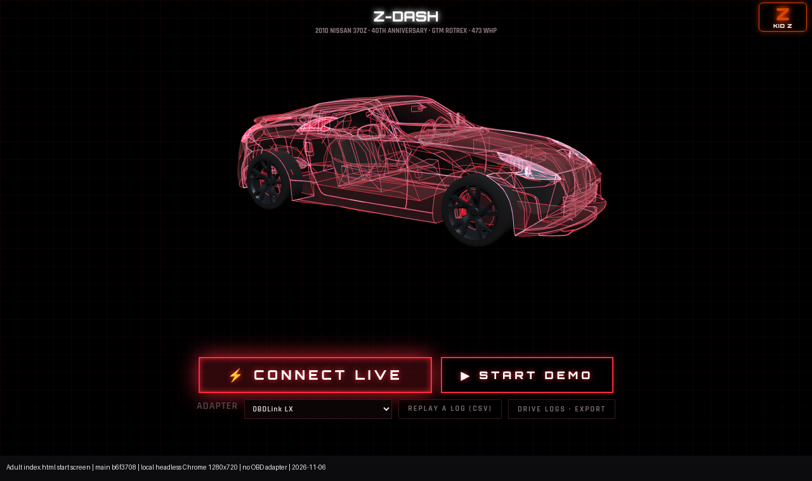

# Adult Z-DASH Android separation audit

**Answer: separation is not complete.** The adult start page is its own manifest and no longer loads the kid paint studio onto the adult wireframe, and it still ships a one-tap Kid Z launcher, the full Passenger Mode games inside `index.html`, and a service worker that precaches the kid app. Kid Z, Neon World, and Adventure still live on the same site the Android wrapper opens.

This is a status audit of current `main`. It does not change the app, delete files, or submit a store listing. Cleanup below is a proposal for Bob's approval.

Verified commit: `b6f370849b8152c22f1715510545f26d5a1294c5`  
Date: 2026-10-25 03:50:20 +0000  
Subject: Publish /test/ explore idle and home presets at cache dev51.  
`origin/main` matches that commit (0 ahead, 0 behind after `git fetch origin main` on 2026-11-06).

Live `https://z.beagle.games/` matches this commit byte for byte on the files checked (SHA-256):

| File | Bytes | SHA-256 |
| --- | ---: | --- |
| `index.html` | 7,462,115 | `b623d4f8a933b9acf94993c05d71f0ec737060185560d9d2d772355548b1d4bf` |
| `jr.html` | 7,599,682 | `3f0a29781ec9322bc4fe4d8386fbb68b9ccb701be1e98712fef1631916ee3d1f` |
| `sw.js` | 7,135 | `1e2159233af221aa92fea209f054e600ff64f93c812b230ba61b2258ad2cec6d` |
| `manifest.webmanifest` | 694 | `d0d671eb7533561215007ef63cfe1d82c84de971b911bbcf2d427563e1d8e7eb` |
| `manifest-jr.webmanifest` | 701 | `cde9d0d8f4a27c7aa98872bb82a8c4cc4274f960e725e83da8b3d5e84d58a5f1` |
| `.well-known/assetlinks.json` | 433 | `a7e830b120cfbd2eea2e2649740abff2669ac05ae60184b36517ec8b999bd60d` |
| `shared/version.js` | 279 | `9f7380d24707944b79d7738872f2f8abd6dfedde868c05456dcceebaa915071b` |

Live `Last-Modified` on those responses is `Sun, 25 Oct 2026 03:50:50 GMT`, the GitHub Pages publish of this commit. Host is `z.beagle.games` (`CNAME`).



Label: adult `index.html` start screen, commit `b6f3708`, local headless Chrome at 1280×720, software WebGL, no OBD adapter attached, captured 2026-11-06. The Kid Z control is the orange button at the top right. Connect Live and Start Demo are the adult start actions. This is the in-app wireframe, not a photograph of a car.

## What already happened

These older notes were checked against `main`, not taken as current truth.

| Older note | What is true on this commit |
| --- | --- |
| Around v27, adult `index.html` was isolated from kid paint, stickers, and garage. | Partly. Commit `8777eb8` (2026-10-23, message "Deploy v27 … and adult index isolation") only changes the adult build string in `index.html`. Commit `b7976b9` (same night, ancestor of `main`) is the real wireframe cut: "adult index.html no longer loads kid paint or writes kid vinyl storage." On this commit that is still true for the **wireframe and vinyl keys**, and false for the **page, the menu, and the cache**. |
| Adult kept a Kid Z launcher to `jr.html`. | Still true. The control is on the adult start screen. |
| Kid `jr.html`, Neon World, and Adventure share this repo and this site. | Still true. |
| The Android wrapper loaded live `z.beagle.games`. | No Android project is in this repo. The only package name in the repo is `games.beagle.zdash` in `.well-known/assetlinks.json`. The site that file is published for is `z.beagle.games`. Whether an installed APK still points here is a Play Console / wrapper fact, not something this repo can prove. |
| PR 101 deployed assetlinks, and the Play App Signing fingerprint was still pending. | PR 101 is merged (`dda6e70`, 2026-10-24). The live file has two fingerprints. The commit says the **second** is the Play **upload** key. The PR body calls the pair "the original app cert and the new Play upload key." This repo never labels either fingerprint as the Play App Signing certificate. That match is still unknown. |

Unmerged plans, left untouched by this audit:

- PR 98 (`docs/APP-SPLIT-PLAN.md` on `cursor/app-split-plan-9e5c`) is open. That file is **not** on `main`. It plans cutting driver code out of the kid app. It says live `index.html` is not part of those diffs.
- PR 83 ("Keep adult driver code off the Kid App menu and settings") is open and not on `main`.
- PR 63's separation plan (`docs/APP-SEPARATION-PLAN.md`) is open and not on `main`.

`rbeaglemedia/z-dash-tools` did not resolve with this run's GitHub token, so the private regression suite was not run. This change is documentation only.

## Adult identity and what the start page loads

Adult install identity is `manifest.webmanifest`:

- `name`: Z-DASH · 370Z
- `short_name`: Z-DASH
- `id` and `start_url` and `scope`: `./` (the whole site, not a kid-free path)
- `display`: fullscreen, then standalone
- `orientation`: landscape
- icons: `icons/zdash-192.png`, `icons/zdash-512.png`, `icons/zdash-maskable-512.png`

`index.html` points at that manifest (line 699) and registers `./sw.js` on load (line 723). It does **not** set `window.ZD_JR`. `jr.html` line 727 sets `window.ZD_JR = true` and line 745 registers the same `./sw.js`.

Scripts and styles the adult page pulls in by tag:

| Request | Role |
| --- | --- |
| `shared/ipad.js?v=27` and `shared/ipad.css?v=27` (line 727) | Shared tablet layout helper. Used by the adult page. Keep. |
| `./sw.js` → `shared/version.js?v=42` (`sw.js` line 9) | Cache name. Keep. Adult `index.html` does not read this file itself. |
| Adult manifest and adult icons | Install identity. Keep. |

The adult page does **not** have a `<script src>` or stylesheet for `neon-paint.js`, `world/`, `adventure/`, `garage-hub.html`, or `jr.html`. A static scan of tags matches the check in `tools/ui-polish-audit.js` (`scanAdultIndex`, around lines 148–166): those kid script URLs are not loaded as tags, and these storage keys are not written by `index.html`: `zdash_paint3d_v1`, `zdash_vinyls_v1`, `zdash_garage_v1`, `zdash_neon_paint_v1`, `zdash.neonpaint`. `zLiv` (the kid live-paint shader flag) occurs 0 times in `index.html` and 37 times in `jr.html`. The word `vinyl` occurs 0 times in `index.html`.

That is the wireframe isolation. It is not an app split. The passenger-mode program is still inside `index.html`, and the service worker still downloads `jr.html` during install.

Adult build string is hardcoded at `index.html` line 707:

`window.ZD_BUILD = '1792863877-world33'`

`shared/version.js` lines 3–5, which the service worker uses, say:

`ZD_WORLD = '42'`, `ZD_BUILD_STAMP = '1792886859'`, so the worker's build is `1792886859-world42`.

The page compares those numbers (`index.html` lines 719–720). The worker build is newer, so the first time the worker talks to an open adult page it reloads once, then the session flag matches and the page shows "Update ready · tap to refresh" instead of looping. That toast is a store-build defect on current `main`. It is not a kid leftover. Proposed fix is one assignment, in a later PR, not here.

## Navigation map from the adult start page

```text
index.html  (adult manifest, scope /)
├── header KID Z  →  jr.html                         always, until Passenger Mode is on
├── CONNECT LIVE  →  OBD adapter path                adult, keep
├── START DEMO    →  simulated drive                 adult, keep
├── Settings
│   ├── PASSENGER MODE  →  kid layer inside index.html
│   ├── JOIN DAD'S CAR  →  kid guest side of the phone link
│   ├── SHARE TO PASSENGER  →  adult host side of the phone link   keep
│   ├── MAKE THIS ELLIE'S DEVICE  →  next cold start redirects to jr.html
│   └── OBD, logs, Spotify, layout, maintenance     adult, keep
├── ?passenger=1     forces Passenger Mode on       index.html line 12892
├── #garage #car #road #drag #wanted #boost #drive
│     and ?kmenu=1   force Passenger Mode on        lines 12859–12871
└── once that kid menu is open, tiles call location.assign:
      fly        → fly3.html
      world      → world.html          (Neon World)
      paint      → neon-paint.html
      wall       → neon-paint.html?mode=wall
      dance      → dance-stage.html?record=character
      petdance   → dance-stage.html?record=dog
      crew       → crew.html
      soccer     → world.html?entry=soccer
      skydrop    → world.html?entry=skydrop
      car, road, drag, wanted, boost, garage stay inside index.html
```

The tile table is `KTILES` at `index.html` line 11777. The `navMap` is line 11717. Names on the adult copy of that menu: SHOWROOM CAR, ROAD, DRAG, NEON FLYING, NEON WORLD, GARAGE, WANTED, RIDE ALONG, CAR SOCCER, SKY DROP, NEON PAINT, GRAFFITI WALL, RECORD DANCE, RECORD MY PET, CREW & PETS.

Cold start on an adult device does not resume Passenger Mode (`index.html` lines 12883–12888): a new session clears `zdash.kidOn` unless the device was marked as Ellie's (`zdash.devMode === 'kid'`, or the passenger role). In that case line 12886 sends the adult URL to `jr.html`. A kid-marked device that opens `jr.html` as an installed app (standalone or fullscreen) is sent back to the adult URL only when `window.ZD_JR` is set and the device is **not** a kid device (line 12885). So the two icons try to swap, and they still share one origin and one worker.

`adventure.html` and `/test/` are not linked from `index.html` or `jr.html` (zero matches). They are still on the same host. Live checks on 2026-11-06: `https://z.beagle.games/adventure.html` returns 200, `https://z.beagle.games/test/` returns 200, `https://z.beagle.games/garage-hub.html` returns 200. `garage-hub.html` is a noindex redirect to `jr.html#garage` and uses the kid manifest. `https://z.beagle.games/privacy` and `/privacy.html` return 404.

There is no `robots.txt`.

## What is packaged with the adult install

`sw.js` lines 12–14 precache this list on install (`cache.addAll`). Sum of the files on disk: **15,351,539 bytes**.

| Precache entry | Bytes | Adult install needs it? |
| --- | ---: | --- |
| `index.html` | 7,462,115 | Yes |
| `jr.html` | 7,599,682 | No. Kid home page. |
| `manifest.webmanifest` | 694 | Yes |
| `manifest-jr.webmanifest` | 701 | No |
| `icons/zdash-192.png` | 13,449 | Yes |
| `icons/zdash-512.png` | 47,179 | Yes |
| `icons/zdash-apple-180.png` | 12,245 | Yes |
| `icons/zdash-maskable-512.png` | 43,962 | Yes |
| `icons/zdash-jr-192.png` | 18,571 | No |
| `icons/zdash-jr-512.png` | 72,068 | No |
| `icons/zdash-jr-apple-180.png` | 16,819 | No |
| `icons/zdash-jr-maskable-512.png` | 64,054 | No |

Kid files in that precache: **7,771,895 bytes**. They download when the adult page's worker installs, even if nobody taps Kid Z.

Other caches, filled on visit, not in the install list (`sw.js` lines 26–32, 46–70):

- `world-split-v` + world number (`42` today): `world.html`, `world-split.html`, `crew.html`, `dance-stage.html`, `garage-hub.html`, `neon-paint.html`, anything under `/world/` or `/shared/`. Network first, 2.5 s timeout, then cache.
- `adventure-v3`: `adventure.html` and `/adventure/`. Same pattern.
- `/test/` is not intercepted and not cached by the root worker (`sw.js` lines 43–45). `test/sw.js` is a separate worker whose scope is `/test/` only. It does not precache the live app. The files are still served from the production host.

Offline: after one online visit, a navigation to `/` or `/jr.html` is network-first, then the cached copy if the network is slow or down (`sw.js` lines 72–78, timeout 2.5 s). `/.well-known/` is never intercepted (`sw.js` lines 5 and 42), so `assetlinks.json` stays the server file. That bypass was checked when PR 101 landed and the same early return is still in `sw.js`.

A navigation that is not one of the special paths above is stored under the `index.html` cache key (`pageKey`, `sw.js` line 21). `fly2.html` and `char.html` are in that bucket. They are not linked from the adult page. Opening them by URL can overwrite the offline adult page. `fly3.html` has its own key. Kid tiles that leave the page use paths that have their own keys, so those tiles do not overwrite `index.html`.

## Leftovers vs shared code

### Reachable from the adult UI (remove from the adult page after approval)

| Leftover | Where | What it does |
| --- | --- | --- |
| Kid Z button | `index.html` lines 54–56 and 757, `href="jr.html"` | Visible on the adult start screen. Screenshot above. |
| Passenger Mode toggle | line 852 | Turns on the kid layer in the adult page: drive, car, road, drag, wanted, ride along, garage. |
| Join Dad's Car | line 853 | Kid guest side of the phone link. |
| Make this Ellie's device | lines 12889–12891 | Next cold open of the adult URL goes to `jr.html`. |
| `?passenger=`, kid hashes, `?kmenu=1`, `?ktab=` | lines 12859–12896 | Open Passenger Mode without the button. |
| Kid menu tiles and `navMap` | lines 11717 and 11777 | Leave the adult page for Neon World, paint, wall, fly, dance, crew, soccer, sky drop. |
| Passenger-mode program inside `index.html` | from the "PASSENGER MODE" comment through `window.ZDKID` near line 12900, plus the kid CSS above the manifest | Parsed and run on every adult load. Builds the hidden `#kid` tree. Not a separate download. This is the large deletion, and it stays in the file until a reviewed cut. |

`tools/ui-polish-audit.js` lines 97–122 currently **fail the adult landing check if Kid Z is missing or covered**. The shot titled "Adult landing — Kid Z launcher, no kid paint" (around line 673) expects the button. The next PR that removes the button has to update that check in the same change, or the polish audit will call the removal a bug.

### Precached or same-origin, not an adult script tag

| Item | How the adult install gets it | Delete the file? |
| --- | --- | --- |
| `jr.html` and kid icons and `manifest-jr.webmanifest` | Precache list | No. The kid app is these files. Stop precaching them from the adult worker only after the kid app has its own worker. |
| `neon-paint.html`, `world.html`, `world-split.html`, `crew.html`, `dance-stage.html`, `garage-hub.html`, `fly3.html` | Tile navigation, or the URL | No. |
| `adventure.html`, `adventure/`, `fly2.html`, `char.html`, `/test/` | URL on the same host. Not linked from `index.html`. | No. `/test/` is the dev hub and is published (this commit's message is a `/test/` publish). |
| `world/`, `shared/assets/`, `shared/car-model.js` | Not imported by `index.html`. Cached if a kid page is opened. Neon World needs them. | No. |

### Shared code the adult app actually needs (do not remove in a kid cleanup)

- OBD / ELM327 path, adapter list, code reader, health limits, shift lights, fuel, Rotrex interval field, drive logs (`indexedDB` `zdash-logs`), run recorder (`zdash-runs`). Connect Live, Start Demo, replay CSV, export.
- Adult screens: DRIVE, GAUGES, ENGINE, CAR, DYNO, TRIP, HANDLING, RUNS, CODES, layout editor.
- Inline 370Z in `index.html`. It has no `zLiv`. Do not merge it with `shared/assets/370z-glb.js` in a cleanup PR. PR 98 already says the three copies stay until Bob approves a model merge. Deleting the inline copy would break the adult car view.
- Share to Passenger (`index.html` line 854) and the WebRTC host. `iceServers` is empty (`index.html` near the phone-link comment). Pairing is QR codes on the local network, camera on only while pairing. The kid iPad's "Join Dad's Car" still needs this host side. Removing the host breaks that link. The guest button on the adult page can go.
- Spotify on the adult settings panel is an adult feature, not a kid file. It calls `accounts.spotify.com` and `api.spotify.com` only after a person connects. Redirect URI in code is `https://rbeaglemedia.github.io/z-dash/` (`index.html` line 8193), not `https://z.beagle.games/`. A default public client id is hardcoded beside that line. A saved id overrides it. No client secret is in the file. Whether the Spotify dashboard lists the live domain is unknown. Tokens stay in `localStorage` (`zdash.spotify.token`).
- Wake lock, low detail, adult FPS toggle, `shared/ipad.js`.
- `sw.js` behavior for `index.html`, the `/.well-known/` bypass, and the `/test/` bypass.
- `.well-known/assetlinks.json` and the adult manifest and adult icons.

`window.ZDNative` is only a bridge the page calls if some outside APK injected it (`index.html` around lines 8974–8985). The bridge is not implemented in this repo. Android WebView comments in that block say Web Serial and Web Bluetooth are missing there, so a plain WebView cannot run Connect Live unless that bridge exists. This repo cannot show whether the installed wrapper provides it.

## Android wrapper, signing, permissions, privacy

There is no `AndroidManifest`, Gradle project, TWA manifest, or Bubblewrap config in this repo. `gh repo list rbeaglemedia` from this run returned only the public repo `z-dash`. A private wrapper repo would be invisible here. Do not treat that as proof the wrapper does not exist.

What the repo does say:

- Package name `games.beagle.zdash`.
- Relation `delegate_permission/common.handle_all_urls` (the app may claim every URL on the host, not only `/`).
- Fingerprints in `.well-known/assetlinks.json` lines 8–9, live and in git:
  - `71:B8:34:0D:82:AC:FB:CC:F0:4B:46:6E:92:6B:02:D7:E1:1E:54:09:B6:60:A0:9D:8E:FB:CA:CD:E6:E4:97:36`
  - `C9:68:F4:7A:3F:14:7D:69:EF:6B:CE:01:38:7E:07:F0:2A:D0:6E:F4:E7:9A:31:19:AD:A6:DC:7D:9A:09:4B:FD`
- Commit `dda6e70` (PR 101 merge): "The Play upload key is the second SHA-256 fingerprint."
- PR 101 body: "the original app cert and the new Play upload key."
- No sentence in the repo says either value is the Play App Signing certificate (the key Google uses to sign the APK users install). If Play App Signing is on, Digital Asset Links must include that certificate. This audit does not claim the link verifies.

No Android Auto / car-app service, automotive manifest, or `CarAppService` is in this repo. Unmerged PR 63 mentions a phone used with Android Auto, AAWireless, and a Kenwood head unit. That is a description of a car stereo setup, not a store declaration. Android Auto approval is unknown. This audit does not claim it.

Permissions the adult page can request, from code, not from an APK manifest:

| API | When | Leaves the device? |
| --- | --- | --- |
| Web Bluetooth, Web Serial, or `ZDNative` | Connect Live | OBD bytes stay on the device unless the user exports a log. |
| Camera (`getUserMedia` video) | Share to Passenger pairing | QR scan. No upload URL in the link code. ICE host candidates only. |
| Microphone | Music visualizer, if that path is started | Local analyzer. Not an upload. |
| Wake lock | Keep screen on, default on | No. |
| `navigator.getBattery` | Run recorder | Written into the local run log. |
| Device orientation | Kid tilt steering, and adult tilt where that code runs | No. |
| Vibration, clipboard | Kid games and the pairing code copy | No. |
| No `navigator.geolocation` | Not in `index.html` | — |

Data stored on the device:

- `indexedDB` `zdash-logs`: drive rows as CSV.
- `indexedDB` `zdash-runs`: OBD samples, user agent, screen size, battery notes, supported PIDs. VIN and calibration are recorded when Mode 09 returns them (`index.html` around the OBD scan that stores `zdash.obd.pids` and the run header).
- `indexedDB` `zdash-roles` and `localStorage`: random device id, passcode hash. The comment at the roles block says the passcode itself is not stored.
- `localStorage` `zdash.kid.v1` if Passenger Mode runs on this page.
- Spotify tokens if connected.

No analytics SDK showed up in the adult source (no `gtag` / Firebase call in the app script; earlier search hits were inside embedded font and model bytes). There is no privacy-policy page on the host (404). Play's Data safety form and a privacy-policy URL cannot be filled from this repo.

## Store blockers this repo can see

These block a careful adult Play listing. They are not a claim that Google has rejected anything.

1. Kid content is one tap from the adult start screen, and hashes / `?passenger=1` open it without the button. Same origin, same worker, `handle_all_urls`. A reviewer who installs the wrapper of `/` can reach kid games, Neon World, Adventure, and `/test/`.
2. The adult install precaches `jr.html` (about 7.8 MB of kid files).
3. No privacy-policy URL on the site. The page can read a VIN, use camera and microphone, and store drive logs.
4. Play App Signing certificate vs the two fingerprints is unconfirmed. Upload key alone does not verify a Play-signed APK.
5. No wrapper, target SDK, version code, or navigation allowlist is in this repo. Connect Live on a WebView depends on `ZDNative`, which is not here.
6. Adult `ZD_BUILD` is `world33` while the worker is `world42`, so the adult page offers a stale "Update ready" toast.
7. Spotify redirect URI in the adult page is the `github.io` URL, not `z.beagle.games`.
8. `/test/` is published on the production host.

Not blockers for the kid apps themselves. Do not delete those apps to clear this list.

## Tests performed

Run on 2026-11-06 against commit `b6f370849b8152c22f1715510545f26d5a1294c5`. Log: `test-results/adult-separation-audit/checks.txt`.

| Check | Result |
| --- | --- |
| `git fetch origin main`; local `HEAD` equals `origin/main` | pass, both `b6f3708…` |
| SHA-256 of live `index.html`, `jr.html`, `sw.js`, both manifests, `assetlinks.json`, `shared/version.js` vs this tree | pass, byte match |
| Live `assetlinks.json` package name and both fingerprints | pass, same as the file in git |
| Adult tag scan: no `neon-paint.js`, `world/`, or vinyl storage keys | pass |
| `zLiv` / `vinyl` counts, adult vs `jr.html` | pass, 0 on adult |
| Headless Chrome loaded `http://127.0.0.1:8876/index.html` from this tree and wrote a 1280×720 PNG | pass. Kid Z, Connect Live, and Start Demo are visible. Chrome's process was then stopped by a 50 s timeout (exit 124) after the PNG was written. Software WebGL. No OBD adapter. |
| Dump of that same page | pass. DOM contains `btnNeonZ`, `href="jr.html"`, `KID Z`, `CONNECT LIVE`. |
| Live `GET /test/`, `/adventure.html`, `/garage-hub.html` | 200 |
| Live `GET /privacy` and `/privacy.html` | 404 |
| Service-worker `caches.keys()` in a browser | **not run.** A Chrome DevTools session hung and was killed. The precache list is from `sw.js` lines 12–14, which match the live worker byte for byte. |
| OBD hardware, phone, Play Console, Android Auto | **not run.** Do not read this audit as a hardware pass or a store approval. |
| `z-dash-tools` regression | **not run.** Repo not visible to this token. No product code changed, so that suite was not required for this PR. |

## Phased cleanup (proposal only)

Nothing in this list is done. Each phase is its own later PR after Bob writes an explicit yes. Kid files stay. Adult OBD, gauges, codes, logs, layout, the inline 370Z, and Share to Passenger stay.

### Phase 1 — next narrow PR

Stop the adult page from opening kid content. Do not delete `jr.html` or the passenger script body yet.

In `index.html` only:

- Remove the Kid Z anchor (line 757) and its CSS (lines 54–56).
- Remove the Passenger Mode row (line 852) and the Join Dad's Car row (line 853).
- Keep Share to Passenger (line 854).
- On the adult page (`window.ZD_JR` unset), ignore `zdash.kidOn`, `?passenger=`, `?kmenu=1`, `?ktab=`, and the kid hashes. Do not call `setOn(true)`. Do not redirect to `jr.html` when the device is marked as Ellie's. Do not inject "Make this Ellie's device".
- Make the `navMap` at line 11717 a no-op on the adult page so a leftover menu cannot `location.assign` to Neon World or paint.
- Update `tools/ui-polish-audit.js` so a missing Kid Z button is the expected adult landing, and the wireframe still must not load kid paint.
- In the same PR, set `window.ZD_BUILD` at line 707 from `shared/version.js` (or to the same `1792886859-world42` string) so the false "Update ready" toast stops. One assignment. If that should be separate, do it first.

Do not edit `jr.html`, `sw.js`, or any kid page in phase 1. `jr.html` keeps Kid Z's home, Neon World, and its own copy of the driver until the open kid-split PRs are approved on their own.

### Phase 2 — delete the kid program from the adult file

After phase 1 is on a branch and the adult screens still connect, demo, and open settings:

- Delete the passenger-mode CSS and the passenger IIFE from `index.html` (the block that ends at `window.ZDKID`).
- Do not `git rm` `jr.html`, `world.html`, `world-split.html`, `world/`, `adventure.html`, `adventure/`, `neon-paint.html`, `fly2.html`, `fly3.html`, `crew.html`, `dance-stage.html`, `char.html`, `garage-hub.html`, `test/`, `shared/`, the kid icons, or `manifest-jr.webmanifest`.
- Do not delete the inline 370Z or the adult OBD script.

This is the risky edit. The adult file is one document. It needs its own review.

### Phase 3 — stop precaching the kid app

Only after phase 2, and only with a worker plan that keeps `jr.html` offline:

- Remove `jr.html`, `manifest-jr.webmanifest`, and the four `icons/zdash-jr-*` files from the `ASSETS` array in `sw.js`.
- Give the kid page a worker that still precaches `jr.html` and the kid icons. One worker with scope `/` cannot precache "for adult only" without a client check, and a client check is easy to get wrong.
- Manifest `scope: "./"` cannot exclude `/jr.html` while the adult page stays at `/`. A real scope split is a path move (`/jr/` vs a narrower adult path) or an allowlist in the Android wrapper. The wrapper is not in this repo. Do not change origins: `localStorage` is per origin, and a new origin drops both Ellie's saves and the adult logs.

### Phase 4 — Play Console, outside this repo

Bob, not a bot:

- Compare Play Console → App integrity → App signing key certificate SHA-256 to the two fingerprints above. If the Play signing cert is absent, add it to `assetlinks.json` in its own PR. Do not remove the upload key until that is confirmed.
- Host a privacy policy and set the store URL. Cover VIN, drive logs, camera during pairing, microphone if the visualizer stays, Spotify, and on-device storage.
- Data safety form matches the table above.
- Content rating after kid entry points are gone. `/test/` and Adventure remain on the host until a wrapper allowlist or a later scope move.
- Do not file Android Auto, and do not mark the listing store-ready from this audit.

## cfrinc.app request draft

Bots have read-only access. This draft is for Bob to submit. It is not submitted here.

**One-line ask:** Remove the Kid Z button and the other adult ways into Passenger Mode and the kid pages, and sync the adult build stamp to world 42, without deleting the kid apps or changing Connect Live.

**Details:**

Adult and kid are not split. On `main` `b6f370849b8152c22f1715510545f26d5a1294c5`, `index.html` still shows Kid Z (`href="jr.html"`), Settings still has Passenger Mode, and `?passenger=1` or `#garage` turn that mode on. The kid menu then opens Neon World, paint, fly, dance, and crew. The service worker precaches `jr.html`. The adult wireframe does not load kid paint. Full map, file lines, and the phased list are in `docs/ADULT-ANDROID-SEPARATION-AUDIT.md` on branch `cursor/adult-android-separation-audit-19b9`.

Please approve phase 1 only: edit `index.html` and the adult landing expectation in `tools/ui-polish-audit.js`. Keep Share to Passenger, OBD, logs, and the inline 370Z. Do not edit `jr.html` or `sw.js`. Do not delete kid files. Do not merge to `main`, deploy, or submit Play forms. Play App Signing fingerprint, the Android wrapper, and Android Auto approval are still unknown.
