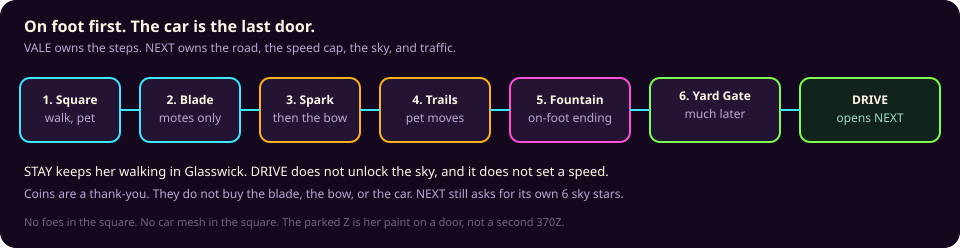
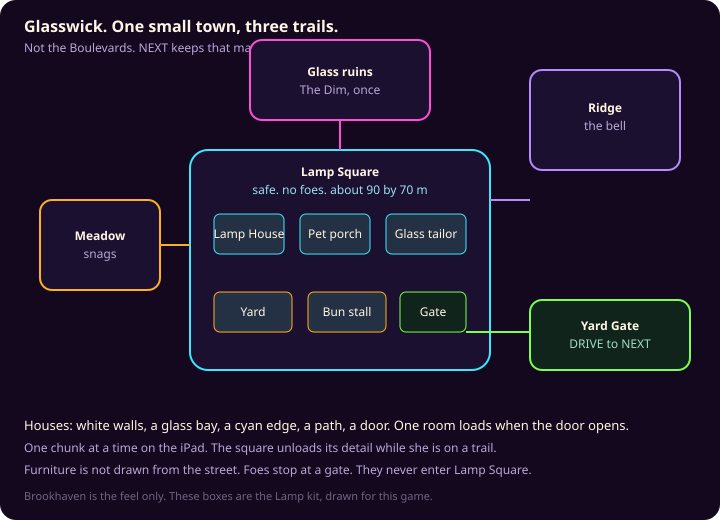
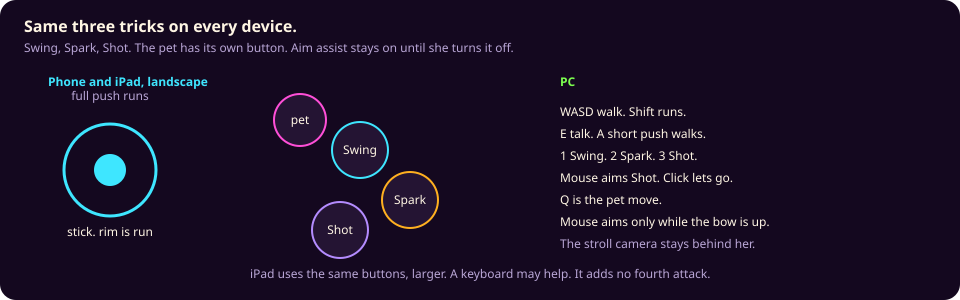

# Adventure world plan

Buy nothing from this list. Do not deploy from this branch. Do not edit `index.html`, `world.html`, `world-split.html`, or any Neon World file.

Bob's note on 24 Oct 2026, 2:11 PM ET: Neon World dips to about 25 fps on his phone, and a WebGL buildings attempt was dropped. Adventure World therefore starts from the ground up, small, and grows one step at a time. Milestone 0 is built. Milestones 1 through 5 wait until the frame gate below passes on the current step. The town story under that (jobs, moves, the car key) is unchanged. Nothing past Milestone 0 is in the page.

This is the one adventure plan. Pull request 90, section 7, commit `935611f`, drafted an on-foot chapter and handed it here. Where that section and this file both describe walking, jobs, foes, pet moves, or the car key, this file is the one to follow. NEXT still owns the Boulevards map, the driving caps, the 400 ft sky, and traffic.

The page is `adventure.html`. It is not linked from the kid menu. The live Neon World stays on `world.html` and `world-split.html`. NEXT stays on `next.html`. Glasswick is still the recommended town name. `vale.html` is not the page.

Ellie is 10 and plays at about a 13-year-old level. The words stay plain and specific: Lamp Square, glow, Yard Gate. No baby talk.

## Renderer

One canvas. One WebGL2 scene. The page loads `adventure/app.js`, which is three.js r170 (MIT) bundled with its FBX and glTF loaders. The courtyard, Ellie, and one follower pet are objects in that one scene. The page loads only the pet named in `?pet=`.

This is not Neon's renderer. Neon paints the city on a 2D canvas (`world/boot.js`, with `shadowBlur`) and keeps a separate three.js build inside `shared/car-model.js` for the car. A buildings pass that added another WebGL view was dropped after the phone dips. Adventure World does not import `world/`, `shared/car-model.js`, or `index.html`. There is no second canvas, no `shadowBlur`, no shadow map, no antialias, and the pixel ratio stays at 1.

Why this scene, and not a hand-written GL core: the phone problem is extra passes and an uncapped city, not the lack of a tiny shader. A skinned character needs a skeleton, a clip, and a single draw. three.js r170 already does that, the bundle is about 1.0 MB, and the draw list for Milestone 0 is one ground, a ring, eight wall pieces, four lamps, and two skinned meshes. If a later step misses the frame gate, that step comes back out. A custom GL core would be smaller on disk and would still have to grow a skinning path before Ellie could walk.

## Frame gate

Every milestone records a frame-time histogram before the world is allowed to grow. The overlay is `adventure.html?fps=1`. The lab bench is `?bench=1&frames=360` and stops the loop when the sample fills. The ring keeps 600 frames. The first 30 frames are warmup (shader compile). The gate scores the frames after that. The worst warmup frame is reported beside the histogram as the boot hitch, and it has to stay under 80 ms.

1% low is 1000 divided by the mean of the worst 1% of frame times.

| Device | How the page tells | 1% low | p95 | Worst steady frame |
| --- | --- | --- | --- | --- |
| Phone | short side under 500 px, or `kind=phone` | at least 50 fps | at most 20 ms | at most 40 ms |
| iPad | the middle sizes, or `kind=ipad` | at least 30 fps | at most 33 ms | at most 50 ms |
| PC | long side at least 1280 px, or `kind=pc` | at least 60 fps | at most 16.7 ms | at most 33 ms |

The iPad floor is 30 because that tablet is 60 Hz and already the strict machine, and a 1% low of 30 means the bad frames are still on the flat-30 floor. The phone asks for 50 because Bob saw 25 and the next step cannot start from there. The PC asks for a 60 fps 1% low because that machine has the headroom.

Lab numbers are software GL on this agent (SwiftShader). They are not his phone and not the 2018 iPad. A lab pass means the scene is cheap enough to grow in the lab. His phone is still the column that matters before a later milestone is called done.

M0 through M8, lab, 360 frames, first 30 dropped as warmup, fox loaded (the default pet). The phone column slows the CPU 4×. iPad and PC do not. Shader compile and the curtain's first draw finish while the opening curtain is up. That first draw has to stay under 80 ms. On this run it was 58.7 ms on the throttled phone, 25.8 ms on the iPad, and 24.2 ms on the PC. An earlier phone run of the same scene was 74.3 ms, so the margin moves. The earlier Lambert pass, with the fox picture bound, left that first draw at 86 ms. Flat materials with no texture bound are what got it under 80.

| Viewport | p50 | p95 | p99 | 1% low | Worst after warmup | Hitch after curtain | Curtain first draw | Gate |
| --- | --- | --- | --- | --- | --- | --- | --- | --- |
| Phone 844×390, CPU 4× | 1.0 ms | 2.8 ms | 6.3 ms | 95 fps | 15.5 ms | 27 ms | 58.7 ms | Pass |
| iPad 1024×768 | 0.3 ms | 0.6 ms | 1.1 ms | 426 fps | 3.1 ms | 10.6 ms | 25.8 ms | Pass |
| PC 1366×768 | 0.3 ms | 1.2 ms | 3.1 ms | 267 fps | 3.9 ms | 13.2 ms | 24.2 ms | Pass |

Phone walk slices, average: world 0.08 ms, player 0.07, pet 0.03, swing 0, spark 0, bow 0, foes 0.03, meter 0.06, draw 0.98, spare 0.00. Draws 38. Triangles 14,680. One warmup frame of 27 ms was named on the meter slice. Steady dips were 0. Logs: `test-results/adventure-m0/gate-phone.json`, `gate-ipad.json`, `gate-pc.json`. Shots: `test-results/adventure-m0/build/`.

## Anatomy on Milestone 0

The Neon checker (`tools/anatomy-check.mjs` on `cursor/anatomy-check-3de5`) scores the crew sprites. It cannot see these meshes. `tools/adventure-anatomy.mjs` applies that same numeric bar to the adventure renders: head 16–45% of the figure, on a neck, centered; side, three-quarter, and back chest at least 36% of the front; a walk with a step, a swing, a plant, and a small bob; opposition scored from the side, because a 3D stride travels away from the camera; Ellie 1.15–2.05 m with feet on the ground; each follower longer than it is tall, at or under her hip, paws on the ground, knee to waist.

Result: **PASS** (exit 0).

| | Measured |
| --- | --- |
| Ellie | 1.50 m. Feet at 0.00 m. Hip bone 0.44 m. |
| Head, front | 35% of the figure. On a neck. Centered. Three-quarter 35%, side 35%, back 36%. |
| Chest width | Front 161 px, three-quarter 151, side 104 (65% of the front), back 160. |
| Walk | Side step 182 px, arm swing 72 px, opposition 0.48, bob 15 px, feet trade a plant. |
| Fox | 0.39 m tall, 0.77 m long. Top 0.39 m, under the 0.44 m hip. Feet at 0.00 m. |
| Cat | 0.34 m tall, 0.42 m long. Top 0.34 m. Feet at 0.00 m. |
| Puppy | 0.31 m tall, 0.49 m long. Top 0.31 m. Feet at 0.00 m. |

Ellie is the CC0 Casual Female, scaled to 1.50 m. Her shirt, pants, body mesh, pack face, and pack hair are the ones in the file. The extra head was removed. Body and pet materials are MeshBasic, flat colors, no texture bound. Lights are in the scene and do not shade these materials, so the courtyard reads flatter than the earlier Lambert shots. The fox coat picture stays in the file and is not bound; the page paints her `#d9783a`. Binding that picture compiled a second skinned program and the curtain's first draw stayed over 80 ms. Shader compile and one warm draw run while the opening curtain is up. The suited pug is not the follower. It is saved at `adventure/assets/later/Pug.fbx` for a later town character.

`?pet=fox|cat|puppy|bunny|aussie` picks the follower. Fox, cat, and puppy are in the scene, one at a time, at her heel, with idle and walk. Bunny and Australian Shepherd are accepted by the switch and are not loaded. Shots are in `test-results/adventure-m0/`. Before shots of the old head and the suited pug are in `test-results/adventure-m0/before/`.

### Bunny and Australian Shepherd

No free model was shipped for either, and nothing was purchased.

Bunny. The Quaternius Ultimate Monsters bunny is CC0 and animated, and the pack sheet shows it on two legs, so it is not a heel pet. https://quaternius.com/packs/ultimatemonsters.html Sketchfab has CC-BY bunnies (for example Bunny Detective, six clips) that this run could not download without an account, and several are characters rather than a plain four-legged rabbit. OpenGameArt rabbits found in the search were flat sprites.

Australian Shepherd. The animation job is still blocked on the file. Luckypon's Low Australian Shepherd is CC BY 4.0, rigged, and has no clips, which is the model Bob picked. Sketchfab's download API returns 401 without an account, this environment has no Sketchfab token, and the public viewer file is encrypted. It was not decrypted. Aigei asks for a login. No copy showed up on GitHub or archive.org. The ribbon_bee model has no license. Nothing was purchased, and no other dog was renamed into the aussie slot. `?pet=aussie` still shows the note and loads nothing. Idle, walk, run, sit, and jump are waiting on that FBX. Anatomy Check was not run on an Aussie, because that mesh is not in the scene.

| Candidate | License | Why it is not in the build |
| --- | --- | --- |
| [Australian Shepherd (Game Ready)](https://sketchfab.com/3d-models/australian-shepherd-game-ready-122dedb159bb4a6da34cc14cda46aa38) by Nyilonelycompany | Sketchfab Standard, paid. Eight clips, including idle and walk. The description names merle coats. | Not free. |
| [Low Australian Shepherd](https://sketchfab.com/3d-models/low-australian-shepherd-166469433a8948c386d127c6cf374513) by Luckypon | CC BY 4.0. Rigged. | No animation clips. |
| [Australian Shepherd Low Poly Model](https://sketchfab.com/3d-models/australian-shepherd-low-poly-model-4fcc0ef60fda4f5d95d57b7e545e7279) by ribbon_bee | No license is set on the model. | No animation clips, and the license is not one this page can use. |

Quaternius does publish a CC0 husky and a CC0 shiba. Neither is an Australian Shepherd, so neither was renamed into the aussie slot.

## Milestones

Each step is one addition. The car is still absent. Sky, traffic, and the Boulevards map stay with NEXT.

| Step | What is added | Not yet |
| --- | --- | --- |
| M0 | One round courtyard. Ellie on foot. One follower at her heel, chosen with `?pet=` (fox, cat, or puppy). The frame harness. | No house, no job, no foe, no car. Bunny and Australian Shepherd wait on a free animated model. This is the build. |
| M1 | One glass house shell on the courtyard edge. No interior. | No room portrait, no second building. |
| M2 | Nia, and job 1 (walk up and knock). | No other people. The iPad cap of 3 awake starts here and is not raised. |
| M3 | Swing, and one crate crab that faints. | No second foe. Nearby cap still 3 / 4 / 6. |
| M4 | Spark, Shot, and the pug's favorite move. | No extra pets. |
| M5 | One gate into a second, tiny meadow chunk. The courtyard unloads detail while she is through the gate. | No ridge, no ruins, no car key. |

M1 does not start until M0's gate passes. The same rule repeats. The later story phases in section 10 (jobs 6 and 7, the car key, the cape) sit after M5.

The page has since followed `docs/ADVENTURE-BUILD-ORDER.md` through M8: the meter, one glass house, Nia, Swing, Spark, the bow, one crate crab, Gust (the fox's move), and one meadow. The table above is the story shape. The build-order file is the perf order, and it is what is on screen.

The shape is borrowed from two games she might already know the feel of. A town, jobs, choices, a partner at her side, then a blade, a spark, and a bow: that is the Fable idea. A pet with a few elemental tricks that grow because of stories: that is the Pokémon idea. The names, the clothes, the creatures, the type list, and the models are ours. Nothing is copied from those games, from Brookhaven, or from a pack.

## How this sits next to NEXT

Read with `docs/NEXT-WORLD-PLAN.md` on `cursor/next-world-plan-039c`, through commit `935611f`, pull request 90. The driving chapter and the traffic test stay there (traffic test pull request 93, commit `feb4211`). This file takes section 7's on-foot ideas. If pull request 90 changes a driving rule, follow it for driving. Do not take the map, the caps, the sky, or the traffic back.

| | NEXT (pull request 90) | VALE (this plan) |
| --- | --- | --- |
| Page | `next.html` | `adventure.html` |
| Map | A copy of Option 1, The Boulevards. World id `next`. | Glasswick. Its own file. Not a copy of `world/city-layout.js`. |
| How she moves | She drives the Z. She cannot launch the sky on foot. | She walks. The Z is not in this world until the last chapter, and then only as a door. |
| Speed | 25 / 35 / 45 mph on the street, only while she is driving. Sky 65 / 90 / 120 after NEXT's own unlock. | Walk 3–4 mph. Run 8–10 mph. Same on every device. No sky speed. |
| Altitude | The 400 ft line, the ramp, the bounce, the portal. Save key `zdash.next.v1`. | None. A fall sits her back at the last lamp. That is not the sky portal. |
| Traffic | Rare: two cars, under her cap, live LOD or the photo fallback. | No traffic. No write to `shared/traffic-tune.js`. |
| Car art | The real Z, and a lighter traffic cut of `assets/370z.glb`. | Her paint color on the Yard Gate door. Not a second mesh of the Z. |

Shared, on purpose, the same way NEXT already shares them:

- `zdash.kid.v1` (her car, coins, Garage stars, name)
- `zdash.char.v1` and `zdash.pet.v1` (the closet and the pet she already picked)
- `zdash.house.v1`, `zdash.crew.v1`, the paint and dance keys

VALE progress is a new key, `zdash.vale.v1`. It stores tales, Warm and Bold, weapons, bond, vale-only guests, and her adventure coat. It does not write `zdash.next.v1`. It does not spend Garage stars. Coins she earns here land in the shared wallet, so a reward here is a reward in the garage. The recommended path never charges a price.

When she finally drives, the sky inside NEXT is still locked until she does that world's 6 of 8 drive jobs. This plan does not skip them, and it does not set the caps. If `next.html` is not in the game yet, the button says the road is still being paved and she stays on foot. We do not build a stand-in city to cover that gap.

### Vale / Glasswick, or Homestead

Section 7 called the hub Homestead, because that block is already on the Boulevards. This plan had named a separate town Glasswick, on a page called VALE. One name has to win. The jobs, the speeds, the foe cap, and the pet moves below are the same either way.

**A. Glasswick, tile VALE. Recommended.** She walks a town that is not the driving map. Homestead stays the name NEXT uses when she is in the car. The car key opens the Yard Gate. STAY keeps walking. DRIVE opens `next.html`. Traffic never runs in Glasswick. The Z is her paint on the gate door, not a second mesh.

**B. Homestead.** Drop the Glasswick name. She starts on foot on the Homestead block NEXT already drew. Read "Homestead" wherever this doc says Glasswick. The Z leaves that garage at the car key. Neighborhood caps (25 / 35 / 45 mph) and the two traffic cars apply only while she is driving. She can park and get out. Getting out turns traffic off and puts her back on foot. The sky is still that ramp, still 400 ft, still owned by NEXT. Pick this if one home matters more than a separate page. The map file stays NEXT's. This doc still does not edit it.



## 1. She starts on foot

She appears in the middle of Lamp Square, in the square coat, with one pet already at her heel. There is no car in the square, no wings button, and no street/arcade switch. Neon World keeps flying. NEXT keeps driving, and those caps start only when she has the car key.

Speeds, all devices. The band is the rule. The default is the middle of the band, so a build has one number to measure.

| | Band | Default | What it is for |
| --- | --- | --- | --- |
| Walk | 3–4 mph | 3.5 mph (1.6 m/s) | Looking at a house |
| Run | 8–10 mph | 9 mph (4.0 m/s) | Crossing the square. A full push on the stick. |

There is no third sprint. A run does not widen the pretty ring. She still has many seconds of houses ahead of her. A long frame drops picture. It does not change these speeds mid-step. They stay under NEXT's slowest driving cap (25 mph on her iPad). Foes chase at about 6 mph, so a run leaves them behind.

### The unlock path

Trust is the price. Not coins. She cannot skip ahead by walking to a ramp.

**A. Two keys. Recommended.**

1. **On foot.** Day one. One pet follows. No driving. No traffic. No sky. The ramp, if she can see it, is a small hop she can look at. It does not push.
2. **Car key.** 5 of 7 town jobs. Swing, Spark, and Shot are all inside those five, so the car is after the three moves and still well after the first minute. Each finished job pays 25 coins into the shared wallet. The last two jobs are optional forks. Both endings pay the 25. One ending changes the street.
3. **Sky.** After the car key, NEXT's own 6 of 8 drive jobs (section 4 of that plan). Same ramp, same 400 ft line, same one bounce then the neon portal. She cannot launch the sky on foot. This plan does not rewrite that list.

On the Glasswick pick, the car key opens the Yard Gate: **STAY** or **DRIVE**. DRIVE opens `next.html`. On the Homestead pick, the Z leaves the garage, the driving caps and the two traffic cars turn on only while she drives, and getting out puts her on foot with traffic off.

**B. One ladder.** Fourteen stars in one list. The car is star 8. The sky is star 14. Simpler to count. Harder to tell a town story from a drive story.

**C. Parent switches only.** `?car=1` and `?sky=1` open a chapter for testing. She does not see them. `?vale=1&chapter=5` can skip to the yard lane. These are not the design.

A parade lap inside the walking town (12 mph, no other cars, no sky, not the full Z) is there if DRIVE-to-NEXT feels like leaving the story. It is not the recommendation.

## 2. The town, the tales, the choices

Glasswick is one hub and three trails. Lamp Square is about 90 by 70 metres, fourteen buildings, a low glass wall, three trail gates, and the Yard Gate. The trails are Meadow (about 80 by 80), Ridge (about 70 by 120), and the glass ruins (about 60 by 60). Each one is a chunk. On her iPad only one trail is resident, and the square drops its detail while she is out there.



Houses use the Brookhaven feel NEXT already named, and none of its files: clean lots, bright walls, a big glass bay, a cyan edge, a front path, a door. The kit is ours (the Lamp kit). Rooms draw only after a door opens. Furniture is never drawn from the street. The Homestead sport house stays NEXT's art pass. Do not copy Brookhaven models, names, or screens.

The known interior bug stays out. `walkPaintCrew` stretches a portrait and the anatomy check still fails those rooms. Bob paused that check. VALE rooms draw the 3D body at about 1.5 m. They do not use that portrait.

People: **Nia** at the Lamp House (the jobs), **Otto** at the bun stall, **Perrin** at the yard, and the tailor. They share Ellie's rig and walk. They count toward the nearby cap, so on her iPad three are awake and the fourth waits off-screen until one leaves. A foe in the hub would spend that same cap. The hub has no foes, so the cap there is townsfolk only.

### Town jobs

She picks the order. Five done earns the car key. Jobs 6 and 7 are optional. A job is a few minutes. The five are an afternoon, not a grind. The car comes after those five, not after a fourteenth quest.

| # | Counts toward the key? | What she does | Choice |
| --- | --- | --- | --- |
| 1 | Yes | Walk the block and knock on three doors. | — |
| 2 | Yes | At the pet porch, choose which pet walks today. | The four she already has |
| 3 | Yes | Carry Otto's parcel to the tailor. | Walk it over (Warm), or run and he laughs (Bold). Nothing breaks. |
| 4 | Yes | Light the yard lamps. She learns Spark. Late lamps stay dim, and she can try again. No fail screen. | — |
| 5 | Yes | Clear the crate crabs off the yard lane, the road she will drive later. She learns Swing, then Shot, to pin the high crate. They poof. | — |
| 6 | Optional | The meadow gate. A gate brute faints, the gate opens, and that brute is gone for this job. | Talk it open (Warm), or take the long path (Bold). The gate stays as she left it. |
| 7 | Optional | Pick one porch. | Glass sport, or warm. The other look waits. |

The pet's favorite move turns on at job 5, with the crabs. A gap only the pet fits can sit on the meadow wall during job 6. It does not add an eighth job, and it does not change the 5 of 7 count. The tale book in the Lamp House replays any of them. A choice does not lock another job away.

Hub and spokes: the town is home. Jobs send her out and back. She returns for the board, the pet, and the gate. Meadow is job 6. The ridge and the glass ruins are spokes she can walk after the car key. They do not raise the 5 of 7 count. One fixed road of seven jobs is the clearer, thinner version. Every district open on day one is a heavier load than the iPad plan. Recommended is home, then the spokes.

### Warm and Bold

Both are kind. Warm is wait, share, help. Bold is race ahead, tease, take the shiny shortcut. There is no cruel option, no stealing, and no dark makeover. The word Warm or Bold is written on the button, so she can see it before she picks. The tale book shows the count from the first choice. Three Warm softens the porch glass toward cyan. Three Bold makes the neon edge brighter. The meadow gate stays as she left it either way. Neither one closes a door.

**Other tones, if you would rather:** a hidden score she never sees (closer to those older games, easier to feel unfair), or no score at all and the choice is only the line Nia says next. Recommended is the labeled pair.

## 3. Ellie, redrawn

She is still Ellie: the ponytail, the cyan streak added, the adventure coat. The first body is a restyle of the figure she already has. Same rig, a clearer face, a jacket, boots, a satchel. The check already knows this body. A jacket that clips the arms fails even if it looks right. Neon World keeps today's drawer. The adventure coat lives in `zdash.vale.v1` unless she taps USE THIS LOOK, which is the only write back to `zdash.char.v1`.

A free pack is a prototype only after that restyle has been measured. The face, the clothes, and the colors change before it ships, so she does not look like a pack demo. A paid pack waits for a yes on that price. Buying is not part of approving this plan.

The style is stylized and expressive, in the spirit of those adventure games: a readable face, big hands, a coat, boots, a satchel. The proportions are a kid, not a realistic adult and not a chibi that fails the checker. The painted height matches the figure that already passes, about 1.5 m. The 1.75 m number in `world/crew-data.js` is the bone source. This world uses the painted height. Hip about 0.78 m. Head in the 18–40% band (the hard gate is 16–45% of the figure).

Four face textures: rest, smile, determined, surprised. Blink is a PC extra and stays off on the iPad. Eyes and mouth stay on the head mesh. A floating head fails the neck check.

Coats:

| Coat | When | Anatomy note |
| --- | --- | --- |
| Square coat | From the start | Open at the chest so the side view still has a torso |
| Trail kit | Job 3, the parcel | Lighter jacket, scarf. The scarf is not a second neck. |
| Glass cape | Phase 8, after the fountain exists | A back panel on the chest, shorter than the coat. It does not replace the body. |
| Night scarf | Phase 8, a Bold or Warm cosmetic | Same rule |

### Anatomy Check

She does not ship until the checker exits 0. That checker is `tools/anatomy-check.mjs` on pull request 61, agent `bc-bfc8fc93-c2b4-5dbd-a098-1d29cd573de5`, branch `cursor/anatomy-check-3de5`.

```
node tools/anatomy-check.mjs --root <tree> --out test-results/anatomy
```

Exit 0 is a pass. Exit 1 is an anatomy fail. Exit 2 means the checker itself is wrong, and the character result does not count. The review goes on the feature PR tagged `ANATOMY-CHECK`, with the contact sheets. The last full humanoid pass that agent cites is character commit `a509260` with checker `bce9aba`. The interior half of the check is paused. Do not block this world on it. Do not copy the bug it caught.

What the new body has to do, in the checker's words: humanoid at least. Head, then limbs, then the walk. Clothes are secondary unless they pull the body apart.

- Head on the neck, centered, in that size band. Arms from the shoulders, hands at the end of the arms, legs from the hips, feet on the ground, left and right on the correct sides.
- The torso stays visible, with real depth, at every yaw, including the walk, from the front, three-quarter, side, and back. Side, three-quarter, and back chest each stay at least 36% of the front chest.
- The walk is a cycle: opposite arm and leg, a planted foot, a small bob, nothing clipping. Eight frames at those four yaws.
- On-screen height about 1.5 m, inside 1.15–2.05 m. Feet do not float.

Phase 1 is the unarmed body. Swing's blade, Shot's bow, and the cape are a second mesh. If a prop glues itself to an arm in the pixel test, the walk shots hide the prop and combat shows it. Both states get a picture in the review. A bow on her back must not read as a third arm.

Townspeople use her rig, so a pass covers their walk too. We do not need a second walk cycle per person.

## 4. Swing, Spark, and Shot

Three moves. Our names. **Swing** is a sword arc of light. **Spark** is a short spell. **Shot** is a bow: she aims, then lets go. The arrow is a bolt of light. It poofs. No blood. No ammo. A quiver that refills at a lamp is the other choice, and it turns into a chore.

Combat is in the world, in the stroll camera (behind her, about 4.5 m back, looking at her chest). It is not a separate battle screen. The mouse aims only while Shot is up. Aim assist is on until she turns it off in the tale book. The cone is about 35 degrees and 12 metres. There are no crits and no headshots.

One control scheme on every device. She learns one game.

| | Move | Swing, Spark, Shot | The bow |
| --- | --- | --- | --- |
| Phone | Left thumb. A short push walks. A full push runs. | Three buttons under the right thumb. At least 56 pt, with a gap a thumb can feel. | Drag to aim, let go to loose. |
| iPad | Same thumbs, bigger targets (64 pt). A keyboard, if one is attached, also walks her. | Same three buttons. Not a phone row stretched wide. | Same drag, with more room. |
| PC | WASD. Shift runs. | Keys 1, 2, and 3. | Mouse aims. Click lets go. |

The pet move is one more button (Q on a keyboard). It does not replace her three. Talk is a big button at the bottom center when she is next to Nia. Landscape, same as the rest of the kid app. The iPad does not get a fourth attack.



A camera that follows the mouse all the time would be a second game on PC. Not recommended. A pause card for the pet move is the fallback if the phone fight is too fiddly.

### What a hit is

Her meter is three pips, labeled WIND, drawn as small cyan lamps. Not a red bar. A hit on her is a spark and a stagger. Three staggers empty her wind. She sits for about 3 seconds, the pet noses her, then she stands. The line is "Catch your breath." The job stays. There is no game-over screen, and no trip back to a lamp unless she is stuck inside a pen.

A foe faints or poofs. Empty lamps: it sits for about 0.4 s, then breaks into 8–12 motes that fade, unless it is the gate brute, who faints and is gone for that job. Nothing is left on the ground. No blood, no bones, no red X, no "dead", no screaming, no damage numbers. The screen does not print the word. The picture does it.

## 5. Foes

Kid-safe. No gore, no blood, no death screen. No dogs. No kids. They are mischief made of light, crates, and a gate, so bonking one does not feel like hurting a pet. They never enter the hub streets. They never spawn during a conversation. They never appear on top of her.

| Foe | What it does | When it loses |
| --- | --- | --- |
| Glimmer moth | Small. Flutters. A faint spark. | Poof |
| Crate crab | Slow. Blocks a path. Job 5. | Poof into loose planks |
| Lantern wisp | Hovers. A pulse you can see coming. | Poof. Soak puts it out faster. |
| Gate brute | Slow and large. One per gate job. | Faints. The gate opens. It is gone for that job. |

### How one foe thinks

1. Wander inside a pen: a yard, or a piece of lane.
2. Notice her inside about 12 m in front, or 8 m behind. They turn for about half a second. That is the tell. She can miss. Words stay specific. No prompt that waits for a tap.
3. Chase at about 6 mph. Her run is 8–10 mph, so she can leave. They stop at the pen edge.
4. Swing or pulse with a second tell, a glow or a crouch, so she can step aside.
5. After two misses, or if she leaves, they walk home.

Quest foes are placed. They do not come back. Wild ones can be back next visit. Wild pens start at the yard lane. The hub stays friendly.

The pet is not a target. If a bump would overlap the pet, the pet hops aside and stays on the floor. The pet has no wind pips. If a move would land on the pet, it ducks into the satchel for 5 s and comes back. The pet does not pick fights on its own.

### How many

Nearby at once: **3 on her iPad, 4 on the Galaxy phone, 6 on a PC.** Townsfolk share that count. A long frame drops a far foe before it drops her. Anyone past the cap is not simulated. Past about 25 m a foe is an idle bob, or it is unloaded with the chunk.

| | Her iPad | Galaxy phone | PC |
| --- | --- | --- | --- |
| Nearby cap, foes and townsfolk together | 3 | 4 | 6 |
| Tell | about half a second | same | same |
| Chase | about 6 mph | same | same |

A harder lane can come later: a gate she opts into, or a parent switch. Shorter tells. Chase a bit closer to her run, still under it. Same cap. Not day one. Two in front of her is still the most who swing at once. The rest wait in the pen. The cap is how many are awake, not how many can surround her.

## 6. The pet on the floor

The pet she already chose follows her: fox, cat, dragon pup, or robo-dog, from `zdash.pet.v1`. It is a real-pet size. Knee of the 1.5 m figure is about 0.40 m. Hip is about 0.78 m. The top of the pet, ears included, stays between 0.42 m and 0.74 m. The outdoor fox that already passes is about 0.74 m, which is the top of the band. New pets do not go above it.

Paws stay on the floor. The checker's idle band is about −0.04 m to 0.055 m. This world does not mark a pet tall, so ears do not tower over her shoulder, and nothing rides on her shoulder. Stairs are walked. If a step is too tall, the pet puffs to the landing and is on the floor again. It does not hover.

Follow slot: about a step and a half behind, a little to the side, so the camera still sees both. It walks when she walks and runs to catch up. It does not block a door. Indoors it comes in, still small, still on the floor. A puff to her heel happens only if the gap is over 8 m. She can walk through it. In a fight it stands at her side, not in front of the stick. She presses the pet move. Two fighters choosing targets on their own are harder to read and cost another draw.

In the Z, later, the existing ride clip still applies, and only after DRIVE. A combat move does not fire while she is driving. NEXT's "a pet can ride" stays true.

## 7. Pet moves

Real-time, in the world. One paw button fires the ready move. A long-press on the phone, or the tale book, picks among the moves she has. Cooldowns, not a points pool. The ring on the paw button is the timer. The pet does not start a fight by itself.

Four shared moves, learned in order. Names are ours. Cooldowns are 4 to 8 seconds. The light move is **Gleam**, so it is not the same word as her Spark.

| Move | Element | Cooldown | What it is |
| --- | --- | --- | --- |
| Gleam | Light | 4 s | A short zap |
| Gust | Air | 6 s | A push. Small foes slide back. |
| Pebble | Stone | 5 s | A lob. Good on crate crabs. |
| Soak | Water | 8 s | A splash. Puts a lantern wisp out faster. |

She starts with that pet's favorite when job 5 begins. Favorites: fox Gust, cat Gleam, dragon Pebble, robo Gleam. A level comes from finishing a job with that pet out, about two jobs a level. Not from making foes faint. Level 3 opens the second move, level 6 the third, level 8 the fourth, and it stops. A unique pair on top of these four can come later, if four shared moves feel thin. That later pair does not ship in the first pet phase.

No copied type chart. Soak on a wisp is the only matchup, and it is written on the move.

## 8. More pets, and where models come from

Intricate means the face, the coat, the satchel, a collar, a scarf, a glass charm, and a town with real doors. It does not mean a 50,000-triangle hero. Fur cards, shadow maps, and 2k textures do not fit the iPad.

| | Triangles | Bones | Texture |
| --- | --- | --- | --- |
| Ellie, iPad and phone | about 6,000 | 28 | 256 atlas. 128 if 256 misses the frame. |
| Ellie, PC | about 8,000 | 28 | 256, face can be 512 |
| Pet | 1,500–2,500 | 16 | 128, plus a 50-triangle charm |
| One house shell | 300–800 | — | Shared kit: wall, glass, cyan, trim |
| One interior | about 2,000 | — | Loaded on the door, unloaded when it shuts |
| Foe | Two bodies, palette swaps | 12 | Same atlas family |

Eight shared materials for the whole square. Windows instance. On the iPad, at most eight real glass bays in view. The rest are a bright opaque cyan card that still reads as a window. That is the fill-rate limit on the 2018 iPad's GPU, not a style change.

### New animals

The four she has stay. Then three new ones, found one mesh at a time, each through the anatomy check. Not a roster of 8 to 12 on the first boot.

| Guest | Size | Note |
| --- | --- | --- |
| Tin hare | Ears stop at her hip | On the floor |
| Brook frog | Knee height | On the floor |
| Lamp moth | Knee height, wings folded | Hops. It does not fly, and it does not sit on her shoulder. |

They are guests in `zdash.vale.v1`. They do not go into `zdash.pet.v1` until a later closet pass that teaches every reader to keep an unknown type. The shared pet is the one who follows. "This is my pet everywhere" is a separate tap after that closet pass. They use Gleam, Gust, Pebble, and Soak. They do not get a stronger hit than the fox.

### 3D model sources

Buy nothing. A price below is not a yes. Prices were public on 24 Oct 2026 and they change. Check the pack page on the day of a download. Nothing gets bought unless Bob writes yes for that price.

The figure that ships is the restyle of Ellie. A pack can be a prototype or a background prop. It is not her face, and it is not a copied hero, town, or pet. Download from the author's own page. Read the `license.txt` in that download. Keep it with the phase notes. The game repo does not gain a pack zip from this plan.

**Free / CC0**

| Source | Price | What it is good for |
| --- | --- | --- |
| Quaternius | $0 | Public packs that say CC0: Ultimate Animated Characters, Ultimate Animated Animals, Ultimate RPG, Universal Base Characters, Modular Character Outfits Fantasy. A stylized person or animal to restyle. Newer Quaternius kits may use their own license instead: free in a game, including a commercial one, no credit, and you may not resell the files. If a page shows a price, do not pay it. Patreon ($3, $10, $20, $50) is optional support, not required. Modular Men is an adult kit. Leave it. |
| Kenney | $0 | Props, crates, simple blocks. CC0. Too blocky for her face. Donation is optional. |
| KayKit Adventurers, free tier | $0 | Rigged people and weapons to restyle, including a sword and a bow. CC0. Enough to prototype. Restyle before it ships. |

**Paid. Do not buy.**

| Source | Price | What it adds |
| --- | --- | --- |
| KayKit Adventurers, extra characters | about $7.95 and up | Three more bodies and alt colors. |
| KayKit source files | about $11.95 and up | The Blender files. |
| Kenney Game Assets All-in-1 | about $19.95 and up | The same free packs in one zip. Do not buy. Download the packs one at a time. |
| Synty, POLYGON Fantasy Kingdom | about $349.99 | A whole stylized town. A sale page has shown $174.99. A library plan has been advertised from about $30 a month. A store seat license, not CC. Even with a yes, it would be restyled. The medieval look fights the glass town. |

**Also free, after the license on that file is read. Still do not buy.**

| Source | Price | Note |
| --- | --- | --- |
| Poly Haven | $0, CC0 | Textures and sky light. Not characters. |
| Sketchfab | $0 if that file is CC0 or CC BY. Paid files are often about $5 to $40. | CC BY-NC is a poor fit for a public site. Do not download anything that looks like a copied hero, town, or pet. |
| Mixamo | $0 with an Adobe account | Walk and swing clips only. Usable in a game. Do not redistribute the raw files. The people are realistic, so they are a motion source, not the look. Skip it until Bob says yes to the login. |
| Poly Pizza | $0, license is per model | Easy to grab the wrong file. Prefer the author's page. |

## 9. Frames, and the ten-second load

Her iPad is the 6th generation (2018): A10, 2 GB, 60 Hz, landscape 1024×768 in the lab, the same strict column NEXT uses. Any tablet uses that column until it has been measured. A Galaxy phone is the middle column. A PC is the loose column. She does not pick the column. The game already tells an iPad from a phone from a PC.

60 fps means 16.7 ms. The iPad may sit on a flat 30 (33 ms) when 60 will not hold. A flat 30 is the floor. Drops down to 5 are not. Lab sizes, when this is built: phone 844×390, iPad 1024×768, PC 1366×768. Five on/off pairs, one browser at a time, on that phase's commit. A lab number alone is not "done".

On foot the Z is not drawn, and the two traffic cars are not drawn. That is the 4 ms plus the 2.5 ms from NEXT's driving split, free for her, the pet, and a few foes. When she drives, that split comes back. She is inside the Z. She is not a second full person during the drive. The pet can ride as it does today, small, and does not use a move from the seat.

| Piece, on foot | Time |
| --- | --- |
| Town and lots | 6 ms |
| Ellie and the pet | 3 ms |
| A few foes or townsfolk, inside the 3 / 4 / 6 cap | 3 ms |
| HUD | 2 ms |
| Spare, including a poof | 2.7 ms |

No `shadowBlur` anywhere on the adventure page, HUD included. Glow is in the texture. A blob under her feet is a dark circle decal, and it is the first thing the iPad turns off if a frame runs long. No shadow maps. No copy of the character back onto a 2D canvas.

If a frame runs long, drop in this order: the poof motes, extra glass (already capped), townspeople's face swaps, neon edge strips, then a far foe. Ellie, the pet, and her run stay. Particles cap at 24 on the iPad, 48 on the phone, 80 on the PC. A foe's exit is a short burst of 8–12, once, not a long system. Walk stays 3–4 mph and run stays 8–10 mph while this happens. The run does not grow the draw distance.

Resident memory, decoded, about 40 MB on the iPad, 55 on the phone, 80 on the PC. One chunk. The 2 GB iPad does not keep two towns.

### Load

From the moment she taps the tile to the moment she can take a step:

| | Boot target | What the first screen is |
| --- | --- | --- |
| Her iPad | under 10 s | The hub, Ellie, one pet, the buttons, the job list |
| Galaxy phone | under 6 s | Same, with smaller textures |
| PC | under 4 s | Same, and it may prefetch the next block |

These are targets to measure, not a claim that it is already that fast. The Z file is about 1.8 MB and is not in that boot. It loads when she nears the garage, or when DRIVE opens NEXT. Foe meshes load with the district that uses them. The next block streams in as she walks. A mist card of about 1.5 s can hide that walk across a gate. That mist is this world's. It is not NEXT's 400 ft card, and it is not an excuse for a 30 s load. If the cold iPad misses 10 s, the fix is fewer bytes, not a longer card. One music loop in phase 1, under about 1 MB.

Audio later adds one trail loop. It does not add an orchestra.

## 10. Build order

Each phase is measured before the next one starts. The car key does not start ahead of the five jobs. Finer models do not start ahead of the on-foot measurement.

| Phase | What she can do | Done when |
| --- | --- | --- |
| 0 | Milestone 0. Courtyard, Ellie, one follower (`?pet=fox`, `cat`, or `puppy`), frame harness. Page `adventure.html`. No menu tile. | Anatomy exit 0. The frame gate above, on the lab viewports. |
| 1 | Milestone 1. One glass house shell. Still unarmed. No interior. | The same frame gate, with the shell in the shot. |
| 2 | One real Lamp-kit house, one room at 1.5 m, Nia, job 1, the tale book. | The room does not use the stretched portrait. |
| 3 | Jobs 3–5. Swing, Spark, Shot. Crate crabs. WIND. | Props do not fail the walk. Hub streets stay friendly. Nearby cap holds at 3 / 4 / 6. |
| 4 | Phone, iPad, and PC use the one control scheme. | A thumb can hit the three buttons. Aim assist works with the cone. |
| 5 | The favorite pet move at job 5. Gleam, Gust, Pebble, Soak as levels allow. | The pet stays knee-to-waist, on the floor, and does not pick fights. |
| 6 | Jobs 6 and 7. The gate brute. One new guest animal in the vale save. | One chunk resident. The brute faints and is gone for that job. |
| 7 | The car key, after 5 of 7. | Glasswick: DRIVE opens NEXT and does not write `zdash.next.v1`. Homestead: caps and traffic turn on only while she drives. No Z mesh in the walking boot. No traffic file edited. |
| 8 | The harder lane, the glass cape, PC blink. $0 models only. | Only if the iPad still holds a flat 30 after phase 6. Same foe cap. |

Phase 1 does not add combat "while we are in there". Phase 7 does not invent a boulevard if NEXT is not merged. The sky chapter is NEXT's build, after the car key.

## Risks

- Pull request 90 is still open, and that agent was still testing a traffic car. If NEXT's handoff sentence changes, follow it. Do not answer by taking the map, the caps, the sky, or the traffic.
- Two maps must not share a file. The live builder keeps `world/city-layout.js`. NEXT writes its copy. VALE writes a third file, with its own world id.
- Shared coins are really shared. A price here spends garage money. The recommended path does not charge.
- A new pet type in `zdash.pet.v1` can break an old reader. Guests stay in `zdash.vale.v1` until a closet pass.
- The anatomy checker scores pixels. A cape, a bow, or a big satchel can look like a broken arm. Phase 1 is unarmed for that reason.
- The interior check is paused because of a stretched portrait. Copying that portrait into a VALE room fails the same way the moment the pause lifts.
- Real transparency is expensive on the 2018 iPad. Eight glass bays is the cap. More glass means opaque cards, not a lower jog speed.
- The full Z is about 687 meshes and 26,549 triangles. Parked in the square, it blows the on-foot budget. The walking boot does not load it. On the Glasswick pick the door uses her paint. On the Homestead pick the mesh loads when she nears the garage, and only the driving chapter draws it.
- Turning the traffic mesh on while she is on foot spends the frame the people need. Traffic stays with the driving chapter.
- Loading the whole map, every pet, and the Z on the first step will miss the 10 second boot. The hub loads first.
- Lab frames are not her iPad. NEXT's note still applies: the iPad is the strict column, and a lab number is not done.
- A pack character is the fastest way to fail "original" and the fastest way to fail the anatomy walk we did not author. Model Ellie.

## Picks

Reply with a letter, or "recommended" to take the marked row.

| # | Question | Recommended |
| --- | --- | --- |
| 1 | Name | A. Glasswick, page `adventure.html`. No menu tile yet. Homestead stays the driving home. B. Homestead. She starts on foot on NEXT's block. Read Homestead wherever this doc says Glasswick. |
| 2 | First minute | On foot. One pet. No car, no traffic, no sky. |
| 3 | Walk and run | Walk 3–4 mph (default 3.5). Run 8–10 mph (default 9). Same on every device. |
| 4 | Car key | A. 5 of 7 town jobs. Swing, Spark, and Shot are inside the five. Coins are 25 a job, not a price. B. One ladder of 14. The car is star 8. The sky is star 14. |
| 5 | Sky | NEXT's 6 of 8 drive jobs, after the car key. This plan does not change that list, the caps, or the 400 ft line. |
| 6 | Choices | A. Warm and Bold, both kind, labeled on the button, replayable. Two forks, jobs 6 and 7. B. A hidden score. C. No score, only the next line. |
| 7 | Her moves | A. Swing, Spark, Shot. One control scheme on phone, iPad, and PC. B. Mouse-look on PC all the time. |
| 8 | Foes | Four kinds. They poof or faint. Nearby cap 3 iPad / 4 phone / 6 PC, townsfolk included. Hub streets stay friendly. |
| 9 | Pet size | Knee to hip, on the floor, ears included, under 0.74 m. Follows. Does not pick fights. |
| 10 | Pet moves | A. Gleam, Gust, Pebble, Soak. Cooldowns 4–8 s. Levels from jobs. Stops at four. B. A unique pair on every pet, later, on top of A. |
| 11 | New animals | The four she has, then tin hare, brook frog, lamp moth. One mesh at a time. Vale save until a closet pass. |
| 12 | Models | Restyle today's figure first. Free / CC0 only (Quaternius, Kenney, KayKit free). Do not buy KayKit Extra (about $7.95) or Synty Fantasy Kingdom (about $349.99). |
| 13 | Load and frames | Boot under 10 s on her iPad, under 6 s on the phone, under 4 s on a PC. 60 fps aim, flat 30 floor. No `shadowBlur`. On foot the Z and the traffic cars are not drawn. |
| 14 | First build | Milestone 0 is in `adventure.html`: one courtyard, Ellie, a fox, cat, or puppy at her heel, the frame gate. The suited pug is saved under `adventure/assets/later/` and is not the follower. M1 through M5 wait on that gate. |

Open, and fine to leave until you approve a phase:

- Should DRIVE land her in NEXT's Homestead driveway, or on the first street NEXT already spawns? Recommended: whatever spawn NEXT already uses. VALE does not add a spawn point on their map.
- On the Homestead pick, should getting out of the car in a district far from home walk her there, or sit her back on the Homestead lot? Recommended: she stays where she parked, on foot, and traffic turns off.
- Does the glass cape wait until phase 8? Recommended yes. The cape is the prop most likely to hide her torso.
