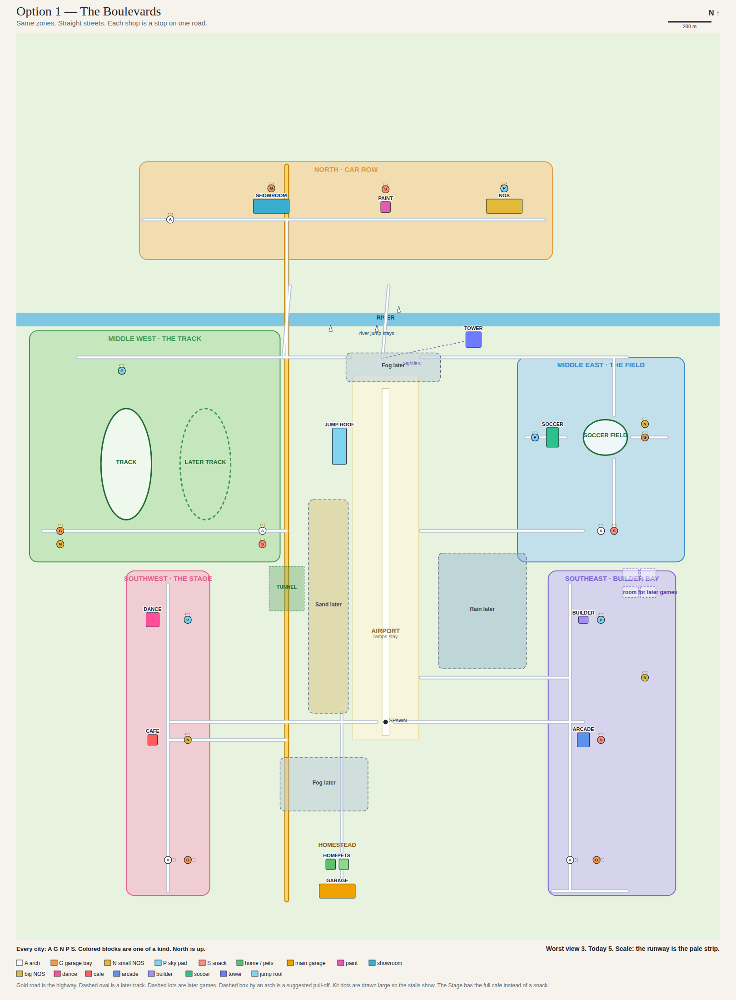
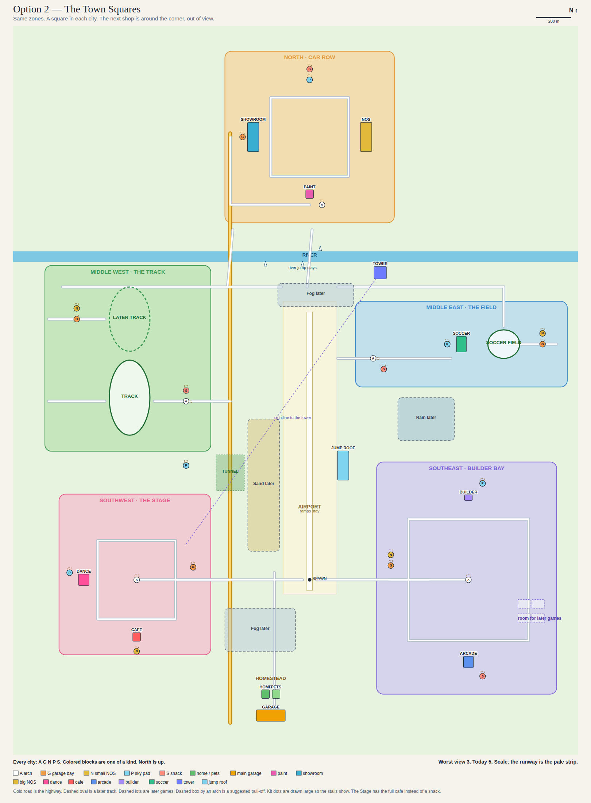

# Neon World city layout

The earlier pair (Option A and Option B) is withdrawn. Those two were too close to today's scattered map, and they kept the duplicate shops. This plan starts over from Bob's zones.

Bob picked Option 1, The Boulevards. Option 2 stays on this page as the other drawing. Nothing on Option 1 moved after that pick. Nothing is built. Nothing deploys. No game file changes until Bob writes "plan approved, build it."

North is up. +x is east, +z is north. One meter is one unit. Spawn stays at (0, 0) on the runway.

## The zones

The river is the line between north and south. The five cities sit apart, with open ground, the river, and the highway between them. Home is not inside a city.

| Zone | What lives there |
|---|---|
| North, above the river | Car Row. Paint studio, showroom, and the one big NOS station, on a waterfront road. |
| Southwest | The Stage. The one dance building, mural facing east, and the one full cafe. |
| Southeast | Builder Bay. Builder HQ, the arcade, and empty lots for games that do not exist yet. |
| Middle west | The Track. One oval now, and open grass for a second oval later. This side is the wide one. |
| Middle east | The Field. One soccer field and the one soccer shop. |
| Open ground, south of spawn | The homestead. The house, the pet lounge, and the main garage, in one yard. |
| The middle | The airport, the runway, and the ramps that are already there. |
| Riverbank, east of the runway | The one sky tower, by itself, so the cities can see it from far away. |

The dance stage is not a second building. The door of the mural building opens the stage, and BACK returns to that street.

The homestead does not get the city kit. It already has the house and the real garage.

## The city kit

Decided. Every city gets the same five small pieces. They are the allowed copies. Everything else appears once.

| Piece | What it is |
|---|---|
| Welcome arch | The city's name over the gate. Two posts and a sign. The lane goes through. No interior. |
| Garage bay | A small bay that opens Garage Z. BACK returns to that bay. |
| NOS station | A small drive-up canopy. Car Row does not get a second one. Its big station is this piece. |
| Sky Drop pad | A small pad. Until a fast-travel menu exists, it uses today's roof launch so a test build still works. |
| Snack stand | A walk-up stall, no room inside. The Stage does not get one. The full cafe is that city's food. |

Names on the arches: CAR ROW, THE STAGE, BUILDER BAY, THE TRACK, THE FIELD.

On the maps the kit is a lettered dot, drawn bigger than the real stall so it shows up. A is the arch, G is the garage bay, N is the small NOS, P is the pad, S is the snack.

## What else every city needs

One suggestion, not decided. A two-stall pull-off beside each arch, so she can get out of the lane and walk to the door. The maps mark it with a dashed box. If Bob says yes, it joins the kit. It is paint on the road, not a new building.

## How the empty ground helps the frame

The game draws building detail only inside 170 m. It does not hide a shop that is behind another shop. A wall is not a shortcut. Distance is what keeps the count down.

Today the worst view is 5 buildings. If Car Row's shops and kit were piled on one corner, that one view would be 7. The stops in each city are spread so a camera sees 2 there, not 7. The closest buildings that belong to two different cities are 382 m apart on the boulevards map and 432 m apart on the squares map, so a camera does not get detail from two cities at once.

The worst view on either map is 3, and only in the homestead yard: the house, the pet lounge, and the main garage. They share a yard on purpose.

Empty grass does not add shops to that count. A bigger map is cheap as long as the cities stay apart. The tower is one building. From a city it is a distant outline, which is the cheap pass, not the detail pass. This layout does not by itself promise 110 fps. The car copies are the other half of that work. On the city side, the worst view goes from 5 today to 3.

## Option 1 — The Boulevards

Bob's pick.

Each city is one straight street. The shops are stops along it, far enough apart that the next stop is out of the detail view. You can see the gate at the end of the street. Car Row faces the river. The dance mural faces east onto its street. The two ovals sit side by side, with a pit road along the south. The soccer approach comes up from the south. The jump roof stays on the west side of the runway. The tower sits on the riverbank, just east of the center bridge, and the short dashed line is a view, not a road. The hatched bands are weather for later: sand on the west shoulder, fog by the river and on the south lane, rain in the east gap.

Worst view: 3 buildings, the homestead yard. Inside a city the worst is 2.

### Place check

Checked against today's 24 shops in `world/city.js`, the track, the soccer field, and the airport, plus the building modes in PR #69 and the city kit. Today's duplicates become one of each. Nothing was missing, so nothing was added and nothing was moved.

| Place | In today's game? | On Option 1? | District |
|---|---|---|---|
| Home | Yes, twice | Once | Homestead, open ground |
| Main garage | Yes, twice | Once, the big one | Homestead, with the house |
| Pet lounge | Yes, twice | Once | Homestead |
| Paint studio | Yes, twice | Once | Car Row |
| Showroom spotlight | Yes, twice | Once | Car Row |
| Big NOS drive-up | Yes, twice | Once | Car Row |
| Dance building | Yes, twice | Once. The stage is the door. | The Stage |
| Cafe | Yes, twice | Once | The Stage |
| Arcade | Yes, twice | Once | Builder Bay |
| Builder HQ | Yes, twice | Once | Builder Bay |
| Soccer shop | Yes, twice | Once. No teleport to the field. | The Field |
| Soccer field | Yes, the dome | Once | The Field |
| Racetrack | Yes, one oval | Once, with grass for a second | The Track |
| Jump roof | Yes | Once, west shoulder | Airport |
| Sky tower | Yes | Once | Riverbank |
| Airport, runway, ramps, half-pipe, loop | Yes | Unchanged | Middle |
| Tunnel and river jumps | Yes | Unchanged | Highway and river |
| Kit: arch, garage bay, small NOS, Sky pad, snack | No. New, and approved. | Every city. Car Row uses the big NOS. The Stage uses the cafe instead of a snack. | Each city |

The walk-in rooms (house, arcade, cafe, pet lounge, soccer shop, Builder HQ) are the space behind those doors. They are not a second row of buildings, including in the southwest. The interiors plan does not add a shop to the map.

Two ideas are not places in today's game, so they are not on the map. They stay suggestions. They do not move anything.

- A Planner Port prop set, and an LED-trailer pad near the main garage, if Bob wants that later. The yard is not rearranged for it.
- A visible southwest row of interior style samples, if he wants the rooms to show on the street. Today those styles live behind the doors above.

## Option 2 — The Town Squares

Same zones, same places. Each city is a square. The arch is the middle (Car Row's arch is the south gate, because that gate faces the river). The next shop is around the corner and out of view. The dance building is the west side of its square so the mural still faces east. The two ovals are stacked north–south, which is why this side of the map is tall. The soccer approach comes in from the west, off the airport. The jump roof is on the east shoulder of the runway, just north of where a Sky Drop already starts. The tower is the same riverbank landmark, and the long dashed line is the view from the southwest across the open middle. The hatched bands are the same later weather, with the rain sitting higher so it stays clear of the east jump roof.

Worst view: 3 buildings, the homestead yard. Inside a city the worst is 2.

## What it takes to make one option playable

Not built. The build, when approved, is Option 1. The first build is the full game that already runs at `/test/`, on `test/world/city.js`. The live pages stay on today's map. Adult `index.html` is not touched.

### Both options

- Replace the 24 duplicate shops with the one-of-each list plus the kit. The unique places keep today's footprints and heights. The kit pieces are new and small: a bay about 20×14×8, a NOS kiosk about 16×12×6, a pad about 28×28×6, a snack about 12×10×5, and an arch about 8 m deep and 12 m tall with the lane open between the posts.
- Grow the ground to about x −1600..1400 and z −900..3000 so the cities and the homestead fit. The new grass is empty.
- Replace the regular road grid with the streets on the chosen map. Keep the highway at x = −450, both bridges, and the tunnel stretch that cars do not spawn in. Hot Drop and traffic follow those roads, so they come along. The picture generator's road list is the source for the segments.
- Move the track to the west district (`TRACK` in `city.js`). The dashed oval is grass, not a second track.
- Move the soccer field to the east district (`STAD`, and `fieldCx` / `fieldCz` in `shared/soccer-tune.js` and the test copy). The shop does not teleport to the oval. That teleport is the old behavior. PR #69 removed it. This build must not put it back.
- Move the builder zone to the dashed lots in Builder Bay. There is one HQ, not two. An older note said both HQs stay on the north bank so they would not cover the river jumps. Bob's zones move the builder south of the river instead. The north bank stays clear for those jumps. No building in this plan overlaps a river ramp or an airport ramp.
- Point the park rectangle at open grass, or drop it, so a green slab does not draw in the flying gap.
- The homestead is the one HOME. The save still finds the house by purpose.
- The main garage and every kit bay are purpose GARAGE. Garage Z already receives the building it was opened from. BACK has to return to that bay. `world/house.js` belongs to the buildings agent. This layout only places the bays.
- Car Row's big NOS is the full canopy. The other cities get the small canopy. Same purpose, drive-up, off the lane.
- The showroom is the one drive-up pad, in Car Row.
- The small pads are purpose SKY_DROP. A real "go to the other city" menu is new, and it belongs to the buildings agent. Until that menu exists, the pad launches the way today's roof does.
- The snack stall is new. A walk-up with a short toast is enough for the test build. No interior. The buildings agent adds it. The arch is visual only.
- Walk-in doors need a street face. The plan sets each of those buildings beside a road. The build snaps the face to the curb.
- The minimap builder box and the soccer ball follow the new spots. The runway plane stays. Spawn stays (0, 0). Sky Drop still starts in the air at (180, 520). Neither point is inside a building.
- The river, the river-edge jumps, the airport ramps, the half-pipe, the loop, and the tunnel stay where they are. Both tunnel mouths stay clear.

### Option 1 only

The jump roof stays on the west shoulder (x −242..−178, z 1158..1322, still 62 m tall). The Sky Drop start is the same glide as today.

Track centers: the live oval at (−1180, 1160), the later oval at (−820, 1160). Field center (1000, 1280).

### Option 2 only

The jump roof moves to the east shoulder (x 158..222, z 558..722, still 62 m). She still appears at (180, 520), just south of that roof, heading mostly north. She does not spawn inside it. If the glide should face the roof, that is the yaw in `resetSkyDrop` in `test/world/state.js`, and only on the test copy.

Track centers: the live oval at (−1020, 1020), the later oval at (−1020, 1460). Field center (1100, 1320).

### Drive this before calling it playable

On `/test/world.html`: start on the runway, fly the tunnel both ways, take the small river jump, and open one of each place (home, the main garage, a kit bay, pets, dance, paint, the cafe, the arcade, the soccer shop, Builder HQ, the big NOS, a small NOS, and a pad). Check the minimap moved with the shops. Trigger a Sky Drop and a Hot Drop. Drive from spawn to each city on the new roads, and check the arch does not block the lane.

## Where everything sits

Boxes are x0..x1 and z0..z1. The full list is also in `docs/city-layout/coords.json`. The picture generator is `docs/city-layout/redesign-maps.mjs`. It is not part of the game.

### Both options

| Place | Box |
|---|---|
| Home | −272..−228, −664..−616 |
| Pets | −212..−168, −664..−616 |
| Main garage | −302..−138, −792..−728 |
| Tower | 365..435, 1685..1755 |

### Option 1

| Place | Box |
|---|---|
| Showroom, and its bay | −602..−438, 2288..2352 and −530..−510, 2393..2407 |
| Paint, and its snack | −22..22, 2292..2340 and −6..6, 2391..2401 |
| Big NOS, and its pad | 458..622, 2288..2352 and 526..554, 2386..2414 |
| Car Row arch | −993..−967, 2256..2264 |
| Stage arch, and its bay | −994..−986, −633..−607 and −907..−893, −630..−610 |
| Cafe, and its small NOS | −1082..−1038, −104..−56 and −908..−892, −86..−74 |
| Dance, and its pad | −1090..−1030, 428..492 and −914..−886, 446..474 |
| Builder arch, and its bay | 836..844, −633..−607 and 953..967, −630..−610 |
| Arcade, and its snack | 872..928, −112..−48 and 974..986, −85..−75 |
| Builder HQ, and its pad | 878..922, 444..476 and 966..994, 446..474 |
| Builder small NOS | 1172..1188, 194..206 |
| Track arch, and its snack | −573..−547, 856..864 and −566..−554, 795..805 |
| Track bay, and its NOS | −1490..−1470, 853..867 and −1488..−1472, 794..806 |
| Track pad | −1214..−1186, 1566..1594 |
| Jump roof | −242..−178, 1158..1322 |
| Soccer shop, and its pad | 732..788, 1236..1324 and 666..694, 1266..1294 |
| Field arch, and its snack | 967..993, 856..864 and 1034..1046, 855..865 |
| Field bay, and its NOS | 1170..1190, 1273..1287 and 1172..1188, 1334..1346 |

### Option 2

| Place | Box |
|---|---|
| Showroom, and its bay | −352..−288, 2398..2562 and −390..−370, 2473..2487 |
| Big NOS | 288..352, 2398..2562 |
| Paint, and the Car Row arch | −22..22, 2136..2184 and 57..83, 2096..2104 |
| Car Row pad, and its snack | −14..14, 2786..2814 and −6..6, 2855..2865 |
| Dance, and its pad | −1310..−1250, −32..32 and −1374..−1346, 26..54 |
| Cafe, and its small NOS | −1002..−958, −344..−296 and −988..−972, −406..−394 |
| Stage bay | −670..−650, 63..77 |
| Stage arch | −993..−967, −4..4 |
| Builder HQ, and its pad | 878..922, 444..476 and 966..994, 526..554 |
| Arcade, and its snack | 872..928, −492..−428 and 974..986, −545..−535 |
| Builder bay, and its NOS | 450..470, 73..87 and 452..468, 134..146 |
| Builder arch | 887..913, −4..4 |
| Jump roof | 158..222, 558..722 |
| Track arch, and its snack | −704..−696, 987..1013 and −706..−694, 1055..1065 |
| Track bay, and its NOS | −1330..−1310, 1453..1467 and −1328..−1312, 1514..1526 |
| Track pad | −714..−686, 626..654 |
| Soccer shop, and its pad | 832..888, 1276..1364 and 766..794, 1306..1334 |
| Field arch, and its snack | 356..364, 1227..1253 and 414..426, 1175..1185 |
| Field bay, and its NOS | 1310..1330, 1313..1327 and 1312..1328, 1374..1386 |

## Weather (later)

Not in the first build. No code in this plan. When it is built, weather sits on the open ground between cities. Sand, fog, and rain. The hatched bands on both maps are those stretches. A city, the homestead yard, the runway, the tunnel, and the river jumps stay clear so she can see the shops, the bore, and the jump.

The look and the frame are tied together. In a weather stretch the world can show a light haze any time: a tint and a few streaks, not a cloud of sprites. The thick version turns on when the frame is low. Use a short average, so one bad frame does not throw a storm, and ease it out slowly so it does not flicker. On a Galaxy that is missing 110 fps, the thick weather shortens the far draw. Above that, the draw distances stay as they are and the weather stays light.

What it shortens: building silhouettes and the ground fill, which today reach 950 m, come in to 320 m. The road draw stays at 360 m, so the lane in front of the car is still there. Building detail stays at 170 m. There is nothing to detail in these stretches anyway. The long highway dash marks, which today draw whenever she is within 700 m of the highway, should stop for the part she can no longer see. The weather itself has to stay cheaper than the silhouettes it removes.

The car keeps its speed. Slowing down does not remove anything from the frame. The draw list depends on where she is, not how fast she is moving. If the frame is still short after the distance is already cut, a later pass may trim a few percent, and only while the thick weather is on. Not a crawl. Not in a city, the tunnel, or a jump.

From the middle of each stretch, these are the building silhouettes the game would draw today (inside 950 m, skipping stalls shorter than 12 m once they are past 595 m) and how many are left if that stretch is thick. Every one of these middles drops to zero. The ground disc shrinks from a 950 m radius to 320 m, which is about one ninth of that area.

### Option 1

| Stretch | Where | Silhouettes now | Left when thick |
|---|---|---|---|
| Sand | West shoulder, between the highway and the runway, z 40 to 1000 | 4 | 0 |
| Fog | North of the runway, south of the river jumps, x −180 to 250 | 7 | 0 |
| Rain | East gap, between Builder Bay and The Field, z 240 to 760 | 6 | 0 |
| Fog | South lane, between spawn and the homestead, stopping before the yard | 5 | 0 |

### Option 2

| Stretch | Where | Silhouettes now | Left when thick |
|---|---|---|---|
| Sand | West shoulder, z 160 to 900 | 5 | 0 |
| Fog | Same riverbank band as Option 1 | 10 | 0 |
| Rain | East gap, x 500 to 820, z 780 to 1020, clear of the jump roof | 9 | 0 |
| Fog | Same south lane as Option 1 | 7 | 0 |

This does not change the worst view of 3. That number is the close-up count, and these stretches already have no building inside 170 m. Weather cuts the far outlines and most of the ground while she is crossing, which is the cost the empty ground still pays today.

## Ideas for Bob

These are not in either option.

1. The dashed pull-off. One sentence if he wants it: yes, add the two stalls. Then it is part of the kit.
2. The arch names can change. Car Row, The Stage, Builder Bay, The Track, and The Field are placeholders.
3. The dashed oval is room, not a promise. Building the second track later is one new oval in that grass. It does not need a new district.
4. The dashed lots in Builder Bay stay empty until a new game exists. Do not fill them with a second arcade.
5. A fast-travel menu on the pad can list the other pads, the jump roof, and home. That is new behavior. It is not required for the first test drive.
6. Streetlights and a couple of trees at an arch are dressing. They are not new places.
7. Interiors stay large behind the door. This map does not grow a footprint to make a room bigger.

## Architecture Check packet

For the Architecture Check agent. This PR is a plan. It does not change `world/`. It is not a pass. Please reply on the PR with pass or fail per row.

Bob picked Option 1. The place check above added nothing and moved nothing. Option 2 is the other drawing, not the build.

Bob's later zoning replaces the older "keep both builder HQs and the tower where they are" note. The reason for that note was the north-bank jumps. Those jumps stay clear because the builder left the north bank.

| Check | This plan |
|---|---|
| One of each place | Yes, except the decided city kit. Count is 36 placed pieces on each map, including the kit. Duplicates of home, garage-as-the-main-one, paint, showroom, dance, cafe, arcade, pets, soccer shop, and builder are gone. |
| Unique footprints | The one-of-each places keep today's footprints and heights, including the 26 m garage, the 62 m jump roof, the 18 m showroom, the 34 m NOS, and the 239 m tower. The kit pieces are new and small. See the sizes above. |
| Dance mural | One building. The east face is 64 m. Option 1: x −1090..−1030, z 428..492. Option 2: x −1310..−1250, z −32..32. The street is on the east side of that wall. |
| Black placeholder boxes | Unchanged. No new meshes in this plan. The kit is a placement, not a mesh. |
| Airport | Runway, taxiway, half-pipe, loop, and shoulder ramps stay. Both options are drawn around them. Option 2 moves the jump roof to the east shoulder and does not cover a ramp. |
| Tunnel | No change. Hill, bore, 10 m ceiling, and both 60 m mouths stay clear of buildings. |
| River and bridges | Unchanged. The river-edge jumps stay, including the ones that land in the water. No building overlaps a river ramp. Checked against the ramp boxes. |
| Builder | One HQ, in the southeast. The north bank is no longer the builder zone. The river jumps are why it moved, not why it stayed. |
| Roads | The grid is replaced by the streets on the chosen map. Highway, tunnel, and both bridges stay. Traffic and Hot Drop follow the new road list. |
| Spawn | (0, 0). Sky Drop start (180, 520) is not inside a building on either option. |
| Ramps | Airport ramps, river-edge jumps, half-pipe, and loop stay at today's size and rotation. This plan does not add a counted set of new ramps. The open roads between cities are where jumps go at build time. Run-ups of the existing ramps are clear of the new buildings. |
| Plazas | The old plaza rectangles are not reused. The cities are outside those lots. Do not spawn the old plaza ramps inside a new shop. Leave the airport and river ramps where they are. |
| Building interiors | Not this plan. Footprints on the map do not grow to make rooms larger. |
| FPS files | Not touched. The worst view above is a distance count at 170 m, not a new benchmark. |
| Weather | Later. Marked on the maps and written up above. Not in this build, and not a draw-code change now. |
| Adult `index.html` | Not touched. |
