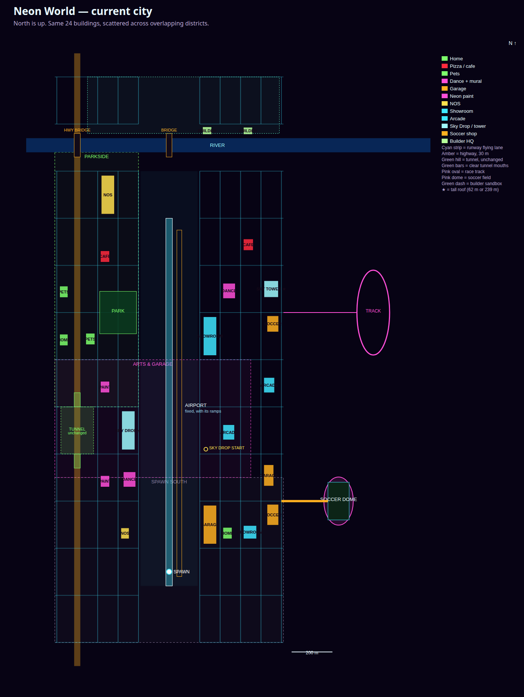
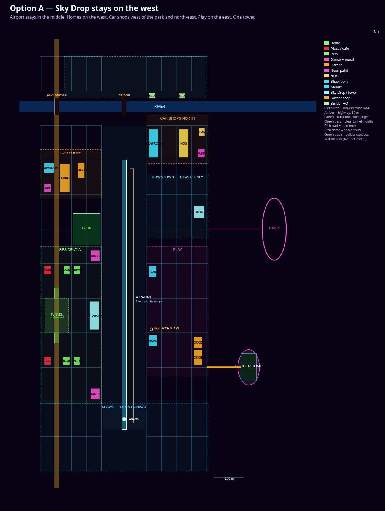
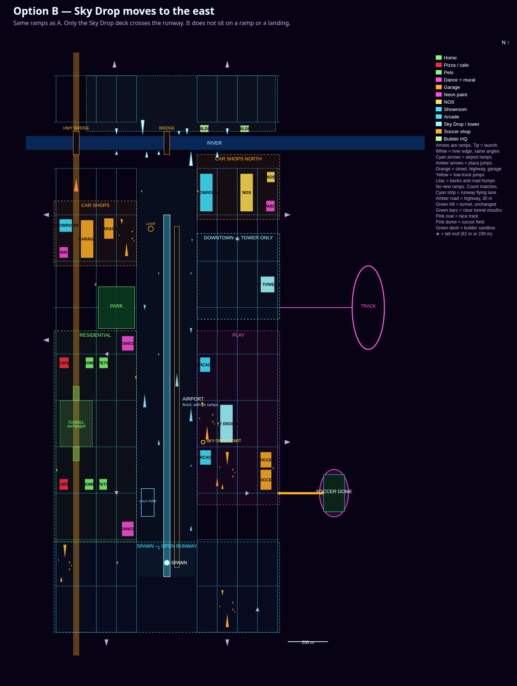

# Neon World city layout plan

Plan only. No game code. The airport stays in the middle, with its ramps, and the rest of the city is arranged around it.

Nothing is built until Bob picks an option and writes "plan approved, build it".

## Plain English

Today the 24 shops are scattered. A home sits next to a showroom, the dance halls don't share a street, and the tower shares its block with a cafe and a soccer shop. The roads are fine. The buildings were placed without neighborhoods.

This plan keeps every building, every height, and every footprint. It keeps the black placeholder boxes. It lines the buildings up into places Ellie can name:

- **Home streets** on the west, two blocks (a house, pets, and pizza on each).
- **The park** between the homes and the west car shops, so those two don't fill one view.
- **Car shops** in two rows: one west of the park, one north-east of the tower. The west highway between them stays open, which leaves a clear run at the highway jump.
- **Play** on the east: both arcades and both soccer shops, on the road that leads to the dome.
- **The tower** alone in downtown.
- **The builder island** on the pads it already uses, north of the river.
- **The runway** empty down the middle, from spawn to the river. She still starts at (0, 0), looking up the airport.
- **The west highway tunnel** left exactly as it is, including the open mouths you line up on to fly through.

The two options are the same map. The only difference is the Sky Drop roof (the 62 m pad).

- **Option A.** The roof stays where it is now, on the west side of the runway. The east side, with the arcades and the soccer shops, stays a little emptier. Pick this if the glide should keep today's pad.
- **Option B.** The roof moves to the east side, next to the arcades, so the play side has the big jump. Pick this if the jump should live with the arcades.

Either way the airport does not move, and the buildings stay the black placeholders.

To change a later round, name the block. "Slide the arcades north" changes one pair of buildings. The other option does not have to be redrawn.

## The current city

North is up. Cyan strip down the middle is the runway and the flying lane. That strip is the anchor.

## Option A — Sky Drop stays on the west

Home streets on the west, car shops split by the park, play on the east, the tower alone. The big cyan jump roof stays on the west shoulder of the runway, where she already glides to it.

## Option B — Sky Drop moves to the east

Same streets, same buildings, same tower. Only the cyan jump roof crosses the runway and sits with the arcades.

## What does not move

- The runway, the taxiway, the half-pipe, the loop, and the ramps beside the runway.
- The river, both bridges, and the river-edge jumps. The small jump that just clears the water at about 80 mph stays the same size and the same place on the bank.
- The west highway tunnel. Same hill, same bore, same ceiling, same guide lines, same place. The mouths stay clear. Details and the flag are in the tunnel section below.
- The park, the soccer dome, the road out to the dome, and the race track.
- The builder sandbox north of the river, and both builder HQs. They stay on today's pads. Sliding them along the bank would put them on top of the north-bank jumps.
- The road centerlines. Traffic, Hot Drop, the tow trucks, and the minimap all read those lines. New roads would be a separate plan.
- Spawn at (0, 0). Ellie's saved home (it looks up a HOME building, not a coordinate). The Garage Z link (it looks up a GARAGE). Objectives.
- Traffic stays 30 cars (12 simulated, 18 dots).
- Both dance halls keep a 64 m mural wall, 18 m and 20 m tall, with the Z Company Arts sign. The wall faces east, onto a street, in both options. It is not smaller than today's mural.

## Tunnel

**Tunnel changes: none.** The layout did not need any.

The tunnel stays the hill on the west highway at x −530..−370, z 500..700. The hill is 160 m wide, 200 m long, and 34 m tall. The bore is the highway itself, 30 m wide (x −465..−435). The ceiling is 10 m. Flying into that ceiling still eases you down instead of crashing. The two cyan guide lines stay on the bore edges, from the south mouth to the north mouth, 1 m off the road. Nothing in this plan resizes, reshapes, lengthens, or moves any of that.

The mouths stay clear for 60 m, which is the lead-in the game already uses when it draws the tunnel. No new building enters that bore, on either side. The nearest shop to the south mouth is the south pizza cafe, 138 m down the road and 25 m off the side of the bore (144 m from the mouth center). The nearest shop to the north mouth is the north pizza cafe, 138 m down the road and 21 m off the bore (143 m from the mouth center). The west jump roof, in Option A, sits beside the runway, about 140 m east of the hill, not on the highway.

The pale green bars on the maps are those two clear mouths. They are not a new tunnel.

There are still a lot of ramps. This pass does not remove any. Two old plaza rectangles sit under a new arcade and a new cafe. At build time those two plazas, ramps included, slide to the nearest empty block. They are not deleted. The airport ramps, river jumps, highway jump, street ramp, and taxi ramp are not in those plazas and do not move.

## What moves, and why

Heights and footprints match today. A star marks a roof pad. Coordinates are meters. +x is east, +z is north.

| # | Building | Now | Both options, unless noted | Why |
|---|---|---|---|---|
| 6 | Home, 11 m | Spawn south, by the runway | West home street, south block. x −408..−364, z 314..362 | Her first house fronts a street, not the runway. |
| 15 | Pets, 12 m | Far west, by the park | Same south block. x −336..−296, z 314..362 | Pets next to the house. |
| 17 | Pizza, 12 m | West, mid-map | Same south block. x −534..−490, z 314..362 | Pizza on the same street. |
| 14 | Home, 12 m | Far west | West home street, north block. x −404..−364, z 838..886 | Second house gets its own street, with the park to the north. |
| 16 | Pets, 13 m | By the park | Same north block. x −336..−292, z 838..886 | Second pet shop with the second house. |
| 19 | Pizza, 13 m | Next to the tower | Same north block. x −534..−486, z 838..886 | Moves the cafe off the tower's block. |
| 12 | Dance, 18 m | West, mid-map. Mural faces east | South of spawn's first cross street. x −224..−164, z 114..178. Mural still faces east | The 64 m wall gets its own view. It does not share the jump roof's shot. |
| 18 | Dance, 20 m | Beside the tower. Mural faces west | North home avenue. x −224..−164, z 914..978. Mural faces east, still 64 m | Gets the mural off the tower. The wall is the same length as today. |
| 2 | Sky Drop roof, 62 m ★ | West shoulder. x −232..−168, z 518..682 | **A:** stays there. **B:** east shoulder, x 264..328, z 518..682 | The one choice. A keeps the glide where it is tuned. B puts the roof with the arcades. |
| 1 | Garage, 26 m ★ | Spawn south | West car row, north of the park. x −428..−364, z 1314..1478 | The big garage leaves the runway and joins the car shops. |
| 10 | Neon paint, 14 m | West, mid-map | Same west car row. x −534..−490, z 1314..1362 | Paint with the garages. |
| 7 | Showroom, 16 m | Spawn south | Same west car row. x −534..−470, z 1426..1482 | The small showroom leaves spawn. |
| 9 | Garage, 15 m | East, by the dome | Same west car row. x −312..−264, z 1396..1486 | Second garage with the first, not beside the stadium. |
| 3 | Showroom, 18 m ★ | Downtown, south of the tower | North-east car row. x 164..228, z 1514..1678 | The long glass showroom leaves the tower's block. |
| 4 | NOS, 34 m ★ | Far west | Same north-east row. x 364..428, z 1514..1678 | The tall fuel shop stands with the other car shops, off the tower. |
| 11 | Neon paint, 15 m | West | Same north-east row. x 492..536, z 1514..1562 | Second paint shop with the north row. |
| 8 | NOS, 12 m | Spawn south | Same north-east row. x 496..536, z 1640..1686 | Small fuel shop leaves the runway. |
| 13 | Arcade, 18 m | East of the runway | Play, on the way to the dome. x 164..220, z 422..486 | Arcades share a district. |
| 20 | Arcade, 17 m | Further east | Play, one avenue north. x 164..216, z 822..886 | Far enough from the first arcade that one shot doesn't pay for both. |
| 21 | Soccer shop, 16 m | By the dome | Play, on the dome road. x 464..520, z 314..402 | The shop faces the road to the field. The dome itself does not move. |
| 22 | Soccer shop, 16 m | East, mid-map | Just north of the other shop. x 464..520, z 410..478 | The pair reads as the stadium block. |
| 5 | Sky tower, 239 m ★ | Downtown | Stays. x 465..535, z 1165..1235 | Downtown is this one tower. That is the shot that has to stay cheap, and the slot a future PC skyline can grow into. |
| 23 | Builder HQ, 15 m | North bank | Stays. x 164..208, z 1856..1888 | On the bank, clear of the river jumps. |
| 24 | Builder HQ, 16 m | North bank | Stays. x 364..408, z 1856..1886 | Same reason. |

Every purpose still has two buildings: home, paint, garage, dance, pets, arcade, NOS, sky drop (the roof and the tower), builder, soccer, pizza, showroom.

## Frame rate

This plan does not re-bench the game, and it does not touch the FPS agent's files. The numbers below are counts, plus the benches already published.

How the city draws today (`world/city-draw.js`): a building within **170 m** is drawn with doors, windows, parking, and neon. From there out to **950 m** it is a silhouette. There is no occlusion culling, so every building inside that radius is paid for. Keeping the 170 m count down is the layout's lever. The speed plan (PR 63) measured the city script at about **3 ms** once the car copy was turned off. The copy itself was about **59 ms** of a **66 ms** phone frame in that lab. The phone target in that plan is a steady **110** (the copy has to fit in **8.3 ms**). The iPad talk in that plan is a flat **30**. PR 51's phone baseline of today's city, before this layout, was about **8 fps** driving and about **2.6 fps** on foot past the dance hall, where the close-up lines turn on.

So this layout will not take the phone from 8 fps to 110. The copy is the frame. What the layout can do is stop the close-up pass from stacking shops in the shots Ellie actually plays: the runway, the jump roof, the tower, the mural.

Count of the 24 buildings within 170 m. Full grid is in `docs/city-layout/near-counts.txt`.

| Camera | Today | Option A | Option B |
|---|---:|---:|---:|
| Runway at spawn | 0 | 0 | 0 |
| South home street | 1 | 3 | 3 |
| South dance mural | 1 | 1 | 1 |
| Sky Drop roof | 1 | 1 | 2 |
| North home street | 3 | 3 | 3 |
| North dance mural | 0 | 2 | 2 |
| West car shops | 2 | 4 | 4 |
| Open west highway | 1 | 1 | 1 |
| North-east car shops | 0 | 2 | 2 |
| Play street | 2 | 3 | 4 |
| Tower face | 4 | 1 | 1 |
| Stadium gate | 2 | 2 | 2 |
| Builder pads | 2 | 2 | 2 |
| Busiest road crossing | 5 | 4 | 4 |
| Busiest spot on a 20 m grid | 5 | 5 | 5 |

Today's busy spot is a mix at the east edge of spawn: two garages, a home, a showroom, and a soccer shop. Option A's busy spot is the block between the west jump roof and the north home street (the street itself, at the doors, sees 3). Option B's busy spot is the east riverbank, where the north car shops face the builder island (the road just south of the river sees 4). Neither option is worse than today's worst spot. The tower shot goes from 4 detailed buildings to 1. That is the estimate: a cheaper tower, mural, and runway, not a new frame rate. The 110 fps phone target and the iPad target stay with the FPS work.

Option A is the lighter of the two. The jump roof stays at 1 near building, and the play street stays at 3. Option B puts the roof next to an arcade (2) and lifts the play street to 4, which is still inside today's worst.

## What is removed

Nothing. Same 24 buildings, same ramps, same roads, same river, same tunnel, same dome, same track, same park, same builder sandbox. Two plazas slide aside at build time so they aren't buried under an arcade and a cafe. Their ramps go with them.

## Ideas for Bob

Suggestions only. They are not in Option A or Option B. The airport anchor and the other fixed constraints still apply. No theme change gets built unless Bob asks for it by name.

Ellie is 10 and ahead of that on games, and the game is a web canvas on a phone and an iPad. The same map should still work when this becomes a PC game. The layout above is already shaped for that: districts don't overlap, so a later game can fill one district without repainting the others, and the runway corridor is reserved so a terminal can be added later without moving the ramps.

1. **Keep the neon airport-city.** The runway in the middle is the idea of the game. A new theme (space, fantasy, a realistic downtown) would throw away the airport, the mural, and the cars. The version that scales is a richer version of this city, not a different genre.
2. **Name the places in her words**, on signs, whenever the building look is allowed to change. Home Street, the Park, Car Shops, the Dome, the Tower, the Island. She can give directions. A PC game keeps the names and fills the blocks in. That is a sign pass, not a new map.
3. **Leave the runway empty on purpose.** A later PC build, or a later iPad build if the frame ever has room, can add a terminal and gates in the corridor. One more big building there would sit in every flying shot. Not now.
4. **Downtown stays one tower until a PC build.** That district is the slot for a skyline. Adding offices next to the tower on the phone would spend the shot this plan just made cheap.
5. **A school on Home Street, a fire station, or a train on the roads that already exist** would make the city feel lived-in. Each new building is another close-up. They wait until the phone holds its frame. The roads can already carry a bus or a train with no new pavement.
6. **Next round is a slide, not a redraw.** The two options differ by one building so a note like "the car shops feel far from home" can move one row. The black boxes stay until the building-look work is cleared.
7. **A second tunnel, only as a comparison, and not on this map.** The west highway tunnel stays the one she already flies. If you want another to set beside it, put a separate short one on the empty east avenue at x = 350, from z 940 to 1060, between Play and the tower. Same 30 m bore and same 10 m ceiling, so the flying physics match, but 120 m long instead of 200 m. It does not touch the existing hill, the guide lines, or either mouth. It is not in Option A or Option B.

## Architecture Check packet

For the Architecture Check agent, bc-c7ace59c. This PR is a plan. It does not change `world/`. It is not a pass. Please reply on the PR with pass or fail per row.

| Check | This plan |
|---|---|
| 24 shops, two of each purpose | Yes. Count checked. |
| Footprints and heights unchanged, including pads at 26, 62, 18, 34, and 239 m | Yes. Checked against today's `shop()` calls. |
| Dance mural | Seeds 12 and 18 keep a 64 m east face, 18 m and 20 m tall. The wall is not shorter than today's 64 m face. Antenna heights (14 m and 16 m) stay at build. The sign stays Z Company Arts. |
| Black placeholder boxes | Unchanged. No new meshes. |
| Airport | Runway, taxiway, half-pipe, loop, and shoulder ramps unchanged. Both options are drawn around them. |
| Tunnel | No change. Hill, bore, 10 m ceiling, and cyan guide lines stay. Both 60 m mouths are clear of new buildings. A second tunnel is an idea only, on the east avenue, and is not in either option. |
| River and bridges | Unchanged. River-edge jumps unchanged, including the small jump that clears the water at about 80 mph. |
| Builder HQs | Seeds 23 and 24 stay on today's pads. Moving them overlaps the north-bank jumps. Sandbox north of the river unchanged. |
| Roads, traffic, Hot Drop, tows | Centerlines unchanged. Traffic stays 30. No building covers a tow point. |
| Spawn | (0, 0). |
| Plazas | Two rectangles overlap new buildings. Not done here. At build time the arcade lot slides one block north (x 160..240, z 510..690) and the pizza lot slides one block south (x −540..−472, z 110..290). Ramps go with them. |
| FPS files | Not touched. |
| Adult `index.html` | Not touched. |

## Driving it on the /test/ copy

Not built. Bob picks an option first. When he does, the playable version is the whole Neon World that already lives under `/test/`, with these black boxes moved onto the new map. It is not a bare map, and it is not the live site.

`/test/world.html` and `/test/world-split.html` already run the full game. They load traffic, walking, doors, the app each building opens, the airport and its ramps, the river jump, the tunnel, soccer, Hot Drop, the minimap, the pet and Z, Garage and Home, saves, menus, and the controls. Both pages read `test/world/city.js`. The live pages stay on today's map.

### What the build changes

One file: `test/world/city.js`. The 24 shop positions, the street faces, the district names, and two plaza rectangles. Same black boxes, same heights, same footprints, same signs and colors. No new art. Traffic, the house code, objectives, soccer, the minimap, and the menus stay as they are. Then bump the `?v=` on that script in both test pages so a refresh loads it.

### What keeps working without rewiring

These look up a building by its purpose, or they draw whatever boxes the city built. They do not remember today's coordinates. This is true for both options.

- **Minimap.** It draws the buildings from the city list when the page loads. The runway plane icon stays at (0, 730). The soccer ball stays on the dome. The builder-zone box stays. Hot Drop is a live star, not a baked shop. Labels follow the purpose (HOME, GARAGE, and the rest), not the old district names.
- **Doors and the apps they open.** Doors are generated from the street face. Walking up still opens the same thing it opens now: Home and Ellie's saved house, Garage Z, the pet and crew page, the dance stage, neon paint, the cafe, the arcade, NOS, and the builder blueprints. A soccer shop still sends her to the dome, and the dome does not move. A sky-drop door is not an indoor room. It sends her to that building's own roof, then launches her, using the box she is standing at. There is no second coordinate to update.
- **Saves, menus, and controls.** The house save, the car paint, and the start-mode choice are not map coordinates. Two homes still share one house save, same as today. Both garages still open Garage Z. Menus and controls do not change.
- **Traffic.** The roads are the same lines, including the tunnel stretch cars do not spawn in. A car skips a stretch only if a wall sits in the lane. None of these shops cover a lane. The 30 cars stay 30 cars.
- **Hot Drop and objectives.** After a Sky Drop landing, Hot Drop picks a road point 200–340 m ahead. The road points do not move. There is no objective pinned to an old shop coordinate.
- **Spawn.** She still starts at (0, 0) on the empty runway. Sky Drop still starts in the air at (180, 520), altitude 460. That point is not inside a building in either option.
- **Airport, river jump, tunnel, soccer field, pet, and Z.** Not moved. The pet greeting happens inside the house. Z is the car.

### What has to be done or it breaks (both options)

- **Two plazas have to slide, or their ramps spawn inside shops.** The ramps are built inside the plaza rectangle. The new arcade covers the lot at x 160..240, z 310..490. The new south pizza shop covers the lot at x −540..−472, z 310..490. Leave them and those ramps are inside the buildings, and the doors are a mess. Slide the arcade lot one block north, to x 160..240, z 510..690. Slide the pizza lot one block south, to x −540..−472, z 110..290. The other three plazas stay. Same slide for A and B.
- **Keep the street faces in the table.** A wall that is not on a street gets a fallback door on the south side, which can open into an alley. The faces in this plan were checked against the curb rule, so the generated doors land on the street.

### Option A only

Nothing else. The jump roof stays on today's west pad, so the Sky Drop start is the same glide she has now. The tow truck at (254, 600) stays in the open play street, clear of that roof. The tow at (−546, 400) stays clear of the pizza shop. No spawn, minimap, traffic, or door code to edit.

### Option B only

- The jump roof is the only extra move: x 264..328, z 518..682, still 62 m, still a roof pad. The elevator follows that box. The walk code does not have a separate coordinate for it.
- She still appears at (180, 520) in the air, just west of that roof, heading mostly north. She does not spawn inside it. She is not pointed at it. The mode still runs. If the glide should face the roof, that is one number, the yaw in `resetSkyDrop` inside `test/world/state.js`, and only on the test copy. The rest of the game does not need it.
- The tow truck at (254, 600) sits about 8 m west of the new roof. It is not inside the building. On the drive, check that the jump does not kiss the wall. If it feels tight, nudge that one truck a few meters west, still in the road. The other five trucks stay.

### What to drive before calling it playable

On `/test/world.html`, with the black boxes: start on the runway, fly the tunnel both ways, take the small river jump, and open one of each building (home, garage, pets, dance, paint, soccer, and a sky-drop roof). Check the minimap labels moved with the shops. Trigger a Sky Drop and a Hot Drop. Watch traffic on a home street and on the north car row. Option B adds the tow-next-to-the-roof check. That pass is the whole game, not a map screenshot.

## If the plan is approved

The first build is the section above: `test/world/city.js` only, inside the existing `/test/` game, plus the two plaza slides. Not the live `world.html`. No draw-code changes, no traffic changes, no new art. Then the drive pass, on the commit that was actually tested.

Pictures and the count log: `docs/city-layout/`. The picture generator is `docs/city-layout/layout-maps.mjs`. It is not part of the game.
