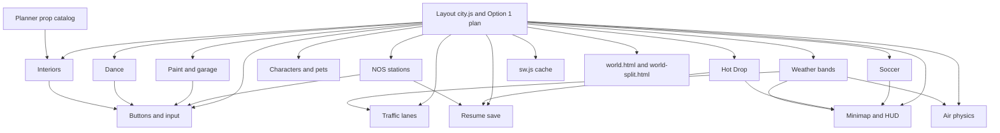

# Z-DASH integration map

Kid App only. The pages that must stay in lockstep are `world.html` (the page the JR menu opens) and `world-split.html`. Adult `index.html` is not a kid system. Do not edit it from a Neon World branch.

This map is the source the checker in `tools/integration-check.js` enforces. Owners are the cloud agents on the open branches and PR titles as of this pass. A system with no branch yet has no owner.

## How a miss happens

Most systems do not copy coordinates into a second file. They read `CITY` at runtime (`CITY.ROADS`, `CITY.BL`, `CITY.DISTRICTS`). A miss is one of these:

- The new coordinates live only in a plan or a JSON file, so the live readers are still on the old city.
- A reader has a hardcoded fallback (minimap bounds, soccer dome, airport dot, `?v=` cache token) that the live `CITY` object does not update.
- A new `world/*.js` file is loaded by one page and not the other.
- `shared/version.js` (`ZD_WORLD`, `ZD_BUILD_STAMP`) and the `sw.js` cache name stay on the previous build after a kid runtime change.
- A saved key (`zdash.kid.v1`, `zdash.house.v1`, paint, crew, pet) is renamed in one writer and left in the other readers.
- Props or interiors invent a second list instead of `docs/planner/PROP-CATALOG.json`.

## Systems

### Layout

| | |
|---|---|
| Files | `world/city.js` (roads, districts, `shop()` blocks, `CITY.ROADS`), `world/city-layout.js` (`window.CITY_LAYOUT`, Option 1 data), `world/city-draw.js`, `world/ground.js`, `world/ramps.js`, `world/landings.js`, `docs/CITY-LAYOUT-PLAN.md`, `docs/city-layout/` |
| Owner | Neon world city layout plan · `cursor/city-layout-plan-ef23` (plan, PR #68) and `cursor/city-boulevards-ef23` (build, PR #85) · `bc-3ff1a27b-8fa0-5250-97f5-63a8eaf5ef23` |
| Reads | Nothing upstream. This is the coordinate source once it is in `world/city.js`. |
| Must update | Minimap, traffic, Hot Drop, resume, NOS, interiors, soccer, dance, paint and garage, characters and pets, buttons, air pads, weather bands, cache, both pages. A docs-only plan does not update any of them. |

`CITY.ROADS` is the road graph (`addRoad`, lanes, `blockedBy`). `shop()` places the purpose buildings (HOME, GARAGE, NOS, DANCE, NEON_PAINT, PETS, SOCCER, …). PR #68 is the Option 1 plan only. PR #85 puts the same boulevards in `world/city-layout.js` and boots them from `world/city.js`. Readers should use `CITY.LAYOUT` / `CITY.ROADS`, not a private copy of the old `shop()` list.

### Minimap / HUD

| | |
|---|---|
| Files | `world/hud.js`, `shared/minimap-tune.js` |
| Owner | Neon World minimap (split-map) · `split-map` PR #37 and `cursor/minimap-boulevards-f039` PR #86 · `bc-8972f8b1-5d6c-5a32-af12-e3b61542f039` |
| Reads | `CITY.ROADS`, `CITY.BL`, river, park, taxiway, `BUILDER_ZONE`, ramps, `HOTDROP`, `SOCCER.field` |
| Hardcoded | Bake frame `MINI` (-1500..1900, -900..2900) on main. Zoom `spanFar: 3400` in `shared/minimap-tune.js`. Airport dot at (0, 730). Soccer dome fallback (830, 300), 104×160, until `SOCCER.field` is the big pitch. Option 1 is wider than 3400 m (about x -1620..1360 and z -900..3000). A hud.js bake-frame edit does not update `spanFar`. |
| Must update | Cache when `hud.js` changes. Both pages already load `hud.js`. A layout that only edits docs leaves this map on the old city. |

### Traffic

| | |
|---|---|
| Files | `world/traffic.js`, `shared/traffic-tune.js`, `world/towdrive.js`, `docs/TRAFFIC-PLAN.md` |
| Owner | Neon World Traffic Physics · `cursor/traffic-option-b-2bdb` (pose) and `cursor/traffic-plan-2bdb` (plan) · PR #78 and #73 · `bc-2af9e871-f1de-59fc-9680-264931312bdb`. Earlier lanes: `split-traffic` PR #35. |
| Reads | `CITY.ROADS` edges and lanes. `build()` walks `R.edges`. On main, `build()` returns immediately once `built` is set, so a reload picks up new roads and a mid-session graph edit does not. |
| Must update | PR #78 adds `roadsSig()` so lanes rebuild when the road signature changes. That rebuild is not on main. Cache and a matching `?v=` when the script changes. Sprite pose does not move the minimap. |

### NOS stations

| | |
|---|---|
| Files | `world/nos-station.js`, NOS `shop()` blocks in `world/city.js`, `tools/nos-station-*.js` |
| Owner | Neon World buildings glow WebGL · `cursor/nos-driveup-58d4` · PR #76 · `bc-2a4360f4-477a-5bc9-9177-263bd56d58d4` (same agent as `cursor/split-webgl-58d4`, PR #59) |
| Reads | Buildings with `purpose === 'NOS'`. Fits a canopy and pumps onto those footprints. Claim copy is `TAP: CLAIM NOS`. |
| Must update | Both pages (the script plus `world/gl-city.js` if that file ships), `world/input.js` for the claim, traffic blocks via `CITY.probe`, resume spots if new collision boxes cover a saved point, cache. Minimap already draws the NOS building rect from `CITY.BL`. Option 1 wants one big station on Car Row, not the two depots on today's map. |

### Resume save

| | |
|---|---|
| Files | `world/resume.js` (PR #79), `world/resume-safe.js` (PR #85 stand-in for the same `zdash.world.resume.v1` key), `world/state.js` when it applies the save, `tools/resume-check.js` |
| Owner | Neon World Save & Resume · `cursor/world-save-resume-b8a9` · PR #79 · `bc-d6a3caca-1ff0-5801-adcf-6baf37bab8a9` |
| Key | `zdash.world.resume.v1`. Must not rewrite `zdash.kid.v1`, `zdash.house.v1`, `zdash.char.v1`, `zdash.pet.v1`, `zdash.crew.v1`, or `zdash.neonpaint.v1`. |
| Reads | `CITY.mapStamp()`, `CITY.probe` / `spotClear`, `CITY.DISTRICTS`, `CITY.ROADS.nodes`, `ZOBJ` challenges |
| Must update | Both pages, pause menu (`world/hud.js` or `world/icon-garage.js`), cache. A layout move is safe only when `mapStamp` changes with the blocks and a blocked spot snaps to a clear anchor. Until PR #79 is on the same branch as the layout, a moved city makes an old absolute spot invalid. |

### Weather

| | |
|---|---|
| Files | None that draw weather. PR #85 stores `weather[]` on `window.CITY_LAYOUT` (Sand, Fog, Rain) and marks it not built. Expected later: `world/weather.js` and a draw hook in `world/city-draw.js`. |
| Owner | No branch and no agent. |
| Plan | Option 1 draws hatched bands: sand on the west shoulder, fog by the river and the south lane, rain in the east gap. The build copies those rectangles and still does not draw them. |
| Must update | When a weather branch appears: air physics, minimap, traffic, cache, both pages. |

### Interiors

| | |
|---|---|
| Files | `world/house.js` (walk-in rooms, `WALK_PAGE`, `zdash.house.v1`), `world/detail.js`, `world/style-sampler.js`, `world/walk-items.js`, `docs/INTERIORS-PLAN.md`, `docs/interiors/` |
| Owner | Neon World Interiors · `cursor/interiors-plan-52fc` and `cursor/style-sampler-52fc` · PR #74 and #81 · `bc-80a1fc6f-48ae-5878-8a43-edeea8d052fc` |
| Reads | Building `purpose` on `CITY.BL`. Door targets: `neon-paint.html`, `dance-stage.html`, `jr.html#garage`, `crew.html`. |
| Must update | Shared prop catalog, both pages (including `style-sampler.js`), buttons / `world/input.js` when a door starts navigating, cache. Rooms must not invent a second prop size list. |

### Planner props

| | |
|---|---|
| Files | `docs/planner/PROP-CATALOG.json`, `docs/PLANNER-PORT-PLAN.md`, `test/planner-port/`, `world/planner-props.js`, `docs/ROOM-PLACE-HOOK.md` |
| Owner | Planner Port: Builder Mode + Props · `cursor/planner-port-plan-cbd5` · PR #82 · `bc-40642464-c47e-5d07-9d56-40205ceccbd5`. Room hook that places from `PLANNER_PROPS`: Neon World Interiors · `cursor/room-place-hook-52fc` · PR #87. |
| Reads | The catalog is the list. Proof baker: `test/planner-port/catalog.js`. `world/planner-props.js` exposes `PLANNER_PROPS` for the style sampler. |
| Must update | `world/house.js`, `world/detail.js`, `world/walk-items.js`, and `world/style-sampler.js` must reference that catalog before the port is real. `world/planner-props.js` has to load on both world pages. |

### Buttons

| | |
|---|---|
| Files | `world/input.js` |
| Owner | Neon World In-Game Buttons & Controls · `split-buttons` · PR #44 (e-brake PR #43) · `bc-900d1d70-320c-553e-8844-c0df701722d6` |
| Reads | Drive mode, wings, brake, NOS hold. Doors and claim actions also land in `world/hud.js` and `world/icon-garage.js`. |
| Must update | Any new TAP / claim / door (NOS, paint, Garage Z, dance, resume) needs `input.js` or the pause menu in the same branch. Cache when the script changes. |

### Paint and garage

| | |
|---|---|
| Files | `world/neon-paint.js`, `neon-paint.html`, `world/garage.js`, `world/garagez.js`, `world/icon-garage.js`, `garage-hub.html`, `world/garage-pet.js` |
| Owner | Ellie's Neon Drawing agent · `cursor/neon-paint-studio-door-0eec` and `cursor/garage-dance-doors-0eec` · PR #71 and #77 · `bc-aebd8a72-1734-5f07-aef5-0e74977e0eec`. Pause-menu hub file also touched by Menus & Garage/Home Hub · `split-menus` · PR #50 · `bc-2a99346f-f07a-585b-80e0-0c1ac2b6aa6e`. |
| Keys | `zdash.kid.v1` (eq paint, Garage Z), `zdash.neonpaint.v1`, `zdash_vinyls_v1`, `zdash_neon_paint_v1`, `zdash_garage_v1`, `zdash_paint3d_v1`. Return trip uses `zdash.neonworld.session.v1` (sessionStorage) shared with the dance door. |
| Must update | Both pages, `world/house.js` `WALK_PAGE`, `jr.html` return, cache. Do not rename a key in one file only. |

### Characters and pets

| | |
|---|---|
| Files | `world/crew.js`, `world/crew-data.js`, `shared/crew-state.js`, `shared/char-closet.js`, `char.html`, `crew.html`, `world/room-preview.js` |
| Owner | Character + pet in the Z · `cursor/torso-depth-b5e7` (also closet and pet camera) · PR #75, #58, #55 · `bc-7f67a79d-81b0-54c0-b24b-afbe865db5e7`. Home preview, prop sheet, and garage turntable pet: Menus & Garage/Home Hub · `cursor/home-room-preview-aa6e`, `cursor/companion-pet-turntable-aa6e`, `cursor/prop-place-menu-aa6e` · PR #70, #65, #60. |
| Keys | `zdash.crew.v1`, `zdash.char.v1`, `zdash.pet.v1`, `zdash.customdance.v1`, `zdash.petdance.v1` |
| Must update | Both pages when a new world script is added. Garage turntable reads the pet key. Cache for runtime edits. Layout's one pet lounge is a building move, not a new pet mesh. |

### Soccer

| | |
|---|---|
| Files | `world/soccer.js`, `shared/soccer-tune.js` |
| Owner | Neon World car soccer field · `split-soccer` · PR #17 · `bc-98d91f77-6188-5c9b-a335-2b3ab43fed8f` |
| Reads / hardcoded | Pitch center (830, 300), half-size 52×80, boulevard from x=550 to the west sideline. Minimap fallback copies those numbers. |
| Must update | `world/hud.js` when the field center or size changes. `CITY` stadium shop when the building moves. Cache. Option 1's single middle-east field has to be the same point in tune and on the minimap. |

### Dance

| | |
|---|---|
| Files | `world/dance-stage.js`, `dance-stage.html` |
| Owner | Ellie's Dance Stage & Camera · `split-dance` · PR #39 · `bc-33af325d-513e-51ff-8d49-163c08869767`. Building door: Neon Drawing agent PR #77. |
| Reads | `WALK_PAGE.DANCE` → `dance-stage.html`. Session return `zdash.neonworld.session.v1`. Dance clips in `zdash.customdance.v1` / `zdash.petdance.v1`. |
| Must update | `world/house.js`, `world/input.js`, both world pages, cache. Option 1 has one dance building. The stage is the door, not a second building. |

### Air physics

| | |
|---|---|
| Files | `world/phys-air.js`, `world/flight.js`, `world/phys-ground.js`, `world/landings.js`, `shared/physics.js`, `shared/tune.js` |
| Owner | Neon World Air & Flight Physics · `split-phys-air` · PR #45 · `bc-6e81e28f-33e8-5704-a337-040aec016e65` |
| Reads | Runway corridor and pads from `CITY` (`PADS`, ramps). NOS in the air is `tune.js` `airNos` plus the bottle on the car. |
| Must update | Buttons when a new air control appears. Cache. Sky Drop pads in the Option 1 kit must keep landing heights. The plan leaves the runway where it is, so cruise physics do not move with the boulevards. |

### Objectives / Hot Drop

| | |
|---|---|
| Files | `world/objectives.js` (`HOTDROP`, `hotDropSpot`) |
| Owner | Open editor is Neon World Save & Resume (PR #79), because that branch saves the beacon. The spot math follows the road graph. Minimap drawing is PR #37. |
| Reads | `CITY.ROADS` nodes and edges. No second coordinate table on main. |
| Must update | Stays correct when roads move only if the layout lands in `CITY.ROADS`. A hardcoded beacon would go stale. Resume must keep the challenge timer with the spot. |

### sw.js cache

| | |
|---|---|
| Files | `shared/version.js` (`ZD_WORLD`, `ZD_BUILD_STAMP`), `sw.js` (`VERSION`, `SPLIT_CACHE`) |
| Owner | Whoever ships the kid runtime change. There is no cache agent. Recent `sw.js` editors: split-polish PR #49, tow collide PR #53, buttons PR #44, detail PR #36, NOS PR #76. |
| Contract | Kid scripts live in the `world-split-v` + `ZD_WORLD` cache (network-first). `?v=` on `world.html` and `world-split.html` must all equal `ZD_WORLD`. Bump `ZD_WORLD` or `ZD_BUILD_STAMP` when a kid runtime file changes. Docs, tools, and `test-results/` do not need a bump. |
| Adult page | `index.html` carries its own `window.ZD_BUILD` string. A kid bump does not belong in that file. |

## Dependency edges



## Frozen Neon World

After the Option 1 Boulevards bundle (plan PR #68, build PR #85), `world.html` and `world-split.html` take bug fixes, FPS fixes, Ellie's interiors, and the planner drop-objects placement tool. The minimap follow-through for that same map (PR #86) is part of the bundle.

Allowed on the current pages:

- Interiors (`world/house.js`, `world/style-sampler.js`, `world/walk-items.js`, `docs/INTERIORS-PLAN.md`, `docs/interiors/`, `docs/STYLE-SAMPLER.md`)
- The drop-objects placement tool (`world/planner-props.js`, `docs/planner/PROP-CATALOG.json`, `docs/ROOM-PLACE-HOOK.md`, `docs/room-place/`, `test/planner-port/catalog.js`)

These still belong on a new world page:

- Builders (the Builder HQ design tool, the planner editor for walls and roofs)
- Building redesigns (`world/gl-city.js`, `bakeBuilding` export of new shells)
- City redesigns (`world/city-layout.js`, `docs/CITY-LAYOUT-PLAN.md`, `docs/city-layout/`) beyond the Option 1 bundle

A plan that only has docs still counts. If the builder tool or a new city layout does not add the new page, the checker flags it before that work lands on the frozen pages. The drop-objects catalog in the same plan is not the part that has to move.

The new world page has to keep Ellie's shared saves. Same keys: `zdash.kid.v1`, `zdash.house.v1`, `zdash.char.v1`, `zdash.pet.v1`, `zdash.crew.v1`, `zdash.neonpaint.v1`, `zdash_vinyls_v1`, `zdash_neon_paint_v1`, `zdash_garage_v1`, `zdash_paint3d_v1`, `zdash.customdance.v1`, `zdash.petdance.v1`. A new `zdash.kid.v2` (or any sibling key) splits Garage, Home, paint, crew, and pets from the current world. The world spot key `zdash.world.resume.v1` and the door-return key `zdash.neonworld.session.v1` are per visit, not those shared profile saves.

## Both pages

`world.html` and `world-split.html` must reference the same script paths (the `?v=` query is compared separately to `ZD_WORLD`). The hidden preview copies are `test/world.html` and `test/world-split.html`. A new `world/*.js` module has to be on the live JR page, not only on `world-split.html`.

A module loaded only by `jr.html`, `char.html`, `crew.html`, `dance-stage.html`, `neon-paint.html`, or `garage-hub.html` is a menu module. `world/garage-pet.js` and `world/room-preview.js` are menu modules. They do not belong on the world pages or the hidden world preview.

If `origin/main` already loads a script on both world pages and the PR does not remove that tag, a branch that is simply behind main is not a missing-page gap. The hidden preview is judged from the test pages the PR edits. When the PR does not edit them, the check uses `origin/main`'s `test/world.html` and `test/world-split.html`, which is what a merge leaves in place.

`shared/version.js` is loaded by `sw.js` through `importScripts`, not by the world pages. `shared/*.js` files that belong to `char.html` or `jr.html` are not required on the world pages unless one world page already loads them.

## Checker

```bash
node tools/integration-check.js --self-test
node tools/integration-check.js --pr 68
node tools/integration-check.js --open --out test-results/integration-check
```

`--pr` and `--open` diff `origin/main...branch`. Exit code 0 means the command ran. Exit code 1 means the selected branch has a `gap` (missing now, not a plan follow-up). `--open` writes the report and exits 0 so a full scan can finish. `before-build` items are still listed. They are the work a plan has not done yet, assigned to the agent who owns that system.
