# Interiors plan

Plan only. No room is built in this change. Nothing deploys. Bob picks one concept for each room, then writes "plan approved, build it".

Kid App only. Adult `index.html` stays untouched.

These six rooms replace the one shared shell in `world/house.js` (`walkPaintRoom`). That shell is about 8.4 m wide, 6.3 m deep, and 3.1 m tall, and the walk stays inside a smaller patch. That size is retired. Each room below is large for its use. The meters are the space behind the door. They do not grow the shop on the map, and they do not change the building height.

The modes come from the building sense audit (PR #69). Paint, the garage, and the dance hall launch an app, so they are out of this plan. NOS, the showroom, and the sky pad are drive-up, so they are out of this plan. The Garage Z link stays `jr.html#garage`.

## Bob's steer

Interiors are free of the night-city glow. Each room has two concepts.

- **A** is a daylight room: wood, paint, glass, and plants. The glow strip is left off.
- **B** is the same kind of clean modern room, with one thin lit strip as an accent.

Brookhaven is the feeling to aim at: clean, bright, and modern. The rooms are our own boxes and flat color. The outdoor city stays the neon night city. This file does not edit `docs/NEON-WORLD-STYLE.md`. The style guide still asks a home for a glass face and a cyan strip. Both house concepts keep the glass. Only concept B keeps the strip. If Bob picks a daylight home, that home line should be updated before the build is reviewed, so the review judges the room he picked.

Ellie is 10 and advanced. The rooms stay smart. Short words on a plaque are enough.

## How a room is built

Straight boxes, flat walls, and flat color. Glass is a pale pane with a brighter edge. Wood is a flat tan fill. A plant is a square planter and a few flat green cards. Daylight is a bright ceiling fill and a pale window pane. On concept B, the glow is a thin lit box. These rooms do not set shadowBlur.

The pictures are the feeling Bob is picking. They are not a model to import. A cabinet screen in a picture is a flat bright panel in the build.

Ellie is drawn at 1.7 m with a visible torso. Her pet stands on the floor at 0.74 m, between her knee and her waist. Anatomy Check reviews that pair. This plan does not change the pet rig or the character. The close-up pet card that makes the pet look huge is left out of these rooms. Extra animals in a picture are stand-ins for that one pet, at the same size, on the floor. The build does not add pet species.

## Doors

A kit is keyed by purpose. It stores no city id and no world x or z. Both copies of a purpose share one kit. City layout PR #68 can land either option. The ids in the audit (house 5 and 13, arcade 12 and 19, cafe 16 and 18, pets 14 and 15, soccer 20 and 21, builder 22 and 23) are names for the copies. PR #68 numbers the same shops on its own table. The kit follows the door she used.

Enter opens the kit for that door's purpose and remembers the door. She starts just inside, on the local floor. Step back outside returns her to that door's stand point. The door code already does this. The near wall has a 2 m opening. It is not a new door on the map.

## Frame cost

While a room is open, the city loop is held (`requestAnimationFrame` keeps the callback named `loop` from drawing). The outdoor building pass does not run. The indoor frame is the room painter. Floor area does not add cost. Box count does.

Each concept stays at or under 32 boxes. One box is five flat faces.

A phone harness on the day-room branch (PR #57, a different commit) drew an indoor room at the 60 fps ceiling of that harness, 16.6 ms, while the city was out of the frame. The same harness with the city in the frame fell to about 7 fps. That split is why these rooms can be huge. It is not a measurement of this commit.

Estimated indoor cost on Bob's Galaxy, city pass held, flat fills, no blur:

| Concept | Boxes | Estimate |
| --- | --- | --- |
| Smaller kits (house B, arcade B, cafe B, pets B, builder B) | 18–20 | about 0.8 ms |
| Mid kits (house A, cafe A, pets A, arcade A, builder A) | 20–28 | about 1.0–1.2 ms |
| Soccer shop | 28–32 | about 1.2–1.5 ms |

The 110 fps line is 9.1 ms. The estimate for every concept is **110+**, with margin. A and B of the same room differ by a few boxes, not by a frame. This plan does not add an FPS bench. FPS Guard reviews the build.

## Saved home

Both house concepts read the saved home and do not add keys.

- Keys stay `zdash.house.v1` and the house object inside `zdash.kid.v1`.
- Theme stays one of `#ff4fd8`, `#3ee6ff`, `#7dff6b`, `#ffb020`, `#9b5cff`.
- Furniture stays `sofa`, `arcade`, `dj`, or `trophy`.
- The pet bed stays on or off.
- The sign stays `ELLIE`, `Z COMPANY`, `370Z`, or `HOME`.

Concept A uses the saved theme on the plaque and one cushion. Concept B uses it on the ceiling strip. The furniture field picks the one hero piece. The pet bed field shows or hides the bed. The sign field is the word on the plaque.

The Home menu preview (PR #70), the day-room item menu (PR #57), and the prop sheet (PR #60) keep their files. A later build replaces the tiny shell. It does not take those menus over. If the prop sheet has landed, placed props sit on the new floor, and that sheet keeps its own cap.

## Pick list

Reply with one letter per room. A mix is fine.

| Room | A, daylight | B, one glow strip | Floor vs the 8.4×6.3 m room |
| --- | --- | --- | --- |
| House | 24 × 18 × 4.8 m | 22 × 16 × 4.6 m | about 8× / about 7× |
| Arcade | 36 × 18 × 5.2 m | 32 × 16 × 5.0 m | about 12× / about 10× |
| Cafe | 28 × 18 × 4.6 m | 26 × 16 × 4.5 m | about 10× / about 8× |
| Pet lounge | 32 × 22 × 5.0 m | 30 × 20 × 4.8 m | about 13× / about 11× |
| Soccer shop | 48 × 30 × 6.8 m | 42 × 28 × 6.5 m | about 27× / about 22× |
| Builder HQ | 28 × 18 × 5.5 m | 26 × 18 × 5.2 m | about 10× / about 9× |

Every ceiling is taller than 3.1 m. The soccer shop is the largest because the kick happens inside. It is still a shop with a small pitch, far smaller than the outdoor dome.

## House — Ellie's home

Walk the room. The four saved controls stay: wall theme, furniture, pet bed, and sign. When she stands still and the pet bed is on, the pet goes to the bed. Step outside when she is done. There is no house app.

**A. Daylight glass house.** 24 m wide, 18 m deep, 4.8 m tall. About 24 boxes. About 1.0 ms. 110+.

White walls, a tan wood floor, a long glass wall, three square planters, a sofa, a low table, the pet bed by the glass, and the plaque.

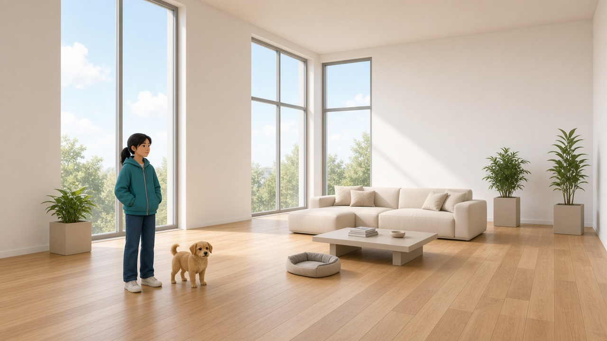

**B. Evening glass loft.** 22 m wide, 16 m deep, 4.6 m tall. About 20 boxes. About 0.8 ms. 110+.

The same glass house. One cyan strip along the ceiling. The saved theme colors that strip. The plaque uses the saved word.

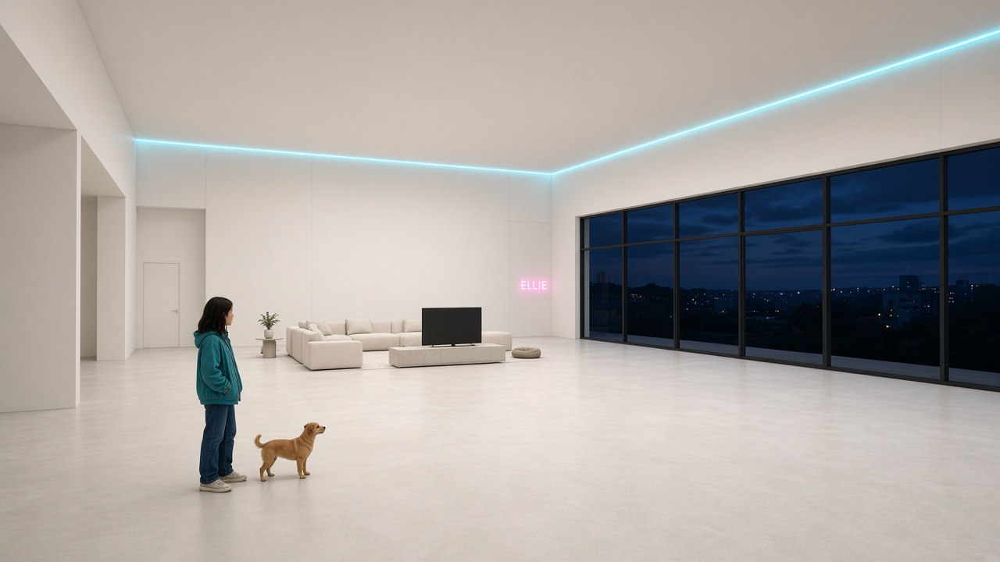

## Arcade

Walk the aisle. The jackpot sits on the far cabinet. Using it adds 500 points, the toast the cabinet already gives. Step outside. There is no arcade app.

**A. Daylight hall.** 36 m long, 18 m wide, 5.2 m tall. About 28 boxes. About 1.2 ms. 110+.

A skylight, a pale floor, two rows of cabinets in coral, teal, yellow, and cream, and a prize counter at the far end. Screens are flat bright panels.

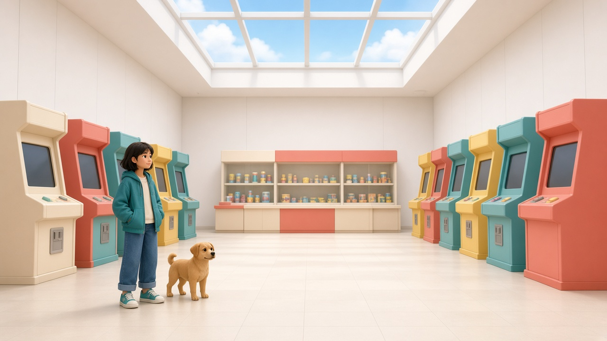

**B. Evening lane.** 32 m long, 16 m wide, 5.0 m tall. About 18 boxes. About 0.9 ms. 110+.

One row of cabinets, flat cyan and magenta screens, one cyan strip along the floor edge, and a gold jackpot cabinet at the end.

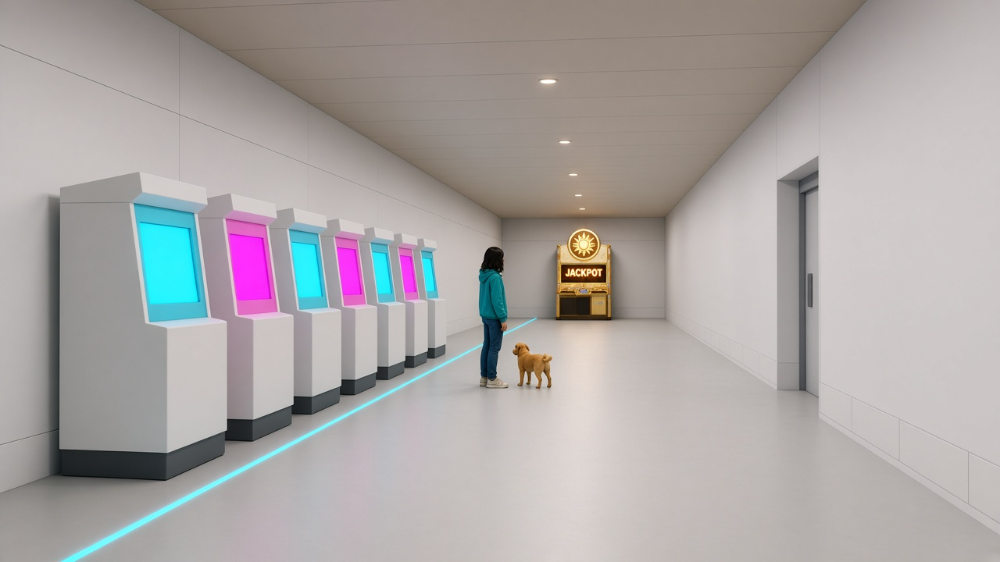

## Cafe

Walk in. Order at the counter. The order adds 250 points and the NOS bump the counter already gives. The tables are places to stand. Step outside. There is no cafe app.

**A. Daylight pizza room.** 28 m wide, 18 m deep, 4.6 m tall. About 26 boxes. About 1.1 ms. 110+.

A tan wood floor, cream walls, a long counter, two square tables, a glass wall, and square planters.

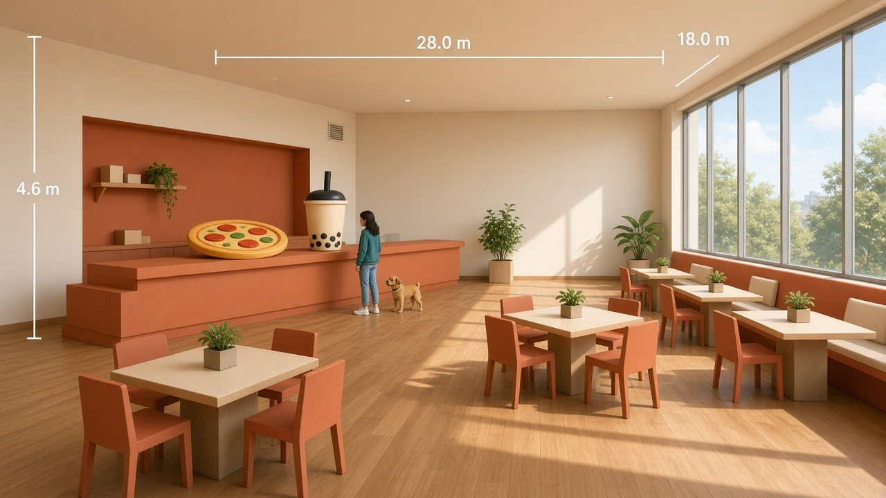

**B. Evening counter.** 26 m wide, 16 m deep, 4.5 m tall. About 20 boxes. About 0.9 ms. 110+.

The same counter and two tables. One gold strip under the counter lip, and one cyan strip at the ceiling. Glass looks onto the night city. The room itself stays bright.

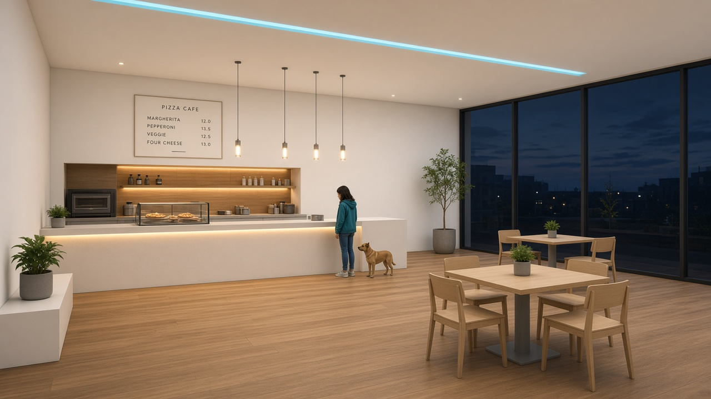

## Pet lounge

Walk the open floor. Greet at a pen. That is the hello the lounge already gives. The pet with her, and any pet in a pen, stands on the floor at 0.74 m. Step outside. The crew page is not required. If a link to it remains, its back button returns to this door, which the audit already decided.

**A. Daylight yard.** 32 m wide, 22 m deep, 5.0 m tall. About 22 boxes. About 1.0 ms. 110+.

A pale wood floor, cream walls, a glass wall, two low pens, and square planters. Most of the floor is open.

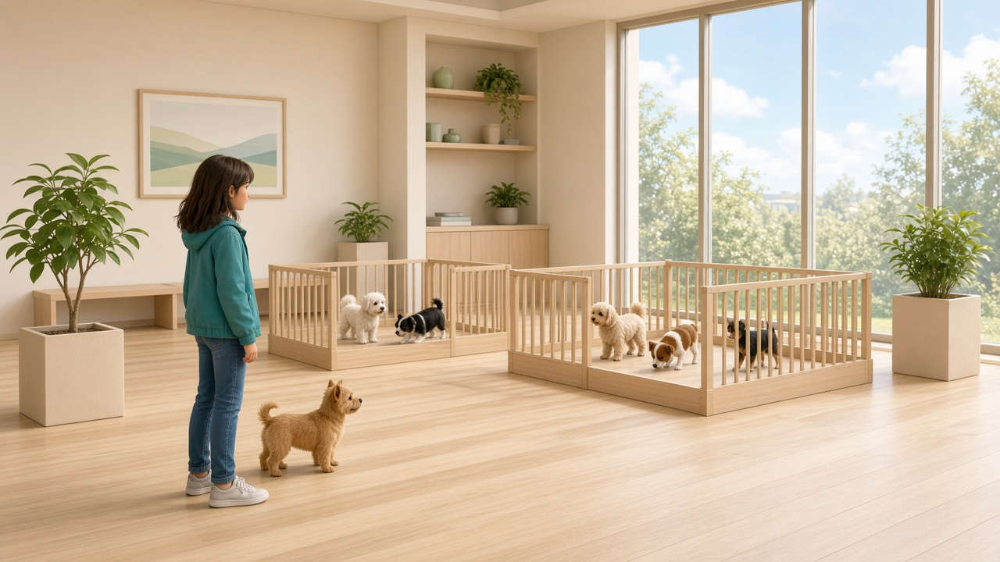

**B. Evening yard.** 30 m wide, 20 m deep, 4.8 m tall. About 18 boxes. About 0.8 ms. 110+.

Pens at the far end. One cyan strip along the ceiling. A lime edge on the pen rails. The walls stay white.

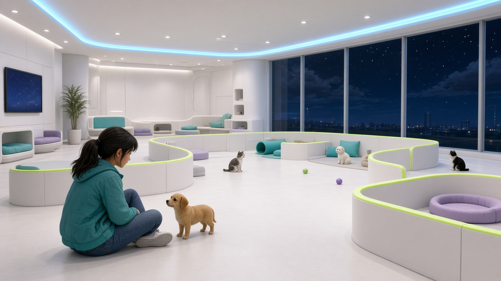

## Soccer shop

Walk the shop wall and the turf. Kick off stands her on foot at the goal in this room and puts a ball there. The car stays at the shop. The outdoor dome stays where it is. Entering does not teleport. The street word SOCCER is the sign the audit already decided. This room shows that word on the shop wall. This plan does not edit the street sign.

**A. Daylight shop and small pitch.** 48 m long, 30 m wide, 6.8 m tall. About 32 boxes. About 1.5 ms. 110+.

White walls, high windows, a shelf of balls, a bench, a green turf rectangle, and one goal.

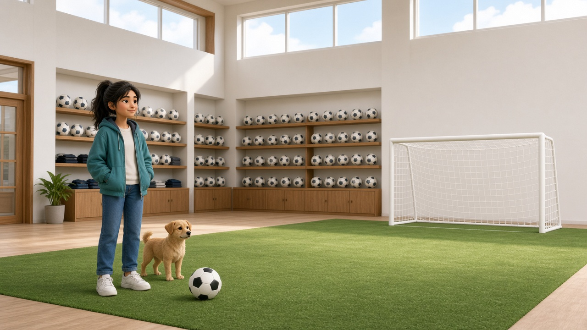

**B. Evening shop.** 42 m long, 28 m wide, 6.5 m tall. About 28 boxes. About 1.2 ms. 110+.

The same shop and one goal. A cyan edge along the turf, and a thin cyan strip on the goal frame.

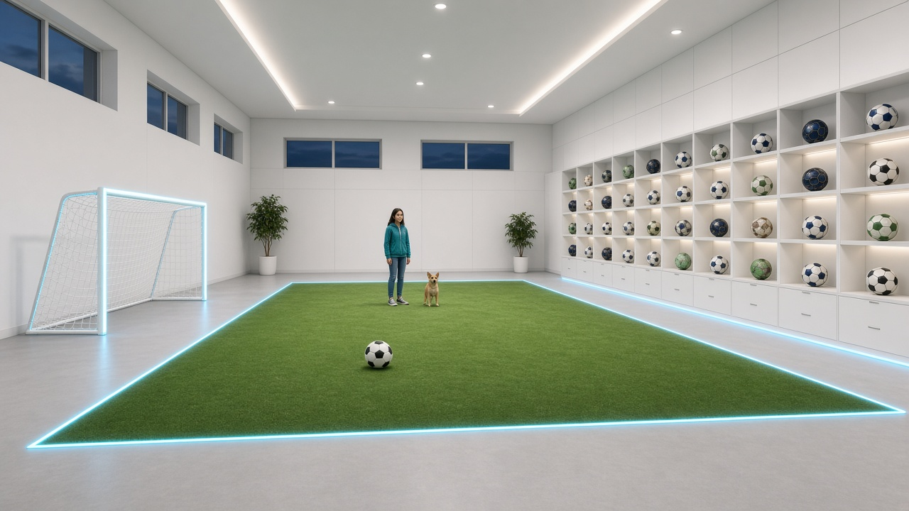

## Builder HQ

Walk up to the desk. Tap a blueprint board. The toast still points at the sandbox outside. The sandbox stays outside. Both HQs stay on their pads. The street word BUILD is the sign the audit already decided. This room shows BUILD on the plaque. This plan does not move a building, and it does not add a blueprint app.

**A. Daylight studio.** 28 m wide, 18 m deep, 5.5 m tall. About 20 boxes. About 0.9 ms. 110+.

White walls, a tan wood floor, a long desk, three flat blueprint boards, a small city of white boxes on the desk, square planters, and a glass wall.

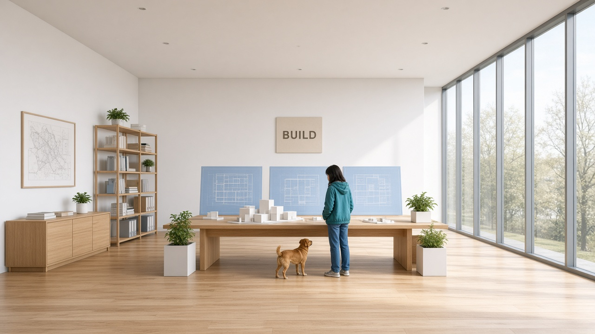

**B. Evening studio.** 26 m wide, 18 m deep, 5.2 m tall. About 18 boxes. About 0.8 ms. 110+.

The same desk and boards. One cyan strip along the front edge of the desk.

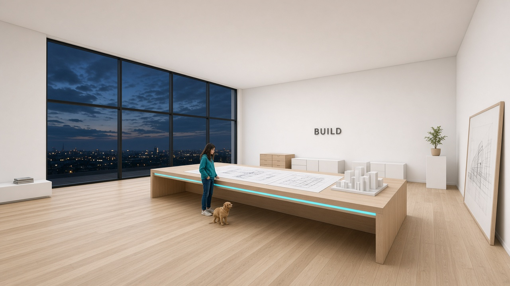

## Who reviews the build

After Bob picks and writes "plan approved, build it":

- The interiors build replaces the shared shell for these six purposes. One editor, and the paint door and the dance door stay with their owners.
- Architecture Check reviews the rooms once they exist. It does not build them, and this plan does not loosen a check.
- Anatomy Check reviews Ellie at 1.7 m with a torso, and the pet at 0.74 m on the floor.
- FPS Guard reviews the frame. This plan does not add a bench.

## What this plan does not do

It does not edit `world/`, `jr.html`, or `index.html`. It does not build a room, deploy, or pick city layout option A or B. It does not change a saved home key, the Garage Z link, a pet rig, or a character. It does not add a shop. The count stays 24.
