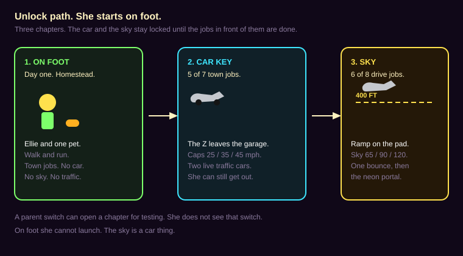

# NEXT world plan

Planning only. This file does not change the game, and it does not deploy. Nothing here is built until Bob writes "plan approved, build it."

NEXT is a new tile and its own page, `next.html`. The live Neon World stays on `world.html` and `world-split.html`, with the same speeds and the same two drive modes. NEXT starts from a copy of Option 1, The Boulevards (`world/city-layout.js` and `CITY.editorDoc()`, pull request 85). That pull request is still open. The copy follows the layout Bob approves there.

Ellie is 10 and plays at about a 13-year-old level. The words in this world stay plain and specific: Homestead, Car Row, 400 FT. No baby talk.

## What she keeps

Same phone, same saves, same Z, same pets. On day one she is on foot in Homestead. The Z stays in the garage until the car key in section 7. NEXT reads and writes the keys the other kid pages already use:

- `zdash.kid.v1` (her car, coins, Garage stars, name)
- `zdash.house.v1`, `zdash.char.v1`, `zdash.pet.v1`, `zdash.crew.v1`
- `zdash.neonpaint.v1`, `zdash_vinyls_v1`
- `zdash.petdance.v1`, `zdash.customdance.v1`

Sky progress is a new key, `zdash.next.v1`. It does not change her Garage save. Coins she earns here land in the shared wallet.

The car in the drawings is a Z34 370Z: long hood, cabin set back, fastback, short deck, boomerang front lamp, stacked round tail lamps. The silver in the picture is only so the shape reads. In the game she drives whatever paint is in her garage save.

## 1. How fast the streets are

Today, street mode is about 63 mph and nitrous about 87 mph (`world/phys-ground.js`, cap 28 m/s). Arcade is about 201 mph and nitrous about 322 mph (`shared/tune.js`, 90 m/s). Close-up detail already turns off above about 107 mph, and it turns off in the air (`shared/detail-tune.js`).

NEXT is a slower city on purpose once she is driving. Pretty homes cost frames. The cap is the speed where she still has a few seconds to see a house before she reaches it. On foot she only walks and runs, inside the same pretty ring. Those speeds are in section 7. The numbers in this section apply to the car. A faster tier gets a slightly wider picture, not the same picture at a higher speed.

Her base iPad on iPadOS 17 is the strict column (the 2018 iPad: A10, 2 GB, 60 Hz, landscape 1024×768). A Galaxy phone is the middle column. A PC is the loose column. The game already knows an iPad from a phone from a PC (`shared/ipad.js`). She does not pick the column. Any tablet uses the iPad column until we have measured that tablet.

If a frame runs long, the game drops picture first: far traffic dots, the plain traffic photo, window grids, yard props, trees, signs, then the far ring. The one close traffic car is last, and her own Z is not dropped to save it. It does not change her speed cap in the middle of a drive. On the iPad, a flat 30 is allowed when 60 will not hold. A flat 30 is the floor from the speed plan. Drops down to 5 are not.

**A. Neighborhood. Recommended.**

| | Her iPad | Galaxy phone | PC |
| --- | --- | --- | --- |
| Ground cap | 25 mph | 35 mph | 45 mph |
| Pretty homes out to | 40 m | 55 m | 70 m |
| Simple boxes out to | 80 m | 110 m | 140 m |
| Sky cap, after unlock | 65 mph | 90 mph | 120 mph |
| Sky picture out to | 300 m | 500 m | 800 m |

At these caps she has about 3.5 seconds of pretty houses ahead of her, and about 7 seconds of boxes. The iPad's 40 m pretty ring is the same distance the current street band already uses for windows. We are not asking the iPad to draw farther. We are asking it to draw nicer things inside that ring, and refusing to go fast enough to need the next district at the same time.

**B. Quicker streets.** If 25 mph feels too slow on the iPad: 40 mph there, 55 on the phone, 70 on the PC. Pretty homes only inside about a second of travel. Past that, boxes. Sky caps stay as in A.

**C. Stroll.** Only if the iPad still misses a flat 30 after A is built: 15 mph, 22 mph, 30 mph. Same draw distances as A. This is for looking at a house, not for a drive. It is the fallback, not the goal.

Nitrous does not break the ground cap. In the sky, the phone and the PC get a short boost of about 20 percent. The iPad does not.

The old world stays at its current caps. NEXT has its own numbers.

## 2. Drive mode, then the sky

This section is the driving chapter. It starts after the car key in section 7. She does not start the world in a car.

Once she is driving, she has one mode: DRIVE. No street/arcade switch. No wings button. The wild flying stays in the current Neon World.

The second mode is earned. It is a high cruise, not a second car. She can enter it only from one spot. Up there the city is cheap cards, so the sky cap is allowed. She has to stay above the line. The line is 400 ft (120 m). That is above the jump roof (62 m) and below the sky tower (239 m), so the tower still sticks up as a beacon.

A normal ramp at 25 mph cannot throw a car to 400 ft. The unlocked spot adds a neon push, a game sling, sized so the iPad cap still clears the line. The push ends once she is above it. This is not a realistic 370Z jump, and the plan does not pretend it is.

**Launch spot. Recommended: the ramp.**

The spot is the LED trailer pad in Homestead, from the Option 1 anchors: x −280 to −160, z −880 to −830. The ramp sits on the yard lane (x = −220), aimed north, about 36 m long and 8 m wide, with a lip about 7 m high. Before unlock it is a small hop back into the yard. After unlock the lip lights and the push is on.

The other choice is a pad on that same trailer pad: stop in the circle, hold the throttle for about a second and a half, and the pad lifts the Z to about 500 ft. Easier to aim. Less like driving. Use the pad if the sling feels like a cheat.

Do not use the sky tower as the first launch. On this map the tower already means JUMP. It stays a thing she can fly around. A second launch from the tower can come later.

## 3. What happens when she drops

Dropping under 400 ft is a transition, not a crash. Same Z, same paint, same pet if one is riding. Speed is already the ground cap when she is on the street. She cannot launch on foot.

**Recommended pair: one bounce, then the neon portal.**

The first time she sinks under the line, the car is popped back to about 500 ft and the bar says TOO LOW. If she sinks under again within 10 seconds, the portal takes her. One save, then she lands. She cannot bounce forever.

The other landings, if you would rather one of these:

1. **Neon portal.** A cyan ring. She comes out on the nearest clear lane, pointed along it. Costs about one frame when the block under her is already loaded.
2. **Sky-dive.** About 4 seconds of glide. The camera stays behind the car. Houses fade in over the last 2 seconds. Fun on a PC. Easy to make someone queasy on the iPad, so it stays off there unless you ask for it.
3. **Warp ring.** A hoop in the sky, the same idea as the hoops she already flies through. Miss it and the portal still catches her, so she never meets a roof at sky speed.
4. **Mist card.** The screen fills with a flat color for about a second and a half, then she is parked in the Homestead driveway. This is the one that hides a slow load. It is the dull one, so it is the backup, not the main trick.

On the iPad and the phone, if the block under her is not ready, the mist card plays instead of a half-built street. The PC can portal right away.

While she is in the sky and heading down, under about 600 ft, the game starts loading the district under her. On the iPad and the phone her speed eases to the ground cap during that drop, so the load can finish before she arrives. That is the Brookhaven idea: the wait is hidden in the fall, and a slow device gets more of that wait. The PC starts loading a little earlier and does not ease off unless a frame actually misses.

## 4. How she earns the sky

The NEXT tile is open on day one. She is on foot. The sky inside it is locked until she has the car and then finishes the drive jobs below. She cannot do these jobs before the car key in section 7.

**Recommended: 6 of 8 errands.** No coin price. Each errand pays 25 coins into the shared wallet. These are world stars on the ramp, not Garage stars. Garage stars still buy car parts.

1. Park in the Homestead driveway.
2. Visit the pet lounge next door.
3. Drive the yard lane out to the runway and back, on the road.
4. Reach the Car Row arch.
5. Stop at The Stage gate.
6. Cross both bridges.
7. One lap of The Track, under the cap.
8. Park at the soccer shop.

That is an afternoon, not a grind. The ramp shows a lock and "6 SKY STARS" until then.

Other prices, if you want a sink: 400 shared coins (about a big NOS tank), or 4 errands plus 150 coins. A coin price spends the same coins as her paint and parts. Not recommended.

For testing, `?sky=1` and a parent switch unlock it without the errands. That switch is not shown to her.

### The altitude bar

A vertical bar on the right. It shows only in the sky, and on the ramp once the sky is unlocked.

- Above about 500 ft: SKY, cyan.
- 400 to 500 ft: HOLD UP, yellow.
- Under 400 ft: TOO LOW, pink.

The same 400 FT line is drawn across the view, one stroke, no glow. The speed number stays in mph, with a MAX tick at her cap, so a limited car does not feel broken.

## 5. How the picture keeps up

60 fps means each frame finishes in 16.7 ms. The iPad may sit on a flat 30 (33 ms) when 60 will not hold. The split we will aim at on the street:

| Piece | Time |
| --- | --- |
| City | 6 ms |
| The Z, on its own layer, not copied back | 4 ms |
| HUD, including the bar | 2 ms |
| House detail | 3 ms |
| Traffic | 0.5 ms if it is still a photo. Up to 2.5 ms for two live cars. |
| Spare | 1.2 ms |

In the sky the city cards are about 2 ms, and about 4 ms is left for the preload.

No `shadowBlur` anywhere on `next.html`, including the HUD. Glow is a picture baked ahead of time. The building pass in the current world already forces `shadowBlur` to 0. The HUD helpers still turn it on. NEXT does not use those.

The Z copy is the expensive part of a frame in the current world (speed plan, branch `cursor/speed-plan-3b68`). A lower cap does not fix that copy. NEXT draws the Z on its own layer and does not read the picture back, on this page, even if the old world has not landed that change yet.

Altitude decides what is loaded:

| Band | What she sees | Speed |
| --- | --- | --- |
| Street, on the ground | Full homes inside the pretty ring. Rooms only after a door opens, which the current house code already does. Furniture is never drawn from the street. | Ground cap |
| Low air, under 400 ft | Boxes and roads. No windows, no yards. | Ground cap. She is not flying. |
| Sky, above 400 ft, after unlock | Neon cards. No trees, no window grids, no traffic. The tower is one glowing needle, not a wall she can hit at sky speed. | Sky cap |
| Heading down, under 600 ft | The district under her loads. iPad and phone ease to the ground cap. | Easing |

The map is already 8 districts in Option 1. Each district is one chunk: the district she is in, plus any neighbor inside the far ring. The rest is unloaded, collision included.

What the landing costs:

| Landing | What she feels | What the frame pays |
| --- | --- | --- |
| Bounce | A pop back up to about 500 ft, once | A speed change. No new picture. |
| Portal | A ring, then a lane | About one frame if the chunk is ready |
| Mist card | A flat color, then the driveway | Cheap. Used when the chunk is not ready. About 1.5 s. |
| Sky-dive | A 4 second glide | The preload. The fade is opacity on layers already drawn. |
| Warp ring | A hoop | Same as a hoop she already has, then the portal if she misses |

Homes are a later art pass. Brookhaven is the reference for a lot, a driveway, a front door, and rooms that appear when you go in. It is not a source of houses, names, or screens to copy. Each building stays a footprint in the layout file. The look lives on a design sheet (`homestead-house-v1` and so on), reviewed before it is modeled.

Three looks, when art starts, not now:

1. **Sport house** for Homestead. The garage is the point. Recommended first drawing.
2. **Glass neon** for Car Row. Matches the signs she already has.
3. **Warm porch** for a later street. Day-room colors.

The first build uses today's boxes at the new cap and measures the frame. Pretty houses come after that number exists. Drawing the houses first is how the current city got slow.

`next.html` gets its own cache name, the way `world-split.html` already does, so a bad cache there cannot replace the live world. The service worker change is part of the build, not this plan.

## 6. Traffic

Fewer cars, and slower ones, so the one she meets can be a real 3D Z. Flat photos are the current complaint, so they are only the fallback here.

This follows the traffic physics work on the live Neon World ([PR 73](https://github.com/rbeaglemedia/z-dash/pull/73), [PR 78](https://github.com/rbeaglemedia/z-dash/pull/78), agent [bc-2af9e871](https://cursor.com/agents/bc-2af9e871-f1de-59fc-9680-264931312bdb)) and the 370Z Design Check ([PR 84](https://github.com/rbeaglemedia/z-dash/pull/84), agent [bc-3a1ede89](https://cursor.com/agents/bc-3a1ede89-c85b-5ae6-b8d1-719a2ef6f3d2)). The live city stays at 30 cars and stays on photos. One extra photo of the full model is about 9 ms in their lab, and four full meshes in one pass are about 13 ms. That does not fit 12 cars. NEXT only has two, so a lighter live car can fit here and must not be copied back onto `world.html`. Lanes, yielding, and corners stay in the traffic plan. The car still has to pass the design check before it counts.

Today, `shared/traffic-tune.js` runs 12 simulated cars plus 18 light dots. The near picture is a 160 px photo out to 150 m. Cruise is 13–19 m/s (about 29–42 mph), and the highway adds 4 m/s. Those cars are faster than her NEXT iPad cap of 25 mph, so those numbers stay on the old world.

### How many

**Rare. Recommended.** Two simulated cars in the districts that are actually loaded. No far dots. About 100 m between them, so meeting one is an event. Homestead can be empty. One car on Car Row or at The Stage is enough.

**Light.** Four cars in the loaded area, about 45 m apart. Only the nearest two are the live mesh. The other two are dots. A short line, not a stream. Still well under today's 12 + 18.

Today's 30 is not a NEXT option. It stays on `world.html`.

### How fast

Traffic stays under her ground cap on every device. No highway bonus. She can always catch and pass. They never enter the sky. On the way down, cars appear only after she is back in the street band, so the preload is not also drawing them.

| | Her iPad | Galaxy phone | PC |
| --- | --- | --- | --- |
| Her ground cap | 25 mph | 35 mph | 45 mph |
| Traffic cruise | 14 mph | 18 mph | 22 mph |
| Traffic max | 18 mph | 24 mph | 30 mph |

### How detailed each car is

The file is `assets/370z.glb`, loaded from `shared/assets/370z-glb.js`. About 687 meshes and 26,549 triangles. Her car and the garage already use those bytes. A traffic copy has to be cut from that same file. A second download, a Kenney body, or a hand-built stand-in fails the design check even if the silhouette is close.

**Live LOD. Recommended.** Two lighter 3D cars, drawn as meshes, with real wheels. Not a photo. Not a wheel card. The pair has to stay inside about 2.5 ms. That is the rare budget: the old 0.5 ms photo line, the 1.2 ms spare, and up to 0.8 ms borrowed from house detail. Houses do not go below about 2 ms to pay for traffic. If the pair will not fit, one car stays live and the other is not drawn until she is closer.

| How close she is | What that car is |
| --- | --- |
| Inside the pretty ring (40 m on her iPad, 55 on the phone, 70 on a PC) | The live LOD. Both rare cars use it. Wheels spin. Front wheels steer. |
| Past the pretty ring | Rare: nothing. Light: the other two cars are dots, not a second live pair. |

Light density does not get four live cars. Four full meshes in one pass were already about 13 ms. The nearest two use this LOD. The other two are dots.

How the lighter car is built:

1. **Same bytes.** At load, read the GLB she already loaded. Do not ship `assets/370z-lod.glb` or any other file. The design check hashes `shared/assets/370z-glb.js` and fails a different path.
2. **Wheels come out first.** Tyre, rim, and brake stay their own meshes so they can spin, and so the front axle can yaw. Welding them into the body is what flattens the arches. A 2 cm weld already failed the check: rear overlap 0.41, side 0.52, three-quarter 0.25. The bar is 0.55 on every close angle.
3. **One mesh per material.** Merge the body by material: paint, glass, lamps. That is the draw-call cut. 687 meshes become a handful. Triangles stay put for this step.
4. **Then shrink the body only, in steps.** Try about 1 cm of error, then 1.5 cm. Try 2 cm only if a new sheet passes. Stop at the coarsest step that still clears 0.55. The aim, if the shape holds, is a body near 5,000 triangles and round wheels of a few hundred each, spokes still there. A whole car near 8,000 triangles, down from 26,549. Two cars near 16,000, sharing that one geometry.
5. **Shared materials.** Five materials for both cars: paint, glass, tyre, rim, lamps. Paint color is a per-car value, so the two cars can differ without a second material.
6. **Instancing.** One body draw for both cars. Wheel spin and steer are matrices on the shared wheel geometry, not a clone of the 687-mesh graph. No second picture, no readback, no `shadowBlur`. The 9 ms lab number was a separate photo of the full mesh. This path does not take that photo.

**Photo fallback.** Use this only if the LOD fails the design check, or the two-car probe is over 2.5 ms. A 320 px photo of the same GLB, inside 20 m, with the wheels already in that photo. Past 20 m, 160 px, and nothing past the pretty ring on rare. It is a fallback because a flat picture is the complaint, not the goal. Wheel cards stay unused. They fit the frame and do not read as wheels.

### What it costs

The rows below are the estimates that led to the test. The test has now been run. Section 7 records the measured pair. These rows are not her iPad and not the Galaxy.

| Choice | What is on screen | Estimate for 2 cars | Fits the 2.5 ms rare cap? |
| --- | --- | --- | --- |
| Full GLB, two clones | ~53,000 triangles, ~1,400 draws | about 6–9 ms | No |
| Materials merged, triangles not cut, one pass | ~53,000 triangles, about 10 draws | about 3–6 ms | Tight. Draws were the expensive part. |
| Body near 5,000 triangles, wheels kept, instanced | ~16,000 triangles, about 6 draws | about 1.5–2.5 ms | The target |
| 320 px photo, two cars | two blits | about 0.3 ms | Fits, and looks flat. Fallback only. |
| Wheel cards on the old photo | cards on a blit | about 0.1 ms | Fits, and looks wrong. Not used. |

Her own Z stays at 4 ms. These two cars are extra. They draw in the same pass, so they do not pay the 9 ms photo again.

The design check is the gate, from PR 84: `node tools/car-design-check.mjs --review`. Exit 0, or it is not done. Close shots are about 11–13 m, front, rear, side, and three-quarter. Overlap with her Z at least 0.55 on each. The front shot steers the copy's wheels by 0.45 rad. Real wheels yaw. A card that faces the camera fails. The loaded bytes have to match `shared/assets/370z-glb.js`.

Rule 5 on the live world is twelve close copies under 3.5 ms. This LOD is not for those twelve. NEXT asks the checker for a two-copy probe with a 2.5 ms cap. Putting the same mesh on the live 12-car city would miss that 3.5 ms bar, so it stays on `next.html`.

`shared/traffic-tune.js` stays the live world's 12 + 18. NEXT reads its own numbers, so a rare city cannot empty Neon World.

## 7. On foot first

Bob, Oct 24. She starts on foot. Cars unlock much later. This replaces the old "she starts in DRIVE" line. Sections 1 through 4 still describe the driving chapter and the sky. They start when she earns them. Nothing in this section is built until you write "plan approved, build it." No purchase happens from this list.

The feel to borrow is a stylized adventure town: jobs, a home base, walks, choices, and a character who changes clothes and learns a few moves. The names, the pictures, and the move list stay ours. No Lionhead, Microsoft, or Nintendo names, towns, or pictures. No copied character, pet, or weapon.

### How she unlocks the car, then the sky

**A. Keys. Recommended.** Three chapters. She cannot skip ahead by walking to the ramp.

1. **On foot.** Day one in Homestead. One pet follows. No driving. No traffic. No sky. The ramp is a small hop she can look at. It does not push.
2. **Car key.** 5 of 7 town jobs. The Z leaves the garage. The two live traffic cars from the test turn on only while she is driving. Neighborhood caps apply only then (25 / 35 / 45 mph). She can park and get out. Getting out turns traffic off again and puts her back on foot.
3. **Sky.** The 6 of 8 drive jobs in section 4. Same ramp, same 400 ft line, same one bounce then the neon portal. She cannot launch on foot.

**B. One ladder.** Fourteen stars in one list. The car is star 8. The sky is star 14. Simpler to count. Harder to tell a town story from a drive story. Use this if the two lists feel like homework.

**C. Parent switch only.** `?car=1` and `?sky=1` open a chapter for testing. She does not see the switch. This is not the design.

Town jobs, if you take A. Plain words. She picks the order. Five done earns the key. The last two are optional and each has a fork. Both endings pay 25 coins. One ending changes the street.

1. Walk the Homestead block and knock on three doors.
2. Choose which pet walks with her today, at the lounge.
3. Carry a parcel to the soccer shop. On foot.
4. Light the yard lamps. If she is late they stay dim and she can try again. No fail screen.
5. Clear the crate crabs off the yard lane. They poof. That lane is the road she will drive later.
6. Optional fork. Talk the Stage gate open, or take the long path around. The gate stays as she left it.
7. Optional fork. Pick the porch for one Homestead house: sport, or warm. The other look waits.

### How the town plays

**A. Hub and spokes. Recommended.** Homestead is home. Jobs send her out and back. Other districts open as she walks toward them. She has a reason to return: the board, the pet, the garage.

**B. One road.** The seven jobs in a fixed line down the boulevards. Clear. Less reason to come home.

**C. Everything open.** Every district walkable on day one. Heavier load. Not the iPad plan.

Choices stay small. Two endings, a gate, a porch color. No good-and-evil meter. A meter is a later layer on A if you want the town to remember more than two forks.

Homes stay the Brookhaven feel from section 5: a lot, a driveway, a front door, rooms only after the door opens. Furniture is never drawn from the street. People stand on the lot until she goes in. The three looks stay: sport house first, glass neon for Car Row, warm porch later. Those are our houses. Brookhaven is not a source of buildings, names, or screens.

### How she looks

Stylized and expressive. Big head, a face you can read, adventure clothes: a jacket, boots, a satchel. The body rules do not change. Every new person, and every new pet, still goes through Anatomy Check ([PR 61](https://github.com/rbeaglemedia/z-dash/pull/61), agent [bc-bfc8fc93](https://cursor.com/agents/bc-bfc8fc93-c2b4-5dbd-a098-1d29cd573de5)): head on the neck, arms from the shoulders, legs from the hips, feet on the ground, a real torso at every turn, a walk that reads, and pet ears at or below her hip unless that pet is marked tall. Clothes are notes unless they break the body.

**A. Restyle the figure she already has. Recommended first.** Same rig, new clothes, a clearer face. The check already knows this body. A jacket that clips the arms fails even if it looks right.

**B. A new mesh from a free pack, restyled.** After A is measured. The face, the clothes, and the colors change before it ships, so she does not look like a pack demo. It still has to pass the same check.

**C. A paid pack.** Only if you say yes to that price. The prices are in the source list below. Buying is not part of approving this plan.

### What she can do

Three moves. Our names: **Swing**, **Spark**, **Shot**. Swing is a sword arc of light. Spark is a short spell. Shot is a bow: she aims, then lets go. The arrow is a bolt of light. It poofs. No blood.

**A. One stick brain on every device. Recommended.** She learns one game.

| | Move | Swing, Spark, Shot | The bow |
| --- | --- | --- | --- |
| Phone | Left thumb. A short push walks. A full push runs. | Three buttons under the right thumb. | Drag to aim, let go to loose. |
| iPad | Same thumbs, bigger targets. A keyboard, if one is attached, also walks her. | Same three buttons. Not a phone row stretched wide. | Same drag, with more room. |
| PC | WASD. Shift runs. | Keys 1, 2, and 3. | Mouse aims. Click lets go. |

The pet move is one more button (Q on a keyboard). It does not replace her three.

**B. A different PC camera.** Mouse look all the time, buttons only on the phone. She would learn two games. Not recommended.

### Who she meets

Kid-safe. No gore, no blood, no death screen. A hit on her is a spark and a stagger. Three staggers empty her wind and she sits for about 3 seconds, then stands. The meter is three pips, labeled WIND. Foes poof or faint. No dogs. No kids.

Four kinds. Original. They are not animals she keeps as pets.

| Foe | What it does | When it loses |
| --- | --- | --- |
| Glimmer moth | Small, flutters, a faint spark | Poof |
| Crate crab | Slow. Blocks a path. | Poof into loose planks |
| Lantern wisp | Hovers. A pulse you can see coming. | Poof. Soak puts it out faster. |
| Gate brute | Slow and large. One per gate quest. | Faints. The gate opens. It is gone for that quest. |

How they act:

1. Wander inside a pen: a yard, or a piece of lane.
2. Notice her inside about 12 m in front, or 8 m behind. They turn for about half a second. That is the tell.
3. Chase at about 6 mph. Her run is about 9 mph, so she can leave. They stop at the pen edge.
4. Swing or pulse with a second tell, a glow or a crouch, so she can step aside.
5. After two misses, or if she leaves, they walk home.

Quest foes are placed. They do not come back. Wild ones can be back next visit. The hub streets stay friendly. Wild pens start at the yard lane and in The Field.

How many are nearby at once: 3 on her iPad, 4 on the phone, 6 on a PC. Townsfolk share that count. A long frame drops a far foe before it drops her.

**A. Short tells, a little sharper each district. Recommended.** About half a second, not a glow that waits for a tap. She can miss. Words stay specific. She is 10 and plays ahead of that. No baby prompts.

**B. A harder lane later.** A gate she opts into, or a parent switch. Shorter tells. Chase a bit closer to her run, still under it. Same cap. Not day one.

**C. No fighting.** Jobs only. The fallback if the tone or the frame is wrong.

### The pet

The pet still follows, about a step and a half behind, and runs to catch up. It does not block a door. Indoors it comes in, small. Ears stay at or below her hip unless that pet is marked tall. She already has the fox, the cat, the dragon, and the robo. Those four stay.

She presses the pet move. The pet does not pick fights on its own. Two fighters at once are harder to read and cost another draw.

**A. Four elements, learned in order. Recommended.** Cooldowns are 4 to 8 seconds. Names are ours.

| Move | Element | Cooldown | What it is |
| --- | --- | --- | --- |
| Spark | Light | 4 s | A short zap |
| Gust | Air | 6 s | A push. Small foes slide back. |
| Pebble | Stone | 5 s | A lob. Good on crate crabs. |
| Soak | Water | 8 s | A splash. Puts a wisp out. |

She starts with that pet's favorite. Level 3 opens the second move, level 6 the third, level 8 the fourth, and it stops. A level comes from finishing a quest with that pet out, about two quests a level. Not from fainting foes. Favorites: fox Gust, cat Spark, dragon Pebble, robo Spark.

**B. A unique pair on every pet.** More to draw, more to balance. Later, on top of A, if four shared moves feel thin.

**C. No pet moves until the car chapter.** Delays the part she would use on foot. Not recommended.

### More pets, and finer models

**A. The four she has, then three new ones she finds. Recommended.** New and original: a lamp moth, a brook frog, a tin hare. One new mesh at a time, each through the anatomy check. Not a shop full of models on day one.

**B. A roster of 8 to 12 on the first boot.** Misses the load budget below.

**C. Paid hero packs as the look.** Only with a yes on the price. Even then, restyle before it ships.

Free or already-licensed sources. Prices were public on Oct 24, 2026, and they change. Check the pack page on the day of a download. Do not pay any of these unless you write yes for that price.

| Source | What it is good for | Price | License to read first |
| --- | --- | --- | --- |
| Quaternius, Ultimate Animated Characters | A stylized person to restyle | $0 | CC0 |
| Quaternius, Universal Base Characters, and Modular Character Outfits Fantasy | Body and clothes to restyle | $0 on the pages that say free | Listed CC0. Newer Quaternius kits may use their own license instead: free in a game, including a commercial one, no credit, and you may not resell the files. If a page shows a price, do not pay it. Patreon is optional, not required. |
| KayKit Adventurers, free tier | Rigged people and weapons to restyle, including a sword and a bow | $0 | CC0. Enough to prototype. |
| KayKit Adventurers, extra characters | Three more bodies and alt colors | about $7.95 and up | Do not buy without a yes. |
| KayKit source files | The Blender files | about $11.95 and up | Do not buy without a yes. |
| Kenney | Props, crates, simple blocks | $0 | CC0. Too blocky for her face. |
| Poly Haven | Textures and sky light | $0 | CC0. Not characters. |
| Sketchfab | A single prop, only after the license on that file is read | $0 if the file is CC0 or CC BY. Paid files are often about $5 to $40. | CC BY-NC is a poor fit for a public site. Do not buy. Do not download anything that looks like a copied hero, town, or pet. |
| Mixamo | Walk and swing clips only | $0 with an Adobe account | Usable in a game. Do not redistribute the raw files. The people are realistic, so they are a motion source, not the look. |
| Synty, POLYGON Fantasy Kingdom | A whole stylized town | Listed $349.99. A sale page has shown $174.99. A library plan has been advertised from about $30 a month. | A store seat license, not CC. Do not buy without a yes. If it were ever bought, it would still be restyled so NEXT does not look like that pack. |

### Frames and the first 10 seconds

60 fps is still 16.7 ms. Her iPad may sit on a flat 30 (33 ms). On foot the Z is not drawn, and the two traffic cars are not drawn. That is the 4 ms plus the 2.5 ms from section 5, free for her, the pet, and a few foes.

| Piece, on foot | Time |
| --- | --- |
| Town and lots | 6 ms |
| Ellie and the pet | 3 ms |
| A few foes or townsfolk | 3 ms |
| HUD | 2 ms |
| Spare, including a poof | 2.7 ms |

When she drives, section 5's split comes back. She is inside the Z. She is not a second full person during the drive. The pet can ride as it does today, small, and does not fight from the passenger seat.

Walk is about 3 to 4 mph. Run is about 8 to 10 mph. At a run she still has many seconds of pretty houses ahead of her, so the ring does not grow. Sprint does not widen the world. Neighborhood caps and the sky caps stay in the car chapters.

Up-front loading of about 10 seconds is allowed. The boot loads the Homestead block, Ellie, one pet, the buttons, and the quest list. The Z file is about 1.8 MB and loads when she nears the garage, not on the first step. Foe meshes load with the district that uses them. The next district streams in as she walks, the same hidden-wait idea as the sky drop. The sky chapter still preloads under 600 ft.

These are targets to measure, not a claim that it is already that fast:

| | Boot target | What the first screen is |
| --- | --- | --- |
| Her iPad | under 10 s | Homestead, Ellie, one pet |
| Galaxy phone | under 6 s | Same, with smaller textures |
| PC | under 4 s | Same, and it may prefetch the next block |

### How the traffic test fits

The live traffic car is already tested. It is the driving chapter, not day one. Pull request [93](https://github.com/rbeaglemedia/z-dash/pull/93), branch `cursor/next-traffic-lod-test-039c`, commit `feb4211`. The page is `next-traffic-lod.html`. It does not change `world.html`.

The mesh is the real `assets/370z.glb`, wheels left whole, body simplified at 1 cm, 8,912 triangles a car. Two cars share that shape. Wheels spin. Front wheels steer. The pair was scored with the same overlap math as the 370Z Design Check. The bar is 0.55. Rear 0.99, front 0.965, side 0.935, three-quarter 0.952. The official checker only opens `world.html`, so this is that math on the test page, not an exit 0 from the tool.

Frame time is five on/off pairs after a short warm-up, on the lab's software graphics, not her iPad and not the Galaxy. Cap 2.5 ms. Phone 844×390, median 0.40 ms. iPad 1024×768, median 0.20 ms. PC 1366×768, median 0.50 ms. Every pair was at or under 0.6 ms. The lab being under the cap is a good sign. It is not a device pass.

On foot that 2.5 ms stays unspent, for her and the pet and a few foes. The photo fallback remains only if a later measurement on her iPad or the Galaxy misses the cap. The mesh stays off the live 12-car city.

### Build order, after you approve it

1. On-foot Homestead. Today's boxes, Ellie, one pet. Measure frames and the boot load. No car, no sky, no traffic.
2. The town jobs and the car-key gate. Still no sky.
3. The driving chapter. Caps, the ramp that only hops, the bar, the drive jobs, the sling, the bounce, and the portal. Traffic uses the mesh from pull request 93. It stays off until this step, and it stays off `world.html`.
4. Clothes, the three new pets, foes, and pet moves. Each new body through the anatomy check.
5. Finer models, from the $0 rows only, unless you say yes to a price. The Homestead sport house is still the first house drawing, and it waits until the box measurement in step 1 exists.

## What the first build is, after you approve it

The order is the five steps at the end of section 7. The old "page, then sky, then a house" list is step 3 and step 5 of that order. The house drawing does not start ahead of the on-foot measurement.

## Risks

- Pull request 85 is still open. If Option 1 changes, the copy changes with it. This doc does not freeze the map.
- Two editor documents must not share a file. The live builder keeps writing `world/city-layout.js`. NEXT writes the copy. A world id of `next` on the copy is what keeps them apart.
- Shared coins are really shared. A reward here is a reward in the garage. A price here would spend garage money. The recommended unlock does not charge a price.
- The sky tower pokes through the sky band. Low detail still needs a soft beacon, not a solid she can strike at 65 mph.
- If the preload is skipped, she lands in an empty block. The mist card is there so that does not happen on the iPad.
- Reusing the wings button would make a yard hop start a flight. The sky starts only at the ramp.
- Lab frame times are software graphics. They are not her iPad and not the Galaxy. The speed plan's device notes are the ones to trust: iPad about 5–30 fps today, Galaxy about 70–90. NEXT is not "done" on a lab number alone.
- Brookhaven is a feel to borrow (lots, doors, a hidden load on the way in). Copying its houses or its screens is out.
- NEXT traffic must not write `shared/traffic-tune.js`. The live world stays at 30 cars. A shared tune would empty that city the moment NEXT goes rare.
- A full second 370Z is the frame. Two uncut clones are about 6–9 ms. The live option is a cut of the same file, two cars, about 2.5 ms, and it stays off `world.html`. A 2 cm weld already missed the 0.55 overlap bar. Do not ship that mesh.
- The traffic test fit the lab cap. It is still not her iPad and not the Galaxy. Turning that mesh on while she is on foot spends the frame the people need.
- Adventure names and pictures stay original. A stylized town is a feel. Their towns, heroes, pets, and move names stay out.
- A paid pack is a purchase. The source table is not a yes. Nothing gets bought unless you write yes for that price.
- A new person or a new pet that misses the anatomy check does not ship. An outfit that breaks the arms or the ears fails with it.
- Fighting stays a spark, a poof, or a faint. No gore, no blood, no death screen. No dogs and no kids as foes.
- Loading the whole map, every pet, and the Z on the first step will miss the 10 second boot. Homestead loads first.

## Picks

Reply with a letter, or "recommended" to take the marked row.

| # | Question | Recommended |
| --- | --- | --- |
| 1 | Street speed, once she is driving | A. Neighborhood. 25 / 35 / 45 mph. |
| 2 | Launch, after the sky is earned | Ramp on the Homestead trailer pad |
| 3 | Drop under 400 ft | One bounce, then the neon portal. Mist only if the block is not ready. |
| 4 | How she earns the sky | 6 of 8 drive jobs, after the car key. Coins are a reward, not a price. |
| 5 | Tile name | NEXT |
| 6 | Safe line | 400 ft |
| 7 | First art | On-foot boxes and a frame measurement, then the Homestead sport house |
| 8 | Nitrous | Cannot break the ground cap. Sky boost on phone and PC only. |
| 9 | Traffic density | Rare. Two cars, no dots. Off until she is driving. |
| 10 | Traffic speed | Under her cap: 18 / 24 / 30 mph max. No highway bonus. Off in the sky. |
| 11 | Traffic detail | The tested live mesh from pull request 93. Photo only if her iPad or the Galaxy misses 2.5 ms. |
| 12 | How she starts | A. On foot in Homestead. The car is a later key. |
| 13 | Unlock path | A. Keys. 5 of 7 town jobs, then the car, then 6 of 8 drive jobs for the sky. |
| 14 | World shape | A. Hub and spokes. Homestead is home. |
| 15 | Her look | A. Restyle today's figure first. Jacket, boots, satchel. Anatomy check still applies. |
| 16 | Her moves | A. Swing, Spark, Shot. One control brain on phone, iPad, and PC. |
| 17 | Foes | A. Four original kinds. They poof or faint. Nearby cap 3 / 4 / 6. |
| 18 | Pet moves | A. Spark, Gust, Pebble, Soak. Cooldowns. Levels from quests. The pet still follows. |
| 19 | More pets and models | A. Her four pets, then three new ones she finds. $0 sources only. |
| 20 | Boot load | Hub, Ellie, one pet, quests. Aim under 10 s on her iPad. The Z loads at the garage. |

Open, and fine to leave until the build:

- Does the sky get the calm controls first (steer, climb, dive, no barrel roll)? Recommended yes.
- Is a second launch, from the sky tower, something you want in the first sky, or later?
- Should the current Neon World stay the default tile until NEXT has been driven on her iPad? Recommended yes.
