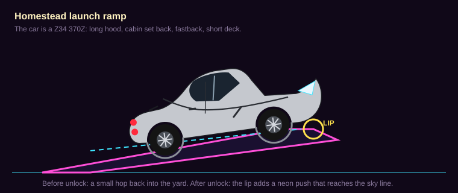
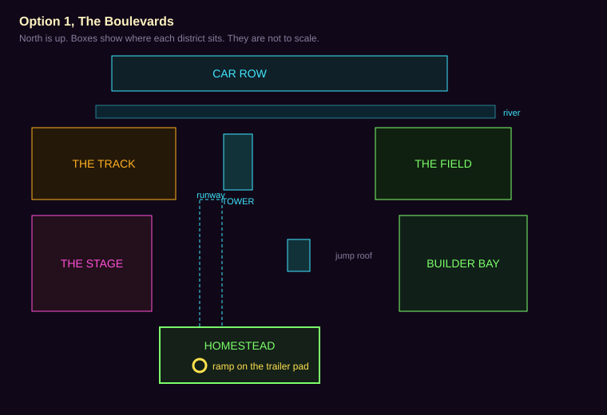
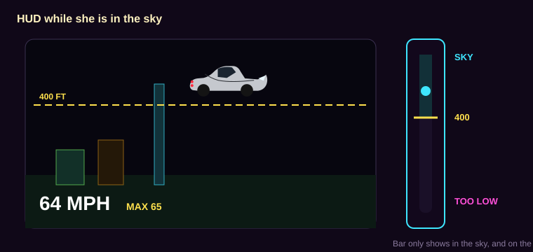

# NEXT world plan

Planning only. This file does not change the game, and it does not deploy. Nothing here is built until Bob writes "plan approved, build it."

NEXT is a new tile and its own page, `next.html`. The live Neon World stays on `world.html` and `world-split.html`, with the same speeds and the same two drive modes. NEXT starts from a copy of Option 1, The Boulevards (`world/city-layout.js` and `CITY.editorDoc()`, pull request 85). That pull request is still open. The copy follows the layout Bob approves there.

Ellie is 10 and plays at about a 13-year-old level. The words in this world stay plain and specific: Homestead, Car Row, 400 FT. No baby talk.

## What she keeps

Same phone, same saves, same Z, same pets. NEXT reads and writes the keys the other kid pages already use:

- `zdash.kid.v1` (her car, coins, Garage stars, name)
- `zdash.house.v1`, `zdash.char.v1`, `zdash.pet.v1`, `zdash.crew.v1`
- `zdash.neonpaint.v1`, `zdash_vinyls_v1`
- `zdash.petdance.v1`, `zdash.customdance.v1`

Sky progress is a new key, `zdash.next.v1`. It does not change her Garage save. Coins she earns here land in the shared wallet.

The car in the drawings is a Z34 370Z: long hood, cabin set back, fastback, short deck, boomerang front lamp, stacked round tail lamps. The silver in the picture is only so the shape reads. In the game she drives whatever paint is in her garage save.

## 1. How fast the streets are

Today, street mode is about 63 mph and nitrous about 87 mph (`world/phys-ground.js`, cap 28 m/s). Arcade is about 201 mph and nitrous about 322 mph (`shared/tune.js`, 90 m/s). Close-up detail already turns off above about 107 mph, and it turns off in the air (`shared/detail-tune.js`).

NEXT is a slower city on purpose. Pretty homes cost frames. The cap is the speed where she still has a few seconds to see a house before she reaches it. A faster tier gets a slightly wider picture, not the same picture at a higher speed.

Her base iPad on iPadOS 17 is the strict column (the 2018 iPad: A10, 2 GB, 60 Hz, landscape 1024×768). A Galaxy phone is the middle column. A PC is the loose column. The game already knows an iPad from a phone from a PC (`shared/ipad.js`). She does not pick the column. Any tablet uses the iPad column until we have measured that tablet.

If a frame runs long, the game drops picture first: window grids, yard props, trees, signs, traffic dots, then the far ring. It does not change her speed cap in the middle of a drive. On the iPad, a flat 30 is allowed when 60 will not hold. A flat 30 is the floor from the speed plan. Drops down to 5 are not.

**A. Neighborhood. Recommended.**

| | Her iPad | Galaxy phone | PC |
| --- | --- | --- | --- |
| Ground cap | 25 mph | 35 mph | 45 mph |
| Pretty homes out to | 40 m | 55 m | 70 m |
| Simple boxes out to | 80 m | 110 m | 140 m |
| Sky cap, after unlock | 65 mph | 90 mph | 120 mph |
| Sky picture out to | 300 m | 500 m | 800 m |

At these caps she has about 3.5 seconds of pretty houses ahead of her, and about 7 seconds of boxes. The iPad's 40 m pretty ring is the same distance the current street band already uses for windows. We are not asking the iPad to draw farther. We are asking it to draw nicer things inside that ring, and refusing to go fast enough to need the next district at the same time.

**B. Quicker streets.** If 25 mph feels too slow on the iPad: 40 mph there, 55 on the phone, 70 on the PC. Pretty homes only inside about a second of travel. Past that, boxes. Sky caps stay as in A.

**C. Stroll.** Only if the iPad still misses a flat 30 after A is built: 15 mph, 22 mph, 30 mph. Same draw distances as A. This is for looking at a house, not for a drive. It is the fallback, not the goal.

Nitrous does not break the ground cap. In the sky, the phone and the PC get a short boost of about 20 percent. The iPad does not.

The old world stays at its current caps. NEXT has its own numbers.

## 2. One drive mode, then the sky

She starts with one mode: DRIVE. No street/arcade switch. No wings button. The wild flying stays in the current Neon World.

The second mode is earned. It is a high cruise, not a second car. She can enter it only from one spot. Up there the city is cheap cards, so the sky cap is allowed. She has to stay above the line. The line is 400 ft (120 m). That is above the jump roof (62 m) and below the sky tower (239 m), so the tower still sticks up as a beacon.

A normal ramp at 25 mph cannot throw a car to 400 ft. The unlocked spot adds a neon push, a game sling, sized so the iPad cap still clears the line. The push ends once she is above it. This is not a realistic 370Z jump, and the plan does not pretend it is.

**Launch spot. Recommended: the ramp.**

The spot is the LED trailer pad in Homestead, from the Option 1 anchors: x −280 to −160, z −880 to −830. The ramp sits on the yard lane (x = −220), aimed north, about 36 m long and 8 m wide, with a lip about 7 m high. Before unlock it is a small hop back into the yard. After unlock the lip lights and the push is on.

The other choice is a pad on that same trailer pad: stop in the circle, hold the throttle for about a second and a half, and the pad lifts the Z to about 500 ft. Easier to aim. Less like driving. Use the pad if the sling feels like a cheat.

Do not use the sky tower as the first launch. On this map the tower already means JUMP. It stays a thing she can fly around. A second launch from the tower can come later.

## 3. What happens when she drops

Dropping under 400 ft is a transition, not a crash. Same Z, same paint, same pet if one is riding. Speed is already the ground cap when she is on the street. She cannot launch on foot.

**Recommended pair: one bounce, then the neon portal.**

The first time she sinks under the line, the car is popped back to about 500 ft and the bar says TOO LOW. If she sinks under again within 10 seconds, the portal takes her. One save, then she lands. She cannot bounce forever.

The other landings, if you would rather one of these:

1. **Neon portal.** A cyan ring. She comes out on the nearest clear lane, pointed along it. Costs about one frame when the block under her is already loaded.
2. **Sky-dive.** About 4 seconds of glide. The camera stays behind the car. Houses fade in over the last 2 seconds. Fun on a PC. Easy to make someone queasy on the iPad, so it stays off there unless you ask for it.
3. **Warp ring.** A hoop in the sky, the same idea as the hoops she already flies through. Miss it and the portal still catches her, so she never meets a roof at sky speed.
4. **Mist card.** The screen fills with a flat color for about a second and a half, then she is parked in the Homestead driveway. This is the one that hides a slow load. It is the dull one, so it is the backup, not the main trick.

On the iPad and the phone, if the block under her is not ready, the mist card plays instead of a half-built street. The PC can portal right away.

While she is in the sky and heading down, under about 600 ft, the game starts loading the district under her. On the iPad and the phone her speed eases to the ground cap during that drop, so the load can finish before she arrives. That is the Brookhaven idea: the wait is hidden in the fall, and a slow device gets more of that wait. The PC starts loading a little earlier and does not ease off unless a frame actually misses.

## 4. How she earns the sky

The NEXT tile is open on day one. The sky inside it is locked. She needs the streets in order to do the errands.

**Recommended: 6 of 8 errands.** No coin price. Each errand pays 25 coins into the shared wallet. These are world stars on the ramp, not Garage stars. Garage stars still buy car parts.

1. Park in the Homestead driveway.
2. Visit the pet lounge next door.
3. Drive the yard lane out to the runway and back, on the road.
4. Reach the Car Row arch.
5. Stop at The Stage gate.
6. Cross both bridges.
7. One lap of The Track, under the cap.
8. Park at the soccer shop.

That is an afternoon, not a grind. The ramp shows a lock and "6 SKY STARS" until then.

Other prices, if you want a sink: 400 shared coins (about a big NOS tank), or 4 errands plus 150 coins. A coin price spends the same coins as her paint and parts. Not recommended.

For testing, `?sky=1` and a parent switch unlock it without the errands. That switch is not shown to her.

### The altitude bar

A vertical bar on the right. It shows only in the sky, and on the ramp once the sky is unlocked.

- Above about 500 ft: SKY, cyan.
- 400 to 500 ft: HOLD UP, yellow.
- Under 400 ft: TOO LOW, pink.

The same 400 FT line is drawn across the view, one stroke, no glow. The speed number stays in mph, with a MAX tick at her cap, so a limited car does not feel broken.

## 5. How the picture keeps up

60 fps means each frame finishes in 16.7 ms. The iPad may sit on a flat 30 (33 ms) when 60 will not hold. The split we will aim at on the street:

| Piece | Time |
| --- | --- |
| City | 6 ms |
| The Z, on its own layer, not copied back | 4 ms |
| HUD, including the bar | 2 ms |
| House detail | 3 ms |
| Spare | 1.7 ms |

In the sky the city cards are about 2 ms, and about 4 ms is left for the preload.

No `shadowBlur` anywhere on `next.html`, including the HUD. Glow is a picture baked ahead of time. The building pass in the current world already forces `shadowBlur` to 0. The HUD helpers still turn it on. NEXT does not use those.

The Z copy is the expensive part of a frame in the current world (speed plan, branch `cursor/speed-plan-3b68`). A lower cap does not fix that copy. NEXT draws the Z on its own layer and does not read the picture back, on this page, even if the old world has not landed that change yet.

Altitude decides what is loaded:

| Band | What she sees | Speed |
| --- | --- | --- |
| Street, on the ground | Full homes inside the pretty ring. Rooms only after a door opens, which the current house code already does. Furniture is never drawn from the street. | Ground cap |
| Low air, under 400 ft | Boxes and roads. No windows, no yards. | Ground cap. She is not flying. |
| Sky, above 400 ft, after unlock | Neon cards. No trees, no window grids, traffic as dots or off. The tower is one glowing needle, not a wall she can hit at sky speed. | Sky cap |
| Heading down, under 600 ft | The district under her loads. iPad and phone ease to the ground cap. | Easing |

The map is already 8 districts in Option 1. Each district is one chunk: the district she is in, plus any neighbor inside the far ring. The rest is unloaded, collision included.

What the landing costs:

| Landing | What she feels | What the frame pays |
| --- | --- | --- |
| Bounce | A pop back up to about 500 ft, once | A speed change. No new picture. |
| Portal | A ring, then a lane | About one frame if the chunk is ready |
| Mist card | A flat color, then the driveway | Cheap. Used when the chunk is not ready. About 1.5 s. |
| Sky-dive | A 4 second glide | The preload. The fade is opacity on layers already drawn. |
| Warp ring | A hoop | Same as a hoop she already has, then the portal if she misses |

Homes are a later art pass. Brookhaven is the reference for a lot, a driveway, a front door, and rooms that appear when you go in. It is not a source of houses, names, or screens to copy. Each building stays a footprint in the layout file. The look lives on a design sheet (`homestead-house-v1` and so on), reviewed before it is modeled.

Three looks, when art starts, not now:

1. **Sport house** for Homestead. The garage is the point. Recommended first drawing.
2. **Glass neon** for Car Row. Matches the signs she already has.
3. **Warm porch** for a later street. Day-room colors.

The first build uses today's boxes at the new cap and measures the frame. Pretty houses come after that number exists. Drawing the houses first is how the current city got slow.

`next.html` gets its own cache name, the way `world-split.html` already does, so a bad cache there cannot replace the live world. The service worker change is part of the build, not this plan.

## What the first build is, after you approve it

1. The page, the tile, the copied layout, one drive mode, the caps, and a ramp that only hops. Measure on the lab sizes and, when you can, on her iPad and the Galaxy. Boxes stay.
2. The bar, the star count, the sling, the bounce, and the portal.
3. The Homestead sport house on paper, then in the game, then measure again.

Step 3 does not start ahead of the measurement in step 1.

## Risks

- Pull request 85 is still open. If Option 1 changes, the copy changes with it. This doc does not freeze the map.
- Two editor documents must not share a file. The live builder keeps writing `world/city-layout.js`. NEXT writes the copy. A world id of `next` on the copy is what keeps them apart.
- Shared coins are really shared. A reward here is a reward in the garage. A price here would spend garage money. The recommended unlock does not charge a price.
- The sky tower pokes through the sky band. Low detail still needs a soft beacon, not a solid she can strike at 65 mph.
- If the preload is skipped, she lands in an empty block. The mist card is there so that does not happen on the iPad.
- Reusing the wings button would make a yard hop start a flight. The sky starts only at the ramp.
- Lab frame times are software graphics. They are not her iPad and not the Galaxy. The speed plan's device notes are the ones to trust: iPad about 5–30 fps today, Galaxy about 70–90. NEXT is not "done" on a lab number alone.
- Brookhaven is a feel to borrow (lots, doors, a hidden load on the way in). Copying its houses or its screens is out.

## Picks

Reply with a letter, or "recommended" to take the marked row.

| # | Question | Recommended |
| --- | --- | --- |
| 1 | Street speed | A. Neighborhood |
| 2 | Launch | Ramp on the Homestead trailer pad |
| 3 | Drop under 400 ft | One bounce, then the neon portal. Mist only if the block is not ready. |
| 4 | How she earns it | 6 of 8 errands. Coins are a reward, not a price. |
| 5 | Tile name | NEXT |
| 6 | Safe line | 400 ft |
| 7 | First art | Measure with today's boxes, then the Homestead sport house |
| 8 | Nitrous | Cannot break the ground cap. Sky boost on phone and PC only. |

Open, and fine to leave until the build:

- Does the sky get the calm controls first (steer, climb, dive, no barrel roll)? Recommended yes.
- Is a second launch, from the sky tower, something you want in the first sky, or later?
- Should the current Neon World stay the default tile until NEXT has been driven on her iPad? Recommended yes.
